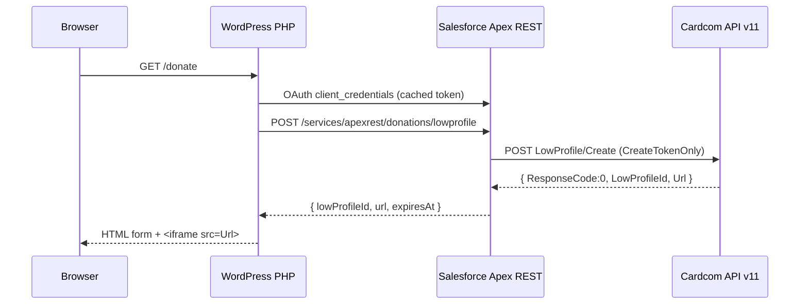
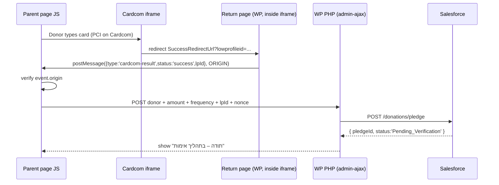
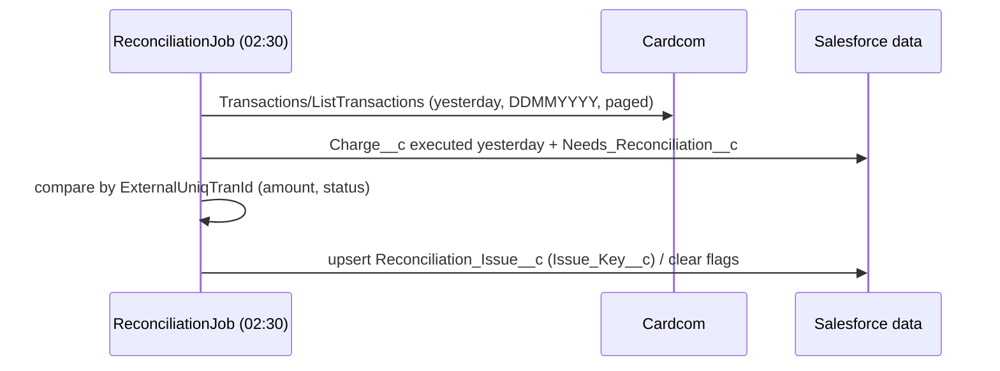
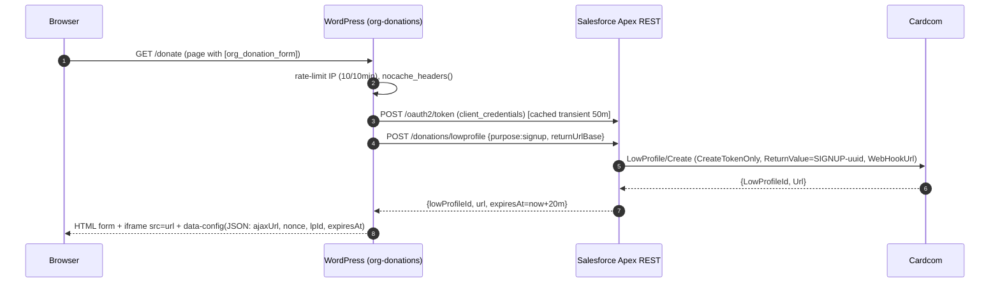
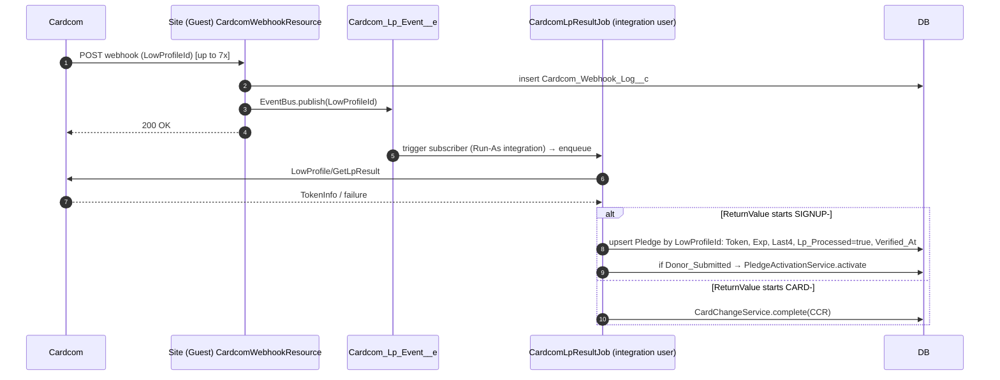
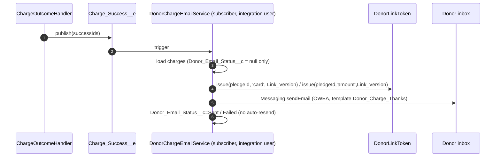
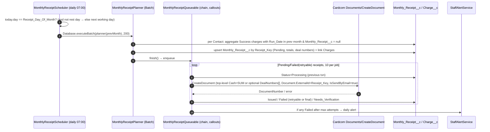

# CLAUDE.md — מערכת תרומות Cardcom ↔ WordPress ↔ Salesforce

> **⚠ חלק ב' (בסוף המסמך) הוא המפרט המחייב וגובר על חלק א' בכל סתירה.** 
> מסמך הנחיות מימוש עבור Claude. הפרוזה בעברית; קוד, מזהים ושמות שדות API באנגלית.
> מקורות: `cardcom-salesforce-spec.docx` (`spec/gen.py`), mockup `mockup/donation-form.html`, Cardcom API v11.
> **(עודכן v1.3)** שמות Cardcom אומתו מול Swagger v11 — ראו B5 (מקורות לכל שדה) ורשימת U1–U11 של מה שלא ניתן לאמת. **סימון `TODO-verify` הישן** = שם שדה/התנהגות שלא אומתו מול התיעוד החי (דף `https://secure.cardcom.solutions/api/v11` החזיר 404 בזמן הכתיבה; KB 503/508 לא נבדקו ישירות). לפני מימוש — לאמת מול Swagger של v11 ומול טרמינל בדיקות.

---

## 1. סקירה

- טופס תרומה **PHP+HTML מותאם** באתר WordPress של הארגון (shortcode, ללא תוסף טפסים).
- שדות: שם, אימייל, טלפון, ת"ז (אופציונלי), סכום לחיוב, תדירות: `micro_once_daily` / `micro_twice_daily`.
- **תרומה רגילה (חד-פעמית עם קבלה) — מחוץ לתחום כרגע; תתווסף בהמשך.**
- בטעינת העמוד PHP קורא ל-Salesforce (Apex REST, Connected App, OAuth Client Credentials) → Apex קורא ל-Cardcom `LowProfile/Create` עם `Operation=CreateTokenOnly` → מחזיר `Url` + `LowProfileId` → ה-iframe מוצג מיד בתוך הטופס.
- פרטי הטרמינל (TerminalNumber, ApiName, ApiPassword) קיימים **רק** ב-Salesforce (Named/External Credential).
- עמוד החזרה בתוך ה-iframe שולח `postMessage` להורה (בדיקת origin) → JS שולח סכום/תדירות + `LowProfileId` ל-PHP → Apex REST שומר את פרטי התורם על ה-Pledge (שדות `Donor_*__c`) במצב `Pending_Verification`, **בלי** ליצור Contact.
- **התאמת איש קשר**: רק אחרי ששני התנאים התקיימו (פרטי תורם הוגשו + Token אומת ב-Webhook/GetLpResult), ה-Job המאמת (משתמש האינטגרציה) מריץ `ContactMatcher`: אם קיים Contact תואם — ה-Pledge, ה-Token והחיובים משויכים אליו ופרטיו מתעדכנים לפי כללי מיזוג; אחרת נוצר Contact חדש (סעיף 7.5א).
- **מקור האמת**: Webhook מ-Cardcom ל-Salesforce Site + אימות `LowProfile/GetLpResult`. ה-Webhook עשוי להישלח עד 7 פעמים → עיבוד אידמפוטנטי.
- תיעוד: `Charge__c` לכל ניסיון (כולל Failed/Skipped), Roll-ups ב-Pledge (ללא השעיה אוטומטית — עצירה ידנית בלבד, התראה לצוות אחרי X כישלונות רצופים), קבלת תרומה חודשית מרוכזת דרך Cardcom `Documents/CreateDocument` (`Monthly_Receipt__c`), מייל לתורם אחרי כל חיוב מוצלח עם קישורים חתומים להחלפת כרטיס ולשינוי סכום, והתאמה לילית מול Cardcom (`Reconciliation_Issue__c`).
- חיובים קבועים: Scheduled Apex פעמיים ביום (Asia/Jerusalem), ללא חיוב בשבת/חג; בכל ערב (שישי/ערב חג) חיוב מוקדם של היום + כל ימי המנוחה הרצופים שאחריו (חגים ב-Custom Metadata). דו-שלבי: יצירת `Charge__c` Pending → Queueable בקבוצות 25–40 ל-`Transactions/Transaction` עם Token.
- מיקרו-חיובים: ללא `Document` ו-`Advanced.SendNote=false` → ללא מסמך לכל חיוב; המסמך היחיד הוא הקבלה החודשית.

### הערכת עלות חודשית
כל יום קלנדרי מחויב (שבת וחגים מחויבים מראש בערב) → **14 חיובים לשבוע** לתורם בתדירות פעמיים ביום.
2 × ימי החודש → **כ-61 ₪ לחודש** ב-1 ₪ לחיוב (טווח 56–62 לפי מספר ימי החודש; חגים לא מקטינים). פעם ביום: 7 לשבוע ≈ 30 ₪.

---

## 2. ארכיטקטורה ותרשימי רצף

### 2.1 טעינת טופס ויצירת LowProfile


### 2.2 הזנת כרטיס, postMessage והגשה


### 2.3 Webhook ואימות
```mermaid
sequenceDiagram
  participant CC as Cardcom
  participant S as SF Site /cardcom/webhook
  participant Q as Queueable
  CC->>S: POST WebHookUrl (retry up to 7x)
  S->>S: insert Cardcom_Webhook_Log__c, return 200 fast
  S->>Q: enqueue CardcomLpResultJob(lpId)
  Q->>CC: POST LowProfile/GetLpResult
  CC-->>Q: ResponseCode, TokenInfo, TranzactionInfo
  Q->>Q: idempotent upsert: Pledge Token + Lp_Processed
  alt donor details already submitted
    Q->>Q: ContactMatcher: FindDuplicates (Matching Rule: email OR phone OR taxId) + SOQL; priority email > phone > taxId
    alt existing Contact found
      Q->>Q: attach Pledge to Contact, merge fields (fill-blanks rule)
    else no match
      Q->>Q: create new Contact
    end
    Q->>Q: Pledge Active (charges reference Pledge → Contact)
  else donor submit not yet arrived
    Q->>Q: wait; submit enqueues PledgeActivationJob later
  end
```
> סדר ההגעה לא משנה: אם ה-submit מגיע אחרי האימות, `DonationPledgeResource` מוסיף `PledgeActivationJob` שמבצע את אותה התאמה. שני המסלולים קוראים ל-`PledgeActivationService.tryActivate`, שהוא אידמפוטנטי (`FOR UPDATE` + בדיקת סטטוס).

### 2.4 חיוב מתוזמן
```mermaid
sequenceDiagram
  participant SCH as DonationChargeScheduler (Schedulable)
  participant PL as ChargePlanner
  participant QJ as ChargeQueueable (chained)
  participant CC as Cardcom
  participant EM as Charge_Success__e → DonorChargeEmailService
  SCH->>SCH: rest day? → stop. isEve(today) must match run type (eve 06:00/11:00, regular 08:00/20:00)
  SCH->>PL: plan(today, slot)
  PL->>PL: logicalDatesFor(today) = today + following rest days (Shabbat / 1-2 day Chag)
  PL->>PL: insert Charge__c attempt #1 Pending (Active pledges only; Stopped skipped)
  PL->>QJ: enqueue batch (25-40)
  QJ->>CC: Transactions/Transaction (Token, CardExpirationMMYY, ExternalUniqTranId=Attempt_Key, ExternalUniqUniqTranIdResponse=true)
  CC-->>QJ: ResponseCode, TranzactionId, Last4CardDigitsString
  QJ->>QJ: attempt → Success / Failed (+ new Pending attempt n+1, Verify_Attempt_Key if unknown)
  QJ->>QJ: ChargeTrigger → PledgeRollupService (totals, consecutive failures)
  alt Consecutive_Failures >= Max_Consecutive_Failures__c and no alert this streak
    QJ->>QJ: PledgeFailureAlert → staff email (once per streak); pledge stays Active, charging continues
  end
  QJ->>EM: becameSuccess → donor email (amount, date, signed links: card / amount)
  QJ->>QJ: chain next batch
```

### 2.6 קבלה חודשית
```mermaid
sequenceDiagram
  participant J as MonthlyReceiptScheduler (07:00, Receipt_Day_Of_Month__c)
  participant SF as Salesforce DB
  participant CC as Cardcom Documents/CreateDocument
  J->>SF: Success charges of last month (IL time), not flagged for reconciliation
  J->>SF: upsert Monthly_Receipt__c {PledgeId}-{YYYYMM} Pending; link charges; Amount/Count
  loop Queueable chain (≤40 per job)
    J->>CC: Cash=SUM (או DealNumbers[] אופציונלי), Document{DonationReceipt, ExternalId=Receipt_Key, Products[1 line = SUM]}
    CC-->>J: ResponseCode, DocumentNumber, DocumentUrl
    J->>SF: Created / Failed (+Attempts, Error)
  end
```

### 2.7 עמוד תורם — החלפת כרטיס ושינוי סכום
```mermaid
sequenceDiagram
  participant D as Donor (email link)
  participant WP as WordPress /donor/
  participant SF as Salesforce /donor/*
  participant CC as Cardcom
  D->>WP: GET /donor/card?t=<signed token>
  WP->>SF: /donor/context (verify HMAC, purpose, Link_Version)
  WP->>SF: /donor/card → LowProfile Create (CreateTokenOnly) + Card_Change_Request__c
  WP-->>D: iframe (Cardcom)
  CC->>SF: Webhook → Platform Event → CardcomLpResultJob
  SF->>CC: GetLpResult (verify)
  SF->>SF: Pledge_Card_History__c (old token) → swap Token/Expiry; Last4 from next charge
  D->>WP: /donor/amount?t=… → new amount
  WP->>SF: /donor/amount (min/max) → Pledge_Change_Log__c, Amount__c (next charge)
```

### 2.5 התאמה לילית


---

## 3. LowProfileId — חד-פעמי
> **הוחלף** — המימוש המחייב ב-B5.1–B5.3 (חלק ב'). התוכן הישן הוסר כדי למנוע מימוש שגוי.

## 4. מודל נתונים (Salesforce)
> **הוחלף** — המימוש המחייב ב-B2 (חלק ב'). התוכן הישן הוסר כדי למנוע מימוש שגוי.

## 5. Cardcom API v11 — שדות בשימוש
> **הוחלף** — המימוש המחייב ב-B5 (שדות מאומתים מול Swagger v11 עם מקורות) (חלק ב'). התוכן הישן הוסר כדי למנוע מימוש שגוי.

## 6. WordPress
> **הוחלף** — המימוש המחייב ב-B7 (תוסף `org-donations` המלא, כולל דף התורם B7.12) (חלק ב'). התוכן הישן הוסר כדי למנוע מימוש שגוי.

---

## 7. Salesforce Apex

### 7.1 Named Credential
- External Credential `CardcomCred` (Custom, Named Principal) עם פרמטרים `ApiName`, `ApiPassword`.
- Named Credential `Cardcom` → `https://secure.cardcom.solutions/api/v11`, Allow Formulas in HTTP Body = true.
- Permission Set `Cardcom_Integration` נותן גישה ל-Principal — מוקצה למשתמש האינטגרציה (Client Credentials Run-As) ולמשתמש ה-Site guest **לא** (ה-Webhook מעביר ל-Queueable שרץ כמשתמש התזמון — ראה 7.5).

### 7.2 `CardcomService`
> **הוחלף** — המימוש המחייב ב-B5.9 (חלק ב'). התוכן הישן הוסר כדי למנוע מימוש שגוי.

```apex
@RestResource(urlMapping='/donations/lowprofile')
global without sharing class DonationLowProfileResource {
    /** Contract: B4. Body {purpose:'signup', returnUrlBase}. Response {lowProfileId, url, expiresAt}. */
    @HttpPost
    global static void create() {
        RestResponse res = RestContext.response;
        res.addHeader('Content-Type', 'application/json; charset=utf-8');
        Map<String, Object> out;
        try {
            Map<String, Object> b = (Map<String, Object>) JSON.deserializeUntyped(RestContext.request.requestBody.toString());
            String returnUrlBase = (String) b.get('returnUrlBase');
            assertAllowedReturnUrl(returnUrlBase);
            String rv = 'SIGNUP-' + UUID.randomUUID().toString();
            Map<String, Object> r = CardcomService.createTokenLowProfile(rv, returnUrlBase, 'הוראת תרומה יומית'); // B5.1
            out = new Map<String, Object>{ 'lowProfileId' => r.get('LowProfileId'), 'url' => r.get('Url'),
                // LP page lifetime is not documented → WP refreshes the iframe after 20 minutes (safe default)
                'expiresAt' => Datetime.now().addMinutes(20).formatGmt('yyyy-MM-dd\'T\'HH:mm:ss\'Z\'') };
            res.statusCode = 200;
        } catch (IllegalArgumentException e) {
            res.statusCode = 400; out = new Map<String, Object>{ 'error' => 'BAD_RETURN_URL' };
        } catch (Exception e) {
            System.debug(LoggingLevel.ERROR, 'LP create ' + e.getMessage());
            res.statusCode = 400; out = new Map<String, Object>{ 'error' => 'CARDCOM_ERROR' };
        }
        res.responseBody = Blob.valueOf(JSON.serialize(out));
    }

    /** https + host in Cardcom_Setting__mdt.Allowed_Return_Hosts__c (comma separated). Used also by DonorPortalResource. */
    public static void assertAllowedReturnUrl(String u) {
        if (String.isBlank(u) || !u.startsWith('https://')) throw new IllegalArgumentException('return url');
        String host = new Url(u).getHost().toLowerCase();
        Set<String> ok = new Set<String>();
        for (String h : CardcomService.settings().Allowed_Return_Hosts__c.split(',')) ok.add(h.trim().toLowerCase());
        if (!ok.contains(host)) throw new IllegalArgumentException('return url');
    }
}
```
> לא יוצרים רשומה בכל טעינת עמוד (מניעת זבל). הרשומה נוצרת ב-submit או ב-Webhook — מה שמגיע קודם (upsert לפי `LowProfileId__c`).

```apex
@RestResource(urlMapping='/donations/pledge')
global without sharing class DonationPledgeResource {
    /** Contract: B4. Rules: B6.2. */
    @HttpPost
    global static void submit() {
        RestResponse res = RestContext.response;
        res.addHeader('Content-Type', 'application/json; charset=utf-8');
        Map<String, Object> out;
        try {
            Map<String, Object> q = (Map<String, Object>) JSON.deserializeUntyped(RestContext.request.requestBody.toString());
            List<String> bad = validate(q);
            if (!bad.isEmpty()) { res.statusCode = 400; out = new Map<String, Object>{ 'error' => 'VALIDATION', 'fields' => bad }; }
            else {
                String lp = (String) q.get('lowProfileId');
                List<Recurring_Pledge__c> ex = [SELECT Id, Status__c, Donor_Submitted__c, Lp_Processed__c
                                                FROM Recurring_Pledge__c WHERE LowProfileId__c = :lp FOR UPDATE];
                if (!ex.isEmpty() && ex[0].Donor_Submitted__c) {
                    res.statusCode = 400; out = new Map<String, Object>{ 'error' => 'LP_ALREADY_USED' };
                } else {
                    Recurring_Pledge__c p = ex.isEmpty() ? new Recurring_Pledge__c(LowProfileId__c = lp, Status__c = 'Pending_Verification')
                                                         : new Recurring_Pledge__c(Id = ex[0].Id);
                    p.Donor_First_Name__c = s(q, 'firstName'); p.Donor_Last_Name__c = s(q, 'lastName');
                    p.Donor_Email__c = s(q, 'email').toLowerCase(); p.Donor_Phone__c = ContactMatcher.normPhone(s(q, 'phone'));
                    p.Donor_Tax_Id__c = String.isBlank(s(q, 'taxId')) ? null : s(q, 'taxId').leftPad(9, '0');
                    p.Amount__c = Decimal.valueOf(String.valueOf(q.get('amount'))).setScale(2);
                    p.Frequency__c = s(q, 'frequency'); p.Type__c = 'Micro';
                    p.Donor_Submitted__c = true; p.Terms_Accepted_At__c = Datetime.now();
                    p.Client_Ip__c = s(q, 'clientIp') == null ? null : s(q, 'clientIp').left(45);
                    if (ex.isEmpty()) insert p; else update p;
                    if (!ex.isEmpty() && ex[0].Lp_Processed__c) System.enqueueJob(new PledgeActivationJob(p.Id)); // webhook came first
                    res.statusCode = 200;
                    out = new Map<String, Object>{ 'pledgeId' => p.Id,
                        'status' => [SELECT Status__c FROM Recurring_Pledge__c WHERE Id = :p.Id].Status__c };
                }
            }
        } catch (Exception e) {
            System.debug(LoggingLevel.ERROR, 'pledge submit ' + e.getMessage());
            res.statusCode = 500; out = new Map<String, Object>{ 'error' => 'INTERNAL' };
        }
        res.responseBody = Blob.valueOf(JSON.serialize(out));
    }

    static String s(Map<String, Object> m, String k) { Object v = m.get(k); return v == null ? null : String.valueOf(v).trim(); }

    @TestVisible static List<String> validate(Map<String, Object> q) {
        List<String> bad = new List<String>();
        Cardcom_Setting__mdt st = CardcomService.settings();
        String fn = s(q, 'firstName'), ln = s(q, 'lastName'), em = s(q, 'email'), ph = s(q, 'phone'), id = s(q, 'taxId');
        if (String.isBlank(fn) || fn.length() > 40) bad.add('firstName');
        if (String.isBlank(ln) || ln.length() > 80) bad.add('lastName');
        if (String.isBlank(em) || em.length() > 80 || !Pattern.matches('^[^@\\s]+@[^@\\s]+\\.[^@\\s]+$', em)) bad.add('email');
        String np = ContactMatcher.normPhone(ph);
        if (np == null || !Pattern.matches('^05\\d{8}$', np)) bad.add('phone');
        if (String.isNotBlank(id) && !ContactMatcher.validIsraeliId(id)) bad.add('taxId');
        Decimal a;
        try { a = Decimal.valueOf(String.valueOf(q.get('amount'))); } catch (Exception e) { a = null; }
        if (a == null || a < st.Min_Amount__c || a > st.Max_Amount__c || a.scale() > 2) bad.add('amount');
        if (!new Set<String>{ 'OnceDaily', 'TwiceDaily' }.contains(s(q, 'frequency'))) bad.add('frequency');
        if (q.get('termsAccepted') != true) bad.add('termsAccepted');
        if (String.isBlank(s(q, 'lowProfileId')) || !Pattern.matches('[A-Za-z0-9-]{10,64}', s(q, 'lowProfileId'))) bad.add('lowProfileId');
        return bad;
    }
}
```

### 7.4א `ContactMatcher` — התאמת תורם קיים (Duplicate Rules + SOQL)

**מפתחות התאמה — כל אחד לבדו מספיק (OR):**
| מפתח | נרמול | שדה ב-Contact |
|---|---|---|
| Email | `trim` + lowercase | `Email_Normalized__c` |
| טלפון | פורמט ישראלי `05XXXXXXXX` (`+972`/`972`/`00972` → `0`, הסרת תווים שאינם ספרות; ניידים בלבד) | `Phone_Normalized__c` (מ-MobilePhone, ואם ריק — Phone) |
| ת"ז | ספרות בלבד, ריפוד ל-9, ספרת ביקורת תקינה → SHA-256 | `Tax_Id_Hash__c` |

**הגדרות Salesforce (Setup):**
- **Matching Rule** `Donor_Contact_Match` על Contact, לוגיקה `1 OR 2 OR 3`:
  1. `Email_Normalized__c` — Exact, Match blank = false
  2. `Phone_Normalized__c` — Exact, Match blank = false
  3. `Tax_Id_Hash__c` — Exact, Match blank = false
  (משתמשים בשדות המנורמלים כי Matching Rules לא מנרמלים טלפון ישראלי ולא תומכים בשדות מוצפנים.) להפעיל (Activate) אחרי מילוי השדות.
- **Duplicate Rule** `Donor_Contact_Duplicate` על Contact, משתמש ב-`Donor_Contact_Match`:
  - Record-level security: Bypass sharing rules (כדי שמשתמש האינטגרציה יראה את כל ה-Contacts).
  - Action on create: **Allow + Alert + Report**; Action on edit: **Allow + Report** (לא Block — כדי שהאינטגרציה לא תיכשל; ההחלטה נעשית בקוד).
  - אופציונלי: Conditions להחרגת משתמש האינטגרציה מה-Alert ב-UI (לא נדרש ל-API).
- Duplicate Record Sets/Items נוצרים אוטומטית לדיווח ("תורמים כפולים").

**אלגוריתם:**
1. **ראשי — `Datacloud.FindDuplicates.findDuplicates`** על Contact זמני (לא נשמר) עם השדות המנורמלים. מחזיר מועמדים לפי ה-Matching Rule של הארגון (כולל כללים נוספים אם קיימים).
2. **השלמה/גיבוי — SOQL** על שלושת השדות המנורמלים (אם Duplicate Rule לא פעיל, נכשל, או כדי לקבוע איזה מפתח התאים לכל מועמד). איחוד התוצאות לפי Id.
3. **בחירה כשיש מועמדים:** לכל מועמד מחושב המפתח הגבוה ביותר שהתאים, לפי סדר עדיפות **Email > טלפון > ת"ז**. נבחר המועמד בעל העדיפות הגבוהה; שוויון → `LastModifiedDate DESC, CreatedDate ASC, Id ASC`.
4. **Review:** אם יותר ממועמד אחד (מפתחות שונים מצביעים ל-Contacts שונים, או כמה Contacts לאותו מפתח) → משייכים לנבחר ומסמנים `Needs_Review__c=true` עם רשימת ה-Ids. גם סתירת Email/ת"ז ברשומה הנבחרת → Review.
5. **אין מועמדים** → Contact חדש (insert עם `DuplicateRuleHeader.allowSave = true`).

**כללי עדכון שדות (fill-blanks, ללא דריסה עיוורת):**
| שדה | כלל |
|---|---|
| FirstName / LastName | ממלאים רק אם ריק; אם שונה — לא דורסים (ערך הטופס נשמר על ה-Pledge) |
| Email | אם ריק — ממלאים; אם שונה — לא דורסים (הערך נשמר על ה-Pledge) ומסמנים Review |
| MobilePhone | אם ריק — ממלאים; אם שונה — ממלאים `OtherPhone` אם ריק, ללא דריסה |
| Donor_Tax_Id__c | ממלאים רק אם ריק; אם שונה — לא דורסים + Review |
| Donor_Source__c | לא משתנה ברשומה קיימת |

```apex
public without sharing class ContactMatcher {
    public class DonorInput {
        public String firstName, lastName, email, phone, taxId;
        public DonorInput(String f, String l, String e, String p, String t) { firstName=f; lastName=l; email=e; phone=p; taxId=t; }
    }
    public class Result { public Id contactId; public String method; public Boolean created = false; }

    @TestVisible static Boolean skipDuplicateRules = false; // tests / orgs without active rule

    // ---------- normalization ----------
    public static String normEmail(String e) { return String.isBlank(e) ? null : e.trim().toLowerCase(); }

    public static String normPhone(String p) {
        if (String.isBlank(p)) return null;
        String d = p.replaceAll('[^0-9]', '');
        if (d.startsWith('00972')) d = d.substring(5);
        else if (d.startsWith('972')) d = d.substring(3);
        if (!d.startsWith('0')) d = '0' + d;
        return Pattern.matches('05\\d{8}', d) ? d : null; // mobile only
    }

    public static String taxIdHash(String id) {
        if (String.isBlank(id)) return null;
        String d = id.replaceAll('[^0-9]', '').leftPad(9, '0');
        if (d.length() != 9 || !validIlId(d)) return null;
        return EncodingUtil.convertToHex(Crypto.generateDigest('SHA-256', Blob.valueOf(d)));
    }

    static Boolean validIlId(String d) {
        Integer sum = 0;
        for (Integer i = 0; i < 9; i++) {
            Integer x = Integer.valueOf(d.substring(i, i + 1)) * (Math.mod(i, 2) + 1);
            sum += x > 9 ? x - 9 : x;
        }
        return Math.mod(sum, 10) == 0;
    }

    // ---------- candidates ----------
    static Set<Id> findViaDuplicateRules(String em, String ph, String tx, DonorInput in) {
        Set<Id> ids = new Set<Id>();
        if (skipDuplicateRules) return ids;
        Contact probe = new Contact(FirstName = in.firstName, LastName = in.lastName, Email = in.email,
            MobilePhone = in.phone, Email_Normalized__c = em, Phone_Normalized__c = ph, Tax_Id_Hash__c = tx);
        try {
            for (Datacloud.FindDuplicatesResult fdr : Datacloud.FindDuplicates.findDuplicates(new List<Contact>{ probe })) {
                for (Datacloud.DuplicateResult dr : fdr.getDuplicateResults()) {
                    for (Datacloud.MatchResult mr : dr.getMatchResults()) {
                        for (Datacloud.MatchRecord rec : mr.getMatchRecords()) ids.add(rec.getRecord().Id);
                    }
                }
            }
        } catch (Exception e) {
            // No active duplicate rule / limits → fall back to SOQL only
            System.debug(LoggingLevel.WARN, 'FindDuplicates failed: ' + e.getMessage());
        }
        return ids;
    }

    static final String FIELDS = 'Id, FirstName, LastName, Email, MobilePhone, OtherPhone, Donor_Tax_Id__c, '
        + 'Email_Normalized__c, Phone_Normalized__c, Tax_Id_Hash__c, Needs_Review__c, Review_Reason__c, LastModifiedDate, CreatedDate';

    static List<Contact> loadCandidates(Set<Id> dupIds, String em, String ph, String tx) {
        // SOQL complement: union of rule hits + direct normalized-field hits
        return Database.query('SELECT ' + FIELDS + ' FROM Contact WHERE Id IN :dupIds'
            + (em != null ? ' OR Email_Normalized__c = :em' : '')
            + (ph != null ? ' OR Phone_Normalized__c = :ph' : '')
            + (tx != null ? ' OR Tax_Id_Hash__c = :tx' : '')
            + ' ORDER BY LastModifiedDate DESC, CreatedDate ASC, Id ASC LIMIT 50');
    }

    // 1 = Email, 2 = Phone, 3 = TaxId, 9 = matched only by an org rule on other fields
    @TestVisible static Integer rank(Contact c, String em, String ph, String tx) {
        if (em != null && c.Email_Normalized__c == em) return 1;
        if (ph != null && c.Phone_Normalized__c == ph) return 2;
        if (tx != null && c.Tax_Id_Hash__c == tx) return 3;
        return 9;
    }
    static final Map<Integer, String> METHOD = new Map<Integer, String>{ 1 => 'Email', 2 => 'Phone', 3 => 'TaxId', 9 => 'DuplicateRule' };

    // ---------- main ----------
    public static Result matchOrCreate(DonorInput in) {
        String em = normEmail(in.email), ph = normPhone(in.phone), tx = taxIdHash(in.taxId);
        Set<Id> dupIds = findViaDuplicateRules(em, ph, tx, in);
        List<Contact> cands = (em == null && ph == null && tx == null && dupIds.isEmpty())
            ? new List<Contact>() : loadCandidates(dupIds, em, ph, tx);

        Database.DMLOptions o = new Database.DMLOptions();
        o.DuplicateRuleHeader.allowSave = true;           // alert-only rule must never block integration
        o.DuplicateRuleHeader.runAsCurrentUser = true;

        Result r = new Result();
        if (cands.isEmpty()) {
            Contact c = new Contact(FirstName = in.firstName, LastName = in.lastName, Email = in.email,
                MobilePhone = in.phone, Donor_Tax_Id__c = in.taxId, Donor_Source__c = 'WP_Micro');
            Database.SaveResult sr = Database.insert(c, o);
            if (!sr.isSuccess()) throw new CardcomService.CardcomException('Contact insert failed: ' + sr.getErrors()[0].getMessage());
            r.contactId = c.Id; r.method = 'New'; r.created = true;
            return r;
        }

        // Pick by priority Email > Phone > TaxId; ties already ordered by LastModifiedDate DESC (stable)
        Contact best = null; Integer bestRank = 99;
        for (Contact c : cands) {
            Integer k = rank(c, em, ph, tx);
            if (k < bestRank) { best = c; bestRank = k; }
        }
        List<String> review = new List<String>();
        if (cands.size() > 1) {
            List<Id> ids = new List<Id>(); for (Contact x : cands) ids.add(x.Id);
            review.add('Multiple candidate contacts: ' + String.join(ids, ','));
        }
        mergeFields(best, in, em, ph, tx, review);
        if (!review.isEmpty()) {
            best.Needs_Review__c = true;
            best.Review_Reason__c = String.join(review, '; ').left(255);
        }
        Database.update(best, o);
        r.contactId = best.Id; r.method = METHOD.get(bestRank);
        return r;
    }

    // Fill-blanks only; conflicts → review flag, never overwrite non-empty values
    @TestVisible static void mergeFields(Contact c, DonorInput in, String em, String ph, String tx, List<String> review) {
        if (String.isBlank(c.FirstName)) c.FirstName = in.firstName;
        if (String.isBlank(c.Email)) c.Email = in.email;
        else if (em != null && normEmail(c.Email) != em) review.add('Different email: ' + em);
        if (String.isBlank(c.MobilePhone)) c.MobilePhone = in.phone;
        else if (ph != null && normPhone(c.MobilePhone) != ph && String.isBlank(c.OtherPhone)) c.OtherPhone = in.phone;
        if (String.isBlank(c.Donor_Tax_Id__c)) { if (tx != null) c.Donor_Tax_Id__c = in.taxId; }
        else if (tx != null && c.Tax_Id_Hash__c != tx) review.add('Different tax id');
    }
}
```
> `Email_Normalized__c`, `Phone_Normalized__c`, `Tax_Id_Hash__c` מתעדכנים ב-`ContactNormalizationTrigger` (before insert/update) באמצעות אותן פונקציות `normEmail/normPhone/taxIdHash`, כך שגם Contacts שנוצרו ידנית ניתנים להתאמה (ע"י ה-Matching Rule וה-SOQL). נדרש Batch חד-פעמי לרשומות קיימות לפני הפעלת ה-Matching Rule.
> `Match_Method__c` ב-Pledge מקבל גם `DuplicateRule` (מועמד שנמצא רק ע"י כלל ארגוני אחר).
> Race: שני תורמים חדשים עם אותו מפתח שמאומתים במקביל עלולים ליצור 2 Contacts. ה-Duplicate Rule (Report) יוצר Duplicate Record Set, ו-`Needs_Review__c` נבדק יומית.

### 7.5 Webhook — `CardcomWebhookResource` + `CardcomLpResultJob`
מוגדר ב-Salesforce Site ציבורי; ל-Guest User profile מותר רק Apex class זה ו-Create על `Cardcom_Webhook_Log__c`.
```apex
@RestResource(urlMapping='/cardcom/webhook')
global without sharing class CardcomWebhookResource {
    @HttpPost
    global static void receive() {
        RestRequest req = RestContext.request;
        String body = req.requestBody == null ? '' : req.requestBody.toString();
        String lpId = extractLowProfileId(req, body);
        Cardcom_Webhook_Log__c log = new Cardcom_Webhook_Log__c(
            LowProfileId__c = lpId, Raw_Body__c = body.left(131000), Received_At__c = Datetime.now());
        insert log;
        // Only an ID is trusted from here; everything else comes from GetLpResult.
        if (String.isNotBlank(lpId) && Pattern.matches('[A-Za-z0-9-]{10,64}', lpId)) {
            // Guest context can't use Named Credential → publish Platform Event; trigger (runs as Automated Process / integration user) enqueues the job
            EventBus.publish(new Cardcom_Lp_Event__e(LowProfileId__c = lpId, Log_Id__c = log.Id));
        }
        RestContext.response.statusCode = 200;
    }

    @TestVisible static String extractLowProfileId(RestRequest req, String body) {
        for (String k : new List<String>{'LowProfileId','lowprofileid','LowProfileCode','lowprofilecode'}) {
            if (req.params.containsKey(k)) return req.params.get(k);
        }
        if (body.startsWith('{')) {
            Map<String, Object> m = (Map<String, Object>) JSON.deserializeUntyped(body);
            Object v = m.containsKey('LowProfileId') ? m.get('LowProfileId') : m.get('LowProfileCode');
            return v == null ? null : String.valueOf(v);
        }
        for (String pair : body.split('&')) { // form-encoded
            List<String> kv = pair.split('=', 2);
            if (kv.size() == 2 && kv[0].equalsIgnoreCase('LowProfileId')) return EncodingUtil.urlDecode(kv[1], 'UTF-8');
        }
        return null;
    }
}
```
```apex
trigger CardcomLpEventTrigger on Cardcom_Lp_Event__e (after insert) {
    // Set "Run As" for this platform event trigger subscriber = integration user (PlatformEventSubscriberConfig)
    Set<String> ids = new Set<String>();
    for (Cardcom_Lp_Event__e e : Trigger.new) ids.add(e.LowProfileId__c);
    System.enqueueJob(new CardcomLpResultJob(new List<String>(ids)));
}
```
```apex
public without sharing class CardcomLpResultJob implements Queueable, Database.AllowsCallouts {
    final List<String> lpIds;
    public CardcomLpResultJob(List<String> lpIds) { this.lpIds = lpIds; }

    public void execute(QueueableContext ctx) {
        // 1) callouts first (no DML before them)
        Map<String, Map<String, Object>> results = new Map<String, Map<String, Object>>();
        Set<String> cardChange = new Set<String>();
        for (Card_Change_Request__c c : [SELECT LowProfileId__c FROM Card_Change_Request__c WHERE LowProfileId__c IN :lpIds]) cardChange.add(c.LowProfileId__c);
        Set<String> done = new Set<String>();
        for (Recurring_Pledge__c p : [SELECT LowProfileId__c FROM Recurring_Pledge__c WHERE LowProfileId__c IN :lpIds AND Lp_Processed__c = true]) done.add(p.LowProfileId__c);
        for (String lp : lpIds) {
            if (done.contains(lp)) continue;                                // webhook retries 2..7 → no-op
            try { results.put(lp, CardcomService.getLpResult(lp)); } catch (Exception e) { /* sweeper will retry */ }
        }
        // 2) DML
        List<Id> toActivate = new List<Id>();
        for (String lp : results.keySet()) {
            Map<String, Object> r = results.get(lp);
            if (cardChange.contains(lp)) { CardChangeService.complete(lp, r); continue; }
            String rv = String.valueOf(r.get('ReturnValue'));
            if (rv != null && rv.startsWith('CARD-')) continue;            // CCR not inserted yet (race) → status poll / sweeper handles it
            Integer code = CardcomService.code(r);
            if (code >= 5117 && code <= 5119) continue;                     // donor still on the payment page (B5.3)
            CardcomService.CardData d = code == 0 ? CardcomService.cardFrom(r) : null;
            List<Recurring_Pledge__c> ex = [SELECT Id, Status__c, Lp_Check_Count__c FROM Recurring_Pledge__c WHERE LowProfileId__c = :lp FOR UPDATE];
            Recurring_Pledge__c p = ex.isEmpty() ? new Recurring_Pledge__c(LowProfileId__c = lp, Status__c = 'Pending_Verification', Type__c = 'Micro')
                                                 : new Recurring_Pledge__c(Id = ex[0].Id);
            if (d != null) {
                p.Token__c = d.token; p.CardExpirationMMYY__c = d.expMMYY; p.Token_Expiry_Date__c = d.tokenExpiry;
                if (d.last4 != null) p.Last4__c = d.last4;
                p.Lp_Processed__c = true; p.Verified_At__c = Datetime.now();
            } else {
                Decimal n = (ex.isEmpty() || ex[0].Lp_Check_Count__c == null ? 0 : ex[0].Lp_Check_Count__c) + 1;
                p.Lp_Check_Count__c = n;
                if (n >= 6) { p.Status__c = 'Verification_Failed'; p.Lp_Processed__c = true; }   // B5.3: after 6 checks (90 min)
            }
            if (ex.isEmpty()) insert p; else update p;
            if (d != null) toActivate.add(p.Id);
        }
        List<Cardcom_Webhook_Log__c> logs = [SELECT Id FROM Cardcom_Webhook_Log__c WHERE LowProfileId__c IN :results.keySet() AND Processed__c = false];
        for (Cardcom_Webhook_Log__c l : logs) l.Processed__c = true;
        update logs;
        for (Id pid : toActivate) PledgeActivationService.tryActivate(pid);   // Contact matching (integration user); activates only if Donor_Submitted__c
    }
}
```
> שדה חדש: `Recurring_Pledge__c.Lp_Check_Count__c` Number(2,0) default 0 — מונה בדיקות GetLpResult שלא החזירו טוקן.
> `PendingVerificationSweeper` (7.7ב) קורא לאותו Job, כך שכל מסלול אידמפוטנטי.

### 7.6 לוגיקת תאריכי חיוב — `ChargeCalendar` (שבת, חגים, ערבי חג)
**מושגים:**
- **יום מנוחה (Rest day):** שבת, או תאריך ב-`Charge_Holiday__mdt` (`Is_Rest_Day__c = true`). ביום מנוחה אין חיובים ואין ניסיונות.
- **ערב (Eve):** יום שאינו יום מנוחה, ושמחרתו יום מנוחה. שישי הוא תמיד ערב (לפני שבת); ערב חג באמצע השבוע גם הוא ערב.
- **חיוב כפול בערב:** ריצת הערב מחייבת את היום עצמו **ובנוסף את כל ימי המנוחה הרצופים שאחריו** (תאריכים לוגיים). כך:
  - שישי רגיל → שישי + שבת (×2).
  - ערב חג חד-יומי (למשל יום ג') → ג' + ד' (×2).
  - חג דו-יומי (שני רשומות `Charge_Holiday__mdt`, למשל ראש השנה ה'–ו') → ערב ביום ד' מכסה ד' + ה' + ו' + שבת (×4), כי שבת צמודה.
  - ערב חג שחל בשישי (חג ביום א' אחרי שבת) → שישי + שבת + א' (×3).
  - חג שחל בשבת → שישי + שבת (אין כפל נוסף).
- **שעות:** בימים רגילים ריצות 08:00 (AM) ו-20:00 (PM). **בכל ערב** (כולל שישי) הריצות מוקדמות: 06:00 (AM) ו-11:00 (PM), לפני `Friday_Cutoff_Hour__c` (14:00), כי החג/שבת נכנסים בערב.
- רשימת החגים מוזנת מראש לכל שנה (Custom Metadata, רשומה לכל יום חג; חג דו-יומי = שתי רשומות). אין צורך לסמן ערבים — הם מחושבים.

```apex
public with sharing class ChargeCalendar {
    // Running user TZ must be Asia/Jerusalem; Date.today() is then Israel date.
    @TestVisible static Set<Date> holidaysOverride;

    public static Set<Date> holidays() {
        if (holidaysOverride != null) return holidaysOverride;
        Set<Date> s = new Set<Date>();
        for (Charge_Holiday__mdt h : Charge_Holiday__mdt.getAll().values()) if (h.Is_Rest_Day__c) s.add(h.Date__c);
        return s;
    }

    public static Integer dow(Date d) { // 0=Sunday .. 6=Saturday
        return Math.mod(Date.newInstance(1900, 1, 7).daysBetween(d), 7); // 1900-01-07 was Sunday
    }

    public static Boolean isRestDay(Date d) { return dow(d) == 6 || holidays().contains(d); }

    /** Eve = working day followed by a rest day (Friday, Erev Chag). */
    public static Boolean isEve(Date d) { return !isRestDay(d) && isRestDay(d.addDays(1)); }

    /** Logical dates charged by a run on `runDate`. Empty = no charge (rest day). */
    public static List<Date> logicalDatesFor(Date runDate) {
        List<Date> out = new List<Date>();
        if (isRestDay(runDate)) return out;
        out.add(runDate);
        Date next = runDate.addDays(1);
        Integer guard = 0;
        while (isRestDay(next) && guard++ < 7) {   // cover the whole rest-day streak (Shabbat, 1-2 day Chag, Chag+Shabbat)
            out.add(next);
            next = next.addDays(1);
        }
        return out;
    }

    public static Integer fridayCutoffHour() {
        Decimal h = ChargeSettings.get().Friday_Cutoff_Hour__c;
        return h == null ? 14 : h.intValue();
    }

    /** True if a charge/retry may be sent at `t` (Asia/Jerusalem). */
    public static Boolean isRetryWindowOpen(Datetime t) {
        Date d = t.date();
        if (isRestDay(d)) return false;                                   // Shabbat / Chag
        if (isEve(d) && t.hour() >= fridayCutoffHour()) return false;    // Friday / Erev Chag after cutoff
        return true;
    }
}
```
> בהערכת העלות: כל יום קלנדרי מחויב (ימי מנוחה מחויבים מראש בערב), כך שתורם TwiceDaily מחויב 2 × מספר ימי החודש (56–62 ₪ ב-1 ₪ לחיוב).

### 7.7 Scheduler, Planner, Queueable
```apex
public with sharing class DonationChargeScheduler implements Schedulable {
    final String slot;     // 'AM' | 'PM'
    final Boolean eveRun;  // true = early run used only on eves (Friday / Erev Chag)
    public DonationChargeScheduler(String slot, Boolean eveRun) { this.slot = slot; this.eveRun = eveRun; }

    public void execute(SchedulableContext sc) {
        Date today = Date.today();
        if (ChargeCalendar.isRestDay(today)) return;
        if (ChargeCalendar.isEve(today) != eveRun) return;   // eve days use only early runs; normal days only regular runs
        ChargePlanner.plan(today, slot);
    }

    // Setup (Execute Anonymous, as integration user with TZ Asia/Jerusalem):
    public static void scheduleAll() {
        System.schedule('Donations AM',          '0 0 8 ? * SUN-THU',  new DonationChargeScheduler('AM', false));
        System.schedule('Donations PM',          '0 0 20 ? * SUN-THU', new DonationChargeScheduler('PM', false));
        System.schedule('Donations Eve AM',      '0 0 6 ? * SUN-FRI',  new DonationChargeScheduler('AM', true));
        System.schedule('Donations Eve PM',      '0 0 11 ? * SUN-FRI', new DonationChargeScheduler('PM', true));
        System.schedule('Donations Retry',       '0 30 * ? * SUN-FRI', new ChargeRetryScheduler()); // calls ChargeDispatcher.start()
        System.schedule('Donations Reconcile',   '0 30 2 * * ?', new ReconciliationJob());
        System.schedule('Donations Receipts',    '0 0 7 * * ?', new MonthlyReceiptScheduler()); // superseded: times from Charge_Settings__c — B9.2
        PendingVerificationSweeper.scheduleAll();
    }
}
```
**מודל ניסיונות:** כל ניסיון חיוב = רשומת `Charge__c` נפרדת. חיוב לוגי אחד (Pledge + תאריך + slot) מזוהה ע"י `ExternalUniqTranId__c` (פנימי). לכל ניסיון `Attempt_Key__c` = `{ExternalUniqTranId}-A{n}` (Unique) — **הוא** הערך שנשלח ל-Cardcom כ-`ExternalUniqTranId`. הגנה מחיוב כפול: B5.4–B5.5 (`Verify_Attempt_Key__c`).

```apex
public with sharing class ChargePlanner {
    public static void plan(Date runDate, String slot) {
        List<Date> dates = ChargeCalendar.logicalDatesFor(runDate);
        if (dates.isEmpty()) return;                       // rest day: no records at all
        List<Charge__c> toInsert = new List<Charge__c>();
        for (Recurring_Pledge__c p : [SELECT Id, Contact__c, Amount__c, Frequency__c, Status__c, CardExpirationMMYY__c
                                      FROM Recurring_Pledge__c
                                      WHERE Status__c = 'Active' AND Type__c = 'Micro'   // Stopped / Cancelled never planned
                                      AND (End_Date__c = null OR End_Date__c >= :runDate)]) {
            if (slot == 'PM' && p.Frequency__c != 'TwiceDaily') continue;
            for (Date d : dates) {
                toInsert.add(buildAttempt(p, d, slot, 1, null)); // no skip on failures/expiry (D11)
            }
        }
        Database.insert(toInsert, false); // duplicate Attempt_Key__c on re-run → silently skipped
        if (!ChargeRunLock.isChainActive()) ChargeDispatcher.start(); // else picked up by the running chain
    }

    public static String extId(Id pledgeId, Date d, String slot) {
        return 'PLG-' + pledgeId + '-' + Datetime.newInstance(d, Time.newInstance(12,0,0,0)).format('yyyyMMdd') + '-' + slot;
    }

    public static Charge__c buildAttempt(Recurring_Pledge__c p, Date d, String slot, Integer attempt, Datetime notBefore) {
        String ext = extId(p.Id, d, slot);
        return new Charge__c(Pledge__c = p.Id, Contact__c = p.Contact__c, Amount__c = p.Amount__c,
            Scheduled_Date__c = d, Slot__c = slot, ExternalUniqTranId__c = ext,
            Attempt_Number__c = attempt, Attempt_Key__c = ext + '-A' + attempt,
            Run_Date__c = Date.today(), // actual send day (receipt month, B6.11)
            Status__c = 'Pending', Not_Before__c = notBefore);
    }
}
```
> בהיקף גדול (אלפי Pledges) — להעביר את ה-planning ל-`Database.Batchable`.

> **ChargeDispatcher / ChargeQueueable / ChargeRetryPolicy / ChargeOutcomeHandler — הוחלפו.** הקוד המחייב ב-B6.5.1–B6.5.3 (ExternalUniqTranId=Attempt_Key + `ExternalUniqUniqTranIdResponse=true`, אימות `Verify_Attempt_Key__c` לפני ניסיון חדש, `Charge_Success__e` במקום job מיילים, כרטיס פג תוקף ממשיך לחייב).
מדיניות: עד `Max_Retries__c` ניסיונות לכל חיוב לוגי (ברירת מחדל 3; המתנה 1 שעה, 4 שעות); כל ניסיון רשומה חדשה עם `Attempt_Key__c` משלו שנשלח כ-`ExternalUniqTranId`. קוד "כרטיס מת" → כישלון סופי לחיוב הלוגי בלבד; ה-Pledge נשאר `Active` (D12). כרטיס שפג תוקף → **ממשיכים לחייב** (D11) — אין Skipped ואין מייל.

### 7.7א `ChargeRetryScheduler` — ניסיונות חוזרים
- רץ כל שעה ב-:30 בימים א'–ו' (cron `0 30 * ? * SUN-FRI`, משתמש האינטגרציה, TZ Asia/Jerusalem).
- אוסף ניסיונות `Charge__c` במצב `Pending` עם `Attempt_Number__c > 1` ו-`Not_Before__c <= now` (וגם ניסיון #1 "תקוע" שלא נשלח — Pending ישן מ-30 דק'), ומפעיל `ChargeDispatcher.start()` שמריץ את שרשרת ה-Queueable.
- **שבת/חג:** אין ניסיונות בשבת, בחג, ובשישי / ערב חג אחרי `Friday_Cutoff_Hour__c` (ברירת מחדל 14). הבדיקה ב-`ChargeCalendar.isRetryWindowOpen(Datetime)`; אותה פונקציה משמשת את `ChargeRetryPolicy.nextWindow` (B6.5.1) כדי שזמני ה-`Not_Before__c` יידחו לחלון הפתוח הבא (בד"כ יום א' בבוקר).
- **מניעת חפיפה:** לא מתחיל אם כבר רץ/ממתין `ChargeQueueable` (בדיקה ב-`AsyncApexJob`), וכן מנעול רך ב-Custom Setting `Charge_Run_Lock__c` (Hierarchy, org default) עם `Locked_Until__c` של 20 דק' — ה-Dispatcher מחזיר ללא פעולה אם המנעול פעיל ע"י ריצה אחרת. המנעול משוחרר בסוף שרשרת ה-Queueable (כשאין עוד Pending בשלים). גם אם בכל זאת רצות שתי שרשראות — `Status__c='Pending'` ב-`ChargeQueueable` ו-`Attempt_Key__c` כ-`ExternalUniqTranId` עם `ExternalUniqUniqTranIdResponse=true` (B5.4) מונעים חיוב כפול.

```apex
public with sharing class ChargeRetryScheduler implements Schedulable {
    public void execute(SchedulableContext sc) { run(Datetime.now()); }

    @TestVisible static Boolean run(Datetime now) {
        if (!ChargeCalendar.isRetryWindowOpen(now)) return false;          // Shabbat / holiday / Friday after cutoff
        if (ChargeRunLock.isChainActive()) return false;                     // overlapping run guard
        Integer due = [SELECT COUNT() FROM Charge__c WHERE Status__c = 'Pending' AND Pledge__r.Status__c = 'Active'
                       AND ((Attempt_Number__c > 1 AND Not_Before__c <= :now)
                         OR (Attempt_Number__c = 1 AND CreatedDate <= :now.addMinutes(-30)))];
        if (due == 0) return false;
        ChargeDispatcher.start();
        return true;
    }
}

public without sharing class ChargeRunLock {
    static final Integer LOCK_MINUTES = 20;

    public static Boolean isChainActive() {
        Integer running = [SELECT COUNT() FROM AsyncApexJob
                           WHERE ApexClass.Name = 'ChargeQueueable' AND Status IN ('Queued','Preparing','Processing','Holding')];
        if (running > 0) return true;
        Charge_Run_Lock__c l = Charge_Run_Lock__c.getOrgDefaults();
        return l != null && l.Locked_Until__c != null && l.Locked_Until__c > Datetime.now();
    }

    public static void acquire() {
        Charge_Run_Lock__c l = Charge_Run_Lock__c.getOrgDefaults();
        if (l == null || l.Id == null) l = new Charge_Run_Lock__c(SetupOwnerId = UserInfo.getOrganizationId());
        l.Locked_Until__c = Datetime.now().addMinutes(LOCK_MINUTES);
        upsert l;
    }

    public static void release() {
        Charge_Run_Lock__c l = Charge_Run_Lock__c.getOrgDefaults();
        if (l != null && l.Id != null) { l.Locked_Until__c = null; update l; }
    }
}
```
```apex
// Added to ChargeCalendar
public static Integer fridayCutoffHour() {
    Decimal h = ChargeSettings.get().Friday_Cutoff_Hour__c;
    return h == null ? 14 : h.intValue();
}

/** True if a charge/retry may be sent at `t` (Asia/Jerusalem; running user TZ). */
public static Boolean isRetryWindowOpen(Datetime t) {
    Date d = t.date();
    Integer w = dow(d);
    Set<Date> hol = holidays();
    if (w == 6 || hol.contains(d)) return false;                          // Shabbat / holiday
    Boolean eve = (w == 5) || hol.contains(d.addDays(1));                 // Friday or Erev Chag
    if (eve && t.hour() >= fridayCutoffHour()) return false;
    return true;
}
```
> `ChargeRetryPolicy.nextWindow` ו-`ChargeDispatcher.start` — ראו B6.5.1 (לא לשכפל כאן).
> קריאה ל-`ChargeDispatcher.start()` מתוך `ChargeQueueable` (שרשור) מאריכה את המנעול; קריאה מ-`ChargePlanner`/`ChargeRetryScheduler` בודקת קודם `isChainActive()` (ב-Planner: אם השרשרת פעילה — הרשומות החדשות ייאספו בחוליה הבאה, ללא enqueue נוסף).
> שישי: ריצות החיוב 06:00 ו-11:00 נמצאות לפני ה-cutoff (14:00), כך שניסיון ראשון שנכשל ב-11:00 מקבל ניסיון ב-12:30/13:30; ניסיונות שלא הספיקו נדחים ליום א'.

```apex
public without sharing class PendingVerificationSweeper implements Schedulable {
    public void execute(SchedulableContext sc) {
        Datetime cutoff = Datetime.now().addMinutes(-10);
        List<String> lpIds = new List<String>();
        for (Recurring_Pledge__c p : [SELECT LowProfileId__c FROM Recurring_Pledge__c
                                      WHERE Status__c = 'Pending_Verification' AND Lp_Processed__c = false
                                      AND CreatedDate <= :cutoff LIMIT 50]) lpIds.add(p.LowProfileId__c);
        for (Card_Change_Request__c c : [SELECT LowProfileId__c FROM Card_Change_Request__c
                                         WHERE Status__c = 'Pending' AND CreatedDate <= :cutoff LIMIT 50]) lpIds.add(c.LowProfileId__c);
        if (!lpIds.isEmpty()) System.enqueueJob(new CardcomLpResultJob(lpIds)); // same idempotent path as the webhook
        CardChangeService.expireStale();                                           // CCR Pending > 30 min → Expired
    }
    public static void scheduleAll() {
        for (Integer m : new List<Integer>{ 0, 15, 30, 45 })
            System.schedule('Donations LP Sweeper :' + m, '0 ' + m + ' * * * ?', new PendingVerificationSweeper());
    }
}
```
> הוראה שלא קיבלה טוקן אחרי 6 בדיקות (90 דק') → `Verification_Failed` (בתוך `CardcomLpResultJob`). הוראות `Verification_Failed` נכללות בהתראה היומית "ממתינות/נכשלו באימות".

### 7.7ג `ContactNormalizationTrigger`
```apex
trigger ContactNormalizationTrigger on Contact (before insert, before update) {
    for (Contact c : Trigger.new) {
        c.Email_Normalized__c = ContactMatcher.normEmail(c.Email);
        String ph = ContactMatcher.normPhone(c.MobilePhone);
        c.Phone_Normalized__c = ph != null ? ph : ContactMatcher.normPhone(c.Phone);
        c.Tax_Id_Hash__c = ContactMatcher.taxIdHash(c.Donor_Tax_Id__c);
    }
}

// One-off backfill before activating the Matching Rule: Database.executeBatch(new ContactNormalizationBatch(), 200);
public class ContactNormalizationBatch implements Database.Batchable<SObject> {
    public Database.QueryLocator start(Database.BatchableContext bc) {
        return Database.getQueryLocator('SELECT Id FROM Contact');
    }
    public void execute(Database.BatchableContext bc, List<Contact> scope) {
        Database.DMLOptions o = new Database.DMLOptions();
        o.DuplicateRuleHeader.allowSave = true;
        Database.update(scope, o); // trigger recomputes normalized fields
    }
    public void finish(Database.BatchableContext bc) {}
}
```

### 7.8 Roll-ups והתראת כישלונות לצוות — `PledgeRollupService`
`Charge__c.Pledge__c` הוא Lookup (לא Master-Detail, כדי לא למחוק היסטוריה ולאפשר Lookups נוספים), לכן Roll-ups מחושבים ב-Apex (או DLRS אם מותקן).

- `Total_Collected__c` = SUM(Amount) של Success.
- `Successful_Charge_Count__c` = COUNT של Success.
- `Last_Successful_Charge_Date__c` = MAX(Executed_At) של Success (תאריך Asia/Jerusalem).
- `Consecutive_Failures__c` = מספר החיובים **הלוגיים** האחרונים (לפי `ExternalUniqTranId`) שהסתיימו ב-Failed אחרי כל הניסיונות, מאז ה-Success האחרון. Skipped לא נספר ולא מאפס.
- **אין השעיה אוטומטית.** גם אחרי X כישלונות רצופים המערכת **ממשיכה לחייב לפי הלו"ז** (כל slot = חיוב לוגי חדש עם ניסיונות חוזרים כרגיל). עצירה רק ידנית (סעיף 7.8א).
- **התראה לצוות בלבד:** כש-`Consecutive_Failures__c >= Max_Consecutive_Failures__c` (Custom Metadata, ברירת מחדל 3) ו-`Failure_Alert_Sent_At__c == null` → `PledgeFailureAlert` שולח מייל לצוות **פעם אחת לכל רצף**. Success מאפס את המונה ואת `Failure_Alert_Sent_At__c` → רצף חדש יוליד התראה חדשה. **אין מייל כישלון לתורם** (מחוץ לתחום).

```apex
trigger ChargeTrigger on Charge__c (after insert, after update) {
    Set<Id> pledgeIds = new Set<Id>();
    Set<Id> becameSuccess = new Set<Id>();
    for (Charge__c c : Trigger.new) {
        Charge__c old = Trigger.isUpdate ? Trigger.oldMap.get(c.Id) : null;
        if (old == null || old.Status__c != c.Status__c) pledgeIds.add(c.Pledge__c);
        if (c.Status__c == 'Success' && (old == null || old.Status__c != 'Success')) becameSuccess.add(c.Id);
    }
    if (!pledgeIds.isEmpty()) PledgeRollupService.recalc(pledgeIds);
    // מיילי תודה: Charge_Success__e מפורסם מ-ChargeQueueable (B6.5.1) — אין enqueue כאן
}
```
```apex
public without sharing class PledgeRollupService {
    public static void recalc(Set<Id> pledgeIds) {
        Integer maxFail = Integer.valueOf(ChargeSettings.get().Max_Consecutive_Failures__c);
        Set<Id> toAlert = new Set<Id>();
        Map<Id, Recurring_Pledge__c> pledges = new Map<Id, Recurring_Pledge__c>([
            SELECT Id, Status__c, Failure_Alert_Sent_At__c FROM Recurring_Pledge__c WHERE Id IN :pledgeIds FOR UPDATE]);
        for (Recurring_Pledge__c p : pledges.values()) {
            p.Total_Collected__c = 0; p.Successful_Charge_Count__c = 0; p.Last_Successful_Charge_Date__c = null;
        }
        for (AggregateResult ar : [SELECT Pledge__c pid, SUM(Amount__c) total, COUNT(Id) cnt, MAX(Executed_At__c) last
                                   FROM Charge__c WHERE Pledge__c IN :pledgeIds AND Status__c = 'Success' GROUP BY Pledge__c]) {
            Recurring_Pledge__c p = pledges.get((Id) ar.get('pid'));
            p.Total_Collected__c = (Decimal) ar.get('total');
            p.Successful_Charge_Count__c = (Integer) ar.get('cnt');
            Datetime last = (Datetime) ar.get('last');
            p.Last_Successful_Charge_Date__c = last == null ? null : Date.valueOf(last.format('yyyy-MM-dd', 'Asia/Jerusalem'));
        }
        // Consecutive failures: final outcome per logical charge (ExternalUniqTranId), newest first
        Map<Id, Map<String, String>> finalByPledge = new Map<Id, Map<String, String>>();
        Map<Id, List<String>> orderByPledge = new Map<Id, List<String>>();
        for (Charge__c c : [SELECT Pledge__c, ExternalUniqTranId__c, Status__c FROM Charge__c
                            WHERE Pledge__c IN :pledgeIds AND Status__c IN ('Success','Failed')
                            ORDER BY Scheduled_Date__c DESC, Slot__c DESC, Attempt_Number__c DESC LIMIT 2000]) {
            if (!finalByPledge.containsKey(c.Pledge__c)) { finalByPledge.put(c.Pledge__c, new Map<String, String>()); orderByPledge.put(c.Pledge__c, new List<String>()); }
            Map<String, String> m = finalByPledge.get(c.Pledge__c);
            if (!m.containsKey(c.ExternalUniqTranId__c)) { m.put(c.ExternalUniqTranId__c, c.Status__c); orderByPledge.get(c.Pledge__c).add(c.ExternalUniqTranId__c); }
        }
        Set<String> pendingExt = new Set<String>();   // logical charges still retrying don't count yet
        for (Charge__c c : [SELECT ExternalUniqTranId__c FROM Charge__c WHERE Pledge__c IN :pledgeIds AND Status__c = 'Pending'])
            pendingExt.add(c.ExternalUniqTranId__c);
        for (Recurring_Pledge__c p : pledges.values()) {
            Integer n = 0;
            for (String ext : orderByPledge.containsKey(p.Id) ? orderByPledge.get(p.Id) : new List<String>()) {
                if (pendingExt.contains(ext)) continue;
                if (finalByPledge.get(p.Id).get(ext) == 'Success') break;
                n++;
            }
            p.Consecutive_Failures__c = n;
            if (n == 0) p.Failure_Alert_Sent_At__c = null;                       // streak ended → re-arm alert
            else if (maxFail != null && n >= maxFail && p.Failure_Alert_Sent_At__c == null
                     && p.Status__c == 'Active') toAlert.add(p.Id);               // NO status change: keep charging
        }
        update pledges.values();
        if (!toAlert.isEmpty()) System.enqueueJob(new PledgeFailureAlert(toAlert));
    }
}
```
```apex
public without sharing class PledgeFailureAlert implements Queueable {
    final Set<Id> pledgeIds;
    public PledgeFailureAlert(Set<Id> ids) { pledgeIds = ids; }

    public void execute(QueueableContext ctx) {
        Cardcom_Setting__mdt cfg = CardcomService.settings();
        List<String> staff = String.isBlank(cfg.Failure_Notify_Email__c) ? new List<String>()
                             : cfg.Failure_Notify_Email__c.replace(' ', '').split(';');
        List<Recurring_Pledge__c> toNotify = new List<Recurring_Pledge__c>();
        for (Recurring_Pledge__c p : [SELECT Id, Name, Amount__c, Frequency__c, Status__c, Consecutive_Failures__c,
                Failure_Alert_Sent_At__c, Last4__c, CardExpirationMMYY__c, Contact__r.Name, Contact__r.Email, Contact__r.MobilePhone,
                (SELECT Scheduled_Date__c, Slot__c, Attempt_Number__c, Error_Code__c, Error_Message__c
                 FROM Charges__r WHERE Status__c = 'Failed' ORDER BY Executed_At__c DESC LIMIT 5)
                FROM Recurring_Pledge__c WHERE Id IN :pledgeIds FOR UPDATE]) {
            if (p.Failure_Alert_Sent_At__c == null) toNotify.add(p);              // once per streak
        }
        if (toNotify.isEmpty()) return;
        Id owea = EmailUtil.oweaId(cfg.Org_Wide_Email_Address__c);
        List<Messaging.SingleEmailMessage> mails = new List<Messaging.SingleEmailMessage>();
        for (Recurring_Pledge__c p : toNotify) {
            if (staff.isEmpty()) break;
            Messaging.SingleEmailMessage m = new Messaging.SingleEmailMessage();
            if (owea != null) m.setOrgWideEmailAddressId(owea);
            m.setToAddresses(staff);
            m.setSubject('כישלונות חיוב רצופים – ' + p.Contact__r.Name + ' (' + p.Name + ')');
            m.setHtmlBody(body(p));
            m.setSaveAsActivity(false);
            mails.add(m);
        }
        if (!mails.isEmpty()) Messaging.sendEmail(mails, false);
        for (Recurring_Pledge__c p : toNotify) p.Failure_Alert_Sent_At__c = Datetime.now();
        update toNotify;
    }

    @TestVisible static String body(Recurring_Pledge__c p) {
        String rows = '';
        for (Charge__c c : p.Charges__r) {
            rows += '<tr><td>' + c.Scheduled_Date__c + '</td><td>' + EmailUtil.esc(c.Slot__c) + '</td><td>' + c.Attempt_Number__c
                  + '</td><td>' + EmailUtil.esc(c.Error_Code__c) + '</td><td>' + EmailUtil.esc(c.Error_Message__c) + '</td></tr>';
        }
        return '<div dir="rtl" style="font-family:Arial">'
            + '<p>להוראה ' + p.Consecutive_Failures__c + ' חיובים כושלים רצופים. <b>החיובים ממשיכים לפי הלו"ז</b>; '
            + 'לעצירה — כפתור "עצירת חיובים" ברשומה.</p>'
            + '<p><b>תורם:</b> ' + EmailUtil.esc(p.Contact__r.Name) + ' | ' + EmailUtil.esc(p.Contact__r.Email) + ' | ' + EmailUtil.esc(p.Contact__r.MobilePhone) + '</p>'
            + '<p><b>הוראה:</b> ' + p.Name + ' | ' + p.Amount__c + ' ₪ | ' + p.Frequency__c
            + ' | כרטיס ****' + EmailUtil.esc(p.Last4__c) + ' תוקף ' + EmailUtil.esc(p.CardExpirationMMYY__c) + '</p>'
            + '<table border="1" cellpadding="4"><tr><th>תאריך</th><th>Slot</th><th>ניסיון</th><th>קוד</th><th>הודעה</th></tr>'
            + rows + '</table>'
            + '<p><a href="' + EmailUtil.recordUrl(p.Id) + '">פתיחת הרשומה ב-Salesforce</a></p></div>';
    }
}

public without sharing class EmailUtil {
    public static String esc(Object v) { return v == null ? '' : String.valueOf(v).escapeHtml4(); }
    public static String recordUrl(Id id) { return URL.getOrgDomainUrl().toExternalForm() + '/' + id; }
    public static Id oweaId(String address) {
        if (String.isBlank(address)) return null;
        List<OrgWideEmailAddress> o = [SELECT Id FROM OrgWideEmailAddress WHERE Address = :address LIMIT 1];
        return o.isEmpty() ? null : o[0].Id;
    }
}
```

### 7.8א עצירה ידנית — Quick Action "עצירת חיובים"
- Quick Action על `Recurring_Pledge__c` → Screen Flow `Stop_Pledge_Charges`: שדה חובה "סיבה" (`Stop_Reason__c`), אישור.
- ה-Flow מעדכן: `Status__c = 'Stopped'`, `Stopped_At__c = NOW()`, `Stopped_By__c = $User.Id`, `Stop_Reason__c`; ואז מסמן את כל ניסיונות ה-`Charge__c` במצב `Pending` של ה-Pledge כ-`Skipped` ("Stopped manually").
- **ה-Scheduler/Planner/Dispatcher/RetryScheduler מדלגים על Pledges ב-`Stopped`**: ה-Planner שולף רק `Active`; ה-Dispatcher וה-`ChargeRetryScheduler` מסננים `Pledge__r.Status__c = 'Active'`; `ChargeQueueable` מסמן Skipped כל ניסיון של Pledge שאינו Active (הגנה מ-race).
- חידוש: Quick Action "חידוש חיובים" (Flow `Resume_Pledge_Charges`) → `Active`, מנקה `Stopped_*`, מאפס `Consecutive_Failures__c` ו-`Failure_Alert_Sent_At__c`. חיובים שהוחמצו בזמן העצירה לא מושלמים.
- הרשאה: Custom Permission `Stop_Pledge_Charges` ב-Permission Set לצוות; ה-Actions מוצגים רק עם ההרשאה. היסטוריה: Field History Tracking על `Status__c`, `Stop_Reason__c`, `Amount__c`.

### 7.9 קבלה חודשית (ישן)
> **הוחלף** — המימוש המחייב ב-B6.11 (חלק ב'). התוכן הישן הוסר כדי למנוע מימוש שגוי.

### 7.9א מייל לתורם (ישן)
> **הוחלף** — המימוש המחייב ב-B6.9 (`Charge_Success__e` → `DonorChargeEmailService`) (חלק ב'). התוכן הישן הוסר כדי למנוע מימוש שגוי.

### 7.9ב עמוד תורם (ישן)
> **הוחלף** — המימוש המחייב ב-B6.9–B6.10.1 + B7.12 (חלק ב'). התוכן הישן הוסר כדי למנוע מימוש שגוי.

### 7.10 התאמה לילית (ישן)
> **הוחלף** — המימוש המחייב ב-B6.12 (חלק ב'). התוכן הישן הוסר כדי למנוע מימוש שגוי.

---

## 8. מבנה בדיקות (Test classes)
> **הוחלף** — המימוש המחייב ב-B11 (חלק ב'). התוכן הישן הוסר כדי למנוע מימוש שגוי.

---

## 9. אבטחה
- **אף נתון כרטיס לא עובר ב-WP או ב-SF**: הכרטיס מוקלד ב-iframe של Cardcom (PCI DSS על Cardcom → SAQ-A לארגון). נשמר רק Token, תוקף ו-4 ספרות.
- **postMessage**: עמוד ההחזרה שולח עם `targetOrigin` מפורש; ההורה בודק `event.origin === ORG_DONATION_ORIGIN` ו-`event.source === iframe.contentWindow`; התוכן אינו מהימן — רק טריגר ל-UX.
- **אמת רק מ-GetLpResult** בצד שרת; Webhook מעביר רק מזהה. אידמפוטנטיות לפי `LowProfileId__c` ו-`Lp_Processed__c`.
- **סודות**: Client secret ב-`wp-config.php`; ApiName/ApiPassword ב-External Credential בלבד; לעולם לא ל-JS/HTML/לוגים. Token מוצפן (Shield/Encrypted field), FLS מוגבל.
- **Connected App**: Client Credentials Flow, Run-As integration user עם הרשאות מינימליות (Apex classes של `/donations/*` בלבד), IP ranges של שרת ה-WP אם אפשרי. סיבוב סוד תקופתי.
- **Site Guest**: גישה רק ל-`CardcomWebhookResource` ו-Create ללוג. אין Read ל-Pledges.
- **WP**: nonce, rate limit, `nocache_headers` לעמוד הטופס (Url חד-פעמי לא יישמר ב-cache של CDN/תוסף cache — להחריג את העמוד!), CSP ל-`frame-src https://secure.cardcom.solutions`, HTTPS בלבד.
- **Replay**: `LowProfileId` לא ניתן לשייך פעמיים לתורמים שונים.
- **ת"ז**: אופציונלי, מוצפן; לא נשלח ל-Cardcom בחיובים, רק בקבלה החודשית.
- **קישורי תורם**: HMAC-SHA256 (סוד רק ב-Salesforce Protected Metadata), ייעודיים לפעולה, **ללא תוקף; ביטול דרך `Link_Version__c` (חלק ב' B6.9)** — [מבוטל: פגי תוקף 14 יום, חד-פעמיים] (`Donor_Link_Use__c`); שגיאה גנרית 403; rate limit ב-WP; `Referrer-Policy: no-referrer`, noindex, ללא cache; העמוד מציג מינימום PII. החלפת כרטיס רק דרך iframe של Cardcom ואימות GetLpResult; הטוקן הישן נשמר בהיסטוריה מוצפנת.
- **ת"ז לקבלה**: נשלחת ל-Cardcom רק ב-CreateDocument (TaxId בקבלה).
- שמירת `Raw_Body__c` — ללא נתוני כרטיס (Cardcom לא שולחת PAN); מחיקה אוטומטית אחרי 90 יום.

---

## 10. צ'קליסט קונפיגורציה
**Cardcom**
- [ ] מודולים בטרמינל: Low Profile, Tokens (טוקניזציה), **מסמכים** (קבלת תרומה, סעיף 46) — נדרש ל-`Documents/CreateDocument`.
- [ ] טרמינל ללא חובת CVV לחיובי Token (ועם CVV בדף ה-LowProfile).
- [ ] לוודא שאין יצירת מסמך/הודעה אוטומטית לחיובי מיקרו (שאלה פתוחה 1).
- [ ] טרמינל בדיקות + ApiName לבדיקות; ספירת עמלות לחיוב.
- [ ] הרשאת דומיין/Referrer ל-iframe אם נדרש (U-list ב-B5.10 — לברר מול Cardcom).

**Salesforce**
- [ ] אובייקטים ושדות (סעיף 4), Platform Event `Cardcom_Lp_Event__e` + Subscriber Run-As.
- [ ] External Credential + Named Credential `Cardcom`, Permission Set.
- [ ] שדות התאמה ב-Contact (`Email_Normalized__c`, `Phone_Normalized__c`, `Tax_Id_Hash__c`, `Needs_Review__c`) + `ContactNormalizationTrigger` + Batch חד-פעמי לרשומות קיימות.
- [ ] Report/List View "תורמים לבדיקה" (`Needs_Review__c = true`).
- [ ] Matching Rule `Donor_Contact_Match` (Email_Normalized__c OR Phone_Normalized__c OR Tax_Id_Hash__c, Exact) — פעיל **אחרי** ה-Batch.
- [ ] Duplicate Rule `Donor_Contact_Duplicate`: Bypass sharing, Create = Allow+Alert+Report, Edit = Allow+Report (ללא Block).
- [ ] סקירת Duplicate Rules קיימים על Contact: אף כלל לא יהיה Block עבור משתמש האינטגרציה (או Condition שמחריג אותו).
- [ ] Report על Duplicate Record Sets של Contact.
- [ ] Custom Metadata: `Cardcom_Setting__mdt.Default`, `Charge_Holiday__mdt` (override בלבד), `Allowed_Return_Hosts__c`/`Webhook_Url__c` ב-`Cardcom_Setting__mdt` (B2.6).
- [ ] Connected App (Client Credentials, Run-As user).
- [ ] Integration user: **TimeZoneSidKey = Asia/Jerusalem**, Locale he_IL.
- [ ] Salesforce Site ציבורי עם Apex REST של ה-Webhook; Guest profile מינימלי.
- [ ] `DonationChargeScheduler.scheduleAll()` כמשתמש האינטגרציה (TZ Asia/Jerusalem). יוצר:
  - `Donations AM` `0 0 8 ? * SUN-THU`, `Donations PM` `0 0 20 ? * SUN-THU` (no-op בערב)
  - `Donations Eve AM` `0 0 6 ? * SUN-FRI`, `Donations Eve PM` `0 0 11 ? * SUN-FRI` (פועלות רק כש-`isEve(today)`)
  - `Donations Receipts` `0 0 7 * * ?` (פועל רק ביום `Receipt_Day_Of_Month__c`)
  - `Donations Retry` (`ChargeRetryScheduler`) `0 30 * ? * SUN-FRI` — הדילוג על שישי אחרי cutoff/ערב חג/חג נעשה בקוד
  - `Donations Reconcile` `0 30 2 * * ?`
  - `Donations LP Sweeper :0/:15/:30/:45` (4 jobs, `0 m * * * ?`)
- [ ] התראת כישלונות לצוות + מייל לתורם: Org-Wide Email Address מאומת + הרשאה למשתמש האינטגרציה; `Failure_Notify_Email__c`, `Org_Wide_Email_Address__c`, `Send_Donor_Charge_Email__c`, `Donor_Portal_Base_Url__c` ב-`Cardcom_Setting__mdt`; Deliverability = All email; בדיקת מכסת Single Email יומית.
- [ ] Quick Actions + Screen Flows `Stop_Pledge_Charges` / `Resume_Pledge_Charges`, Custom Permission `Stop_Pledge_Charges`, Field History על Status/Stop_Reason/Amount.
- [ ] `Donor_Link_Setting__mdt` (Protected) עם סוד אקראי; אובייקטים `Card_Change_Request__c`, `Pledge_Card_History__c`, `Pledge_Change_Log__c`, `Donor_Link_Use__c`; `Min_Amount__c`/`Max_Amount__c`.
- [ ] Custom Settings `Charge_Run_Lock__c` + `Charge_Settings__c` (Org Default records; B2.6, B9.2).
- [ ] ניקוי לוגים (Webhook log > 90 יום).
- [ ] `Charge__c` (Lookups ל-Pledge/Contact/Monthly_Receipt, `Cardcom_Deal_Number__c`, `Attempt_Key__c` Unique), `ChargeTrigger`.
- [ ] `Monthly_Receipt__c` (`Receipt_Key__c` Unique External Id) + List View "קבלות שנכשלו"; `Receipt_Day_Of_Month__c`.
- [ ] `Reconciliation_Issue__c` + Report "פערי התאמה פתוחים" + התראה יומית אם יש Open.
- [ ] `Cardcom_Setting__mdt.Max_Consecutive_Failures__c`, `Max_Retries__c`.
- [ ] Scheduled `ReconciliationJob` 02:30; `Transactions/ListTransactions` (B5.6) — ApiName+ApiPassword.
- [ ] Reports/Dashboard: חיובים יומיים לפי סטטוס, כישלונות, Pledges עם כישלונות רצופים, Pledges ב-Stopped, קבלות חודשיות לפי סטטוס.

**WordPress**
- [ ] תוסף `org-donations` (B7), קבועים ב-`wp-config.php`, עמוד עם `[org_donation_form]`, עמוד `cardcom-return`.
- [ ] החרגת שני העמודים מכל cache (תוסף/CDN/Cloudflare).
- [ ] CSP / `frame-src` / HTTPS.

**בדיקות קבלה**
- [ ] זרימה מלאה בטרמינל בדיקות (מיקרו פעם/פעמיים ביום) כולל Webhook כפול, Webhook לפני submit, iframe שפג.
- [ ] ריצת שישי ידנית עם תאריך מדומה; חג.
- [ ] וידוא: אין קבלה/SMS/מייל מ-Cardcom בחיובי מיקרו.

---

## 11. שאלות פתוחות
> **הוחלף** — המימוש המחייב ב-B14 (חלק ב'). התוכן הישן הוסר כדי למנוע מימוש שגוי.


---
---

# חלק ב' — אפיון מימוש ברזולוציה מלאה (v2, 2026-11-02)

> **כלל קדימות:** חלק ב' **גובר** על חלק א' בכל סתירה. חלק א' נשמר כרקע וכמקור לקוד בסיס; Claude Code יממש לפי חלק ב', ויעתיק קוד מחלק א' רק כשחלק ב' מפנה אליו במפורש ("כמו 7.x בחלק א'").
> מקורות: מסמך אפיון ללקוח v1.1 (2.11.2026), הצעת מחיר מאושרת (29.10.2026, 40 שעות), החלטות סופיות של יוסף (2.11.2026).

## B0. החלטות סופיות (Decision Log) — אין לפתוח מחדש

| # | נושא | החלטה | משמעות למימוש |
|---|---|---|---|
| D1 | טופס | PHP/HTML מותאם ב-WordPress, **תוסף ייעודי** `org-donations` עם shortcode `[org_donation_form]` | סעיף B7 |
| D2 | כרטיס | Cardcom LowProfile iframe, נוצר **לכל סשן**, `Operation=CreateTokenOnly` | B5.1 |
| D3 | אימות | Apex REST + Webhook ל-Site + `LowProfile/GetLpResult` מצד שרת | B6.3 |
| D4 | התאמת תורם | Email OR Phone OR ת"ז + Duplicate Rules; **לא דורסים** שדה מלא; יוצרים אם אין | B6.4 |
| D5 | תדירות | פעם (AM) / פעמיים (AM+PM) ביום | B6.5 |
| D6 | שבת/חג | אין חיוב; שישי/ערב חג מחייבים ×N לימי המנוחה שאחריהם; **זיהוי חגים אוטומטי** (חישוב לוח עברי ב-Apex) + override ידני ב-Custom Metadata | B6.6 |
| D7 | תיעוד | כל ניסיון = `Charge__c`; `ExternalUniqTranId` ייחודי לחיוב לוגי; 608 = כפול | B6.5 |
| D8 | ניסיונות חוזרים | עד 3 ניסיונות (+1ש', +4ש'); לא בשבת/חג/אחרי 14:00 בערב | B6.7 |
| D9 | השעיה | **אין השעיה אוטומטית.** עצירה/חידוש ידני (כפתור + שדה + Custom Permission) | B6.8 |
| D10 | כישלונות רצופים | אחרי X (ברירת מחדל 3) — התראה פנימית **אחת** לרצף; החיובים ממשיכים | B6.7 |
| D11 | כרטיס פג תוקף | **ממשיכים לחייב**; כישלון נספר ככישלון רגיל (אין Skipped, אין סטטוס "כרטיס פג תוקף") | B6.5 |
| D12 | כרטיס חסום | כישלון סופי לאותו חיוב לוגי (ללא ניסיונות חוזרים), החיובים הבאים ממשיכים | B5.6 |
| D13 | מייל לתורם בכישלון | **לא נשלח** | — |
| D14 | מייל אחרי הצלחה | Salesforce שולח לתורם מייל תודה עם 2 קישורים חתומים (HMAC): החלפת כרטיס, שינוי סכום | B6.9 |
| D15 | תוקף קישורים | **ללא תוקף (קבועים).** ניתנים לביטול ע"י `Link_Version__c` על ההוראה. אימות קל בפתיחה — אופציונלי (B6.9.6) | B6.9 |
| D16 | סכום חדש | תקף מ**החיוב הבא** שטרם נוצר (Charge Pending קיים לא משתנה) | B6.10 |
| D17 | קבלה חודשית | ב-1 לחודש, Cardcom `Documents/CreateDocument` סוג DonationReceipt, שורה אחת = סכום חודשי, `Cash`=סכום (או `DealNumbers[]` אם הדגל מופעל) + `IsSendByEmail`; תיעוד ב-`Monthly_Receipt__c` למניעת כפילות | B6.11 |
| D18 | Opportunity | **אין** Opportunity סיכום חודשי | — |
| D19 | חד-פעמי | מחוץ לתחום | — |
| D20 | נפח מייל | < 2,500 תורמים; מגבלת Single Email של Salesforce מספיקה (ראו חישוב B9.4) | — |
| D21 | שולח | כל המיילים מ-Salesforce (OWEA) פרט לקבלת Cardcom | — |
| D22 | התאמה לילית | `Reconciliation_Issue__c` מול Cardcom `Transactions/ListTransactions` | B6.12 |

### B0.1 סתירות שזוהו בין המקורות והכרעתן
1. **הצעת המחיר (רכיב 5)** אומרת "תורם שהכרטיס שלו נכשל שוב ושוב מוקפא אוטומטית" — **מבוטל** ע"י D9 (וגם מסמך הלקוח v1.1). לעדכן את הלקוח שהרכיב מומש כ"התראה + עצירה ידנית" באותן 5 שעות.
2. **הצעת המחיר (רכיב 6)** אומרת "מייל סיכום חודשי לכל תורם עם PDF" — **מוחלף** בקבלה חודשית מ-Cardcom (D17) + מייל תודה לכל חיוב (D14). השעות (3) נשארות; מייל התודה והדף האישי עמוסים יותר מהמקור — ראו B12 (חריגה אפשרית).
3. **מסמך הלקוח 5.3/7.2/8** מתאר "כרטיס שפג תוקף → דולג, סטטוס 'כרטיס פג תוקף', דוח כרטיסים שפג תוקפם" — **מבוטל** ע"י D11. אין ערך picklist `Card_Expired`. הדוח "כרטיסים שפג תוקפם" נשאר כדוח **מידע** (פילטר על `Card_Expiry_Date__c < TODAY`) ללא השפעה על חיוב. יש לעדכן את מסמך הלקוח לגרסה 1.2.
4. **מסמך הלקוח 4.6** אומר "הקישור בתוקף ל-X ימים" ושאלה פתוחה 8 — **מבוטל** ע"י D15.
5. **חלק א' 7.9ב** — nonce חד-פעמי ותוקף 14 יום — **מבוטל**. במקומו `Link_Version__c` (B6.9). `Donor_Link_Use__c` נשאר כ**יומן** פעולות בלבד (לא חוסם שימוש חוזר).
6. **חלק א' 4** — `Status__c` כלל `Failed` להוראה שלא אומתה; נשאר בשם `Verification_Failed` (B2.2) כדי לא להתבלבל עם Charge Failed.
7. **חלק א' 7.6** — חגים רק מ-Custom Metadata — מוחלף בחישוב אוטומטי (B6.6) + override.
8. **ערב חג שחל בשישי / חג ביום א'** — מסמך הלקוח משאיר פתוח; האלגוריתם (רצף ימי מנוחה) מכריע אוטומטית: שישי מחייב שישי+שבת+א' (×3). מסומן כשאלה פתוחה לאישור בלבד (Q3).

---

## B1. מיפוי לשעות ההצעה

| רכיב בהצעה | שעות | חבילות עבודה (B13) |
|---|---|---|
| 1 מבנה נתונים | 2 | T01–T06 |
| 2 טופס באתר | 10 | T20–T29 |
| 3 קליטה ל-Salesforce | 5 | T10–T16 |
| 4 ריצת חיובים | 15 | T30–T41 |
| 5 תקלות ותחקור | 5 | T45–T50 |
| 6 מיילים (כולל קבלה חודשית ודף אישי) | 3 | T55–T64 |
| **סה"כ** | **40** | |

> הערה: בפועל הדף האישי (החלפת כרטיס + שינוי סכום) והקבלה החודשית חורגים מ-3 שעות; Claude Code אמור לממש אותם מהקוד שכאן כמעט כפי שהוא כדי לעמוד בזמן. ראו Q20.

---

## B2. מודל נתונים — מפרט מלא

מוסכמות: כל אובייקט חדש — `Deployment Status=Deployed`, `Sharing=Private` (OWD), `Allow Reports=true`, `Track Field History=true` רק היכן שמצוין. Label בעברית, API באנגלית. אורך Text באותיות.

### B2.1 Contact (סטנדרטי) — שדות חדשים

| API Name | Label (he) | Type | Len | Req | Default | Ext Id/Unique | Help Text |
|---|---|---|---|---|---|---|---|
| `Donor_Tax_Id__c` | תעודת זהות | Text (Encrypted, Shield או Classic Encrypted Text, mask=last 4) | 9 | לא | — | — | ת"ז 9 ספרות כולל ספרת ביקורת. גלוי רק ל-PS `Donations_Admin`. |
| `Tax_Id_Hash__c` | טביעת ת"ז | Text | 64 | לא | — | ExtId (non-unique) | SHA-256 hex של ת"ז מרופדת ל-9. מתמלא ע"י Trigger. אין לערוך. |
| `Email_Normalized__c` | אימייל מנורמל | Text | 255 | לא | — | ExtId | lower(trim(Email)). Trigger. |
| `Phone_Normalized__c` | נייד מנורמל | Text | 10 | לא | — | ExtId | 05XXXXXXXX מ-MobilePhone (ואם ריק — Phone). Trigger. |
| `Needs_Review__c` | לבדיקה | Checkbox | — | — | false | — | סומן ע"י התאמת תורמים; לנקות ידנית אחרי טיפול. |
| `Review_Reason__c` | סיבת בדיקה | Long Text Area | 2000 | לא | — | — | נצבר (append) עם חותמת זמן. |
| `Donor_Source__c` | מקור תורם | Picklist (restricted) | — | לא | — | — | ערכים: `WP_Micro` (טופס מיקרו באתר). |

Validation Rule `Contact.VR_Tax_Id_Format`:
```
AND(NOT(ISBLANK(Donor_Tax_Id__c)), NOT(REGEX(Donor_Tax_Id__c, "^[0-9]{9}$")))
```
הודעה: "ת"ז חייבת להכיל 9 ספרות (כולל אפסים מובילים)." (בדיקת ספרת ביקורת ב-Apex בלבד — Formula לא מאפשרת לולאה נוחה.)
> אם בארגון NPSP/Person Accounts — ראו Q1; המפרט מניח Contact + Account לפי `Cardcom_Setting__mdt.Default_Account_Id__c` (ריק = Contact פרטי ללא Account).

### B2.2 `Recurring_Pledge__c` — הוראת תרומה
Label: הוראת תרומה / הוראות תרומה. Name: Auto Number `PLG-{000000}`. OWD Private. Field History: Status, Amount, Stop_Reason, Frequency, Link_Version, Last4.

| API Name | Label | Type | Len/Prec | Req | Default | Help |
|---|---|---|---|---|---|---|
| `Contact__c` | תורם | Lookup(Contact), Delete=Restrict | — | לא (מתמלא באקטיבציה) | — | |
| `Donor_First_Name__c` | שם פרטי (טופס) | Text | 40 | כן (ב-Apex) | — | כפי שהוקלד |
| `Donor_Last_Name__c` | שם משפחה (טופס) | Text | 80 | כן | — | |
| `Donor_Email__c` | אימייל (טופס) | Email | 80 | כן | — | |
| `Donor_Phone__c` | נייד (טופס) | Phone | 40 | כן | — | מנורמל 05XXXXXXXX |
| `Donor_Tax_Id__c` | ת"ז (טופס) | Text Encrypted | 9 | לא | — | |
| `Donor_Submitted__c` | פרטי טופס התקבלו | Checkbox | — | — | false | |
| `Terms_Accepted_At__c` | אישור תנאים | DateTime | — | לא | — | זמן אישור תיבת התנאים |
| `Client_Ip__c` | IP מגיש | Text | 45 | לא | — | לתיעוד הסכמה |
| `Match_Method__c` | אופן זיהוי | Picklist | — | לא | — | `Email`,`Phone`,`TaxId`,`DuplicateRule`,`New` |
| `Type__c` | סוג | Picklist | — | כן | `Micro` | `Micro` |
| `Frequency__c` | תדירות | Picklist | — | כן | `OnceDaily` | `OnceDaily` (פעם ביום), `TwiceDaily` (פעמיים ביום) |
| `Amount__c` | סכום לחיוב | Currency | 8,2 | כן | — | הסכום לכל חיוב בודד |
| `Status__c` | סטטוס | Picklist (restricted) | — | כן | `Pending_Verification` | `Pending_Verification` (ממתינה לאימות), `Active` (פעילה), `Stopped` (חיובים הופסקו), `Cancelled` (בוטלה), `Verification_Failed` (הכרטיס לא אומת) |
| `LowProfileId__c` | LowProfileId | Text | 64 | כן | — | Unique, ExtId, Case-insensitive |
| `Token__c` | אסימון | Text Encrypted | 64 | לא | — | FLS: Integration + Donations_Admin בלבד |
| `CardExpirationMMYY__c` | תוקף (MMYY) | Text | 4 | לא | — | |
| `Card_Expiry_Date__c` | תאריך תוקף | Formula(Date) | — | — | — | `IF(LEN(CardExpirationMMYY__c)=4, ADDMONTHS(DATE(2000+VALUE(RIGHT(CardExpirationMMYY__c,2)),VALUE(LEFT(CardExpirationMMYY__c,2)),1),1)-1, null)` |
| `Last4__c` | 4 ספרות | Text | 4 | לא | — | **תצוגה בלבד, אופציונלי** — מתמלא מהחיוב המוצלח הראשון אם Cardcom מחזיר; שום לוגיקה לא תלויה בו (ריק → "הכרטיס השמור") |
| `Token_Expiry_Date__c` | תאריך מחיקת טוקן | Date | — | לא | — | `TokenInfo.TokenExDate` |
| `Lp_Check_Count__c` | בדיקות LP | Number 2,0 | — | — | 0 | בדיקות GetLpResult ללא טוקן; 6 → `Verification_Failed` |
| `Lp_Processed__c` | LP עובד | Checkbox | — | — | false | אידמפוטנטיות Webhook |
| `Verified_At__c` | אומת ב | DateTime | — | — | — | |
| `Activated_At__c` | הופעל ב | DateTime | — | — | — | |
| `Total_Collected__c` | סה"כ נגבה | Currency 10,2 | — | — | 0 | Apex rollup (B6.7) |
| `Successful_Charge_Count__c` | חיובים מוצלחים | Number 8,0 | — | — | 0 | |
| `Last_Successful_Charge_Date__c` | חיוב מוצלח אחרון | Date | — | — | — | |
| `Consecutive_Failures__c` | כישלונות רצופים | Number 4,0 | — | — | 0 | חיובים **לוגיים** שנכשלו סופית ברצף |
| `Failure_Alert_Sent_At__c` | התראת כישלונות נשלחה | DateTime | — | — | — | מתאפס בהצלחה |
| `Stop_Reason__c` | סיבת הפסקה | Picklist + `Stop_Reason_Details__c` Text(255) | — | בעצירה | — | `Donor_Request` (בקשת התורם), `Card_Blocked` (כרטיס חסום), `Financial_Review` (בירור כספי), `Other` (אחר) |
| `Stop_Reason_Details__c` | פירוט | Text | 255 | כש-Other | — | |
| `Stopped_At__c` | הופסק ב | DateTime | — | — | — | |
| `Stopped_By__c` | הופסק ע"י | Lookup(User) | — | — | — | |
| `Resumed_At__c` | חודש ב | DateTime | — | — | — | |
| `Resumed_By__c` | חודש ע"י | Lookup(User) | — | — | — | |
| `Link_Version__c` | גרסת קישורים | Number 4,0 | — | כן | 1 | העלאה ב-1 מבטלת את כל הקישורים הקודמים |
| `Start_Date__c` | תאריך התחלה | Date | — | — | — | = Activated date |
| `End_Date__c` | תאריך סיום | Date | — | — | — | בביטול |

Validation Rules:
- `VR_Amount_Range`: `OR(Amount__c < $CustomMetadata.Cardcom_Setting__mdt.Default.Min_Amount__c, Amount__c > $CustomMetadata.Cardcom_Setting__mdt.Default.Max_Amount__c)` → "הסכום חייב להיות בין המינימום למקסימום שהוגדרו."
- `VR_Stop_Requires_Reason`: `AND(ISPICKVAL(Status__c,'Stopped'), ISBLANK(TEXT(Stop_Reason__c)))` → "חובה לבחור סיבת הפסקה."
- `VR_Other_Requires_Details`: `AND(ISPICKVAL(Stop_Reason__c,'Other'), ISBLANK(Stop_Reason_Details__c))`.
- `VR_Status_Change_Permission`: `AND(ISCHANGED(Status__c), OR(ISPICKVAL(Status__c,'Stopped'), ISPICKVAL(Status__c,'Cancelled'), AND(ISPICKVAL(PRIORVALUE(Status__c),'Stopped'), ISPICKVAL(Status__c,'Active'))), NOT($Permission.Stop_Pledge_Charges), $User.Id <> $CustomMetadata.Cardcom_Setting__mdt.Default.Integration_User_Id__c)` → "אין לך הרשאה לעצור/לחדש חיובים."
- `VR_No_Reactivate_Cancelled`: `AND(ISCHANGED(Status__c), ISPICKVAL(PRIORVALUE(Status__c),'Cancelled'))` → "הוראה שבוטלה אינה ניתנת לשינוי סטטוס."
- `VR_Active_Requires_Token`: `AND(ISPICKVAL(Status__c,'Active'), OR(ISBLANK(Token__c), ISBLANK(Contact__c)))`.

### B2.3 `Charge__c` — ניסיון חיוב
Name: Auto Number `CHG-{00000000}`. OWD Controlled by Parent? לא — Lookup ולכן Private + Sharing לפי PS. Field History: לא (נפח).

| API Name | Label | Type | Len | Req | Default | Help |
|---|---|---|---|---|---|---|
| `Pledge__c` | הוראה | Lookup(Recurring_Pledge__c) Restrict delete | — | כן | | |
| `Contact__c` | תורם | Lookup(Contact) | — | לא | | מועתק מההוראה |
| `Monthly_Receipt__c` | קבלה חודשית | Lookup(Monthly_Receipt__c) | — | לא | | רק Success |
| `Amount__c` | סכום | Currency 8,2 | — | כן | | **נלקח מההוראה ברגע יצירת הניסיון** (D16) |
| `Scheduled_Date__c` | תאריך חיוב (לוגי) | Date | — | כן | | |
| `Run_Date__c` | תאריך ריצה | Date | — | כן | | היום שבו נשלח בפועל (שישי לחיוב שבת) — קובע חודש קבלה |
| `Slot__c` | סבב | Picklist | — | כן | | `AM`, `PM` |
| `Status__c` | סטטוס | Picklist | — | כן | `Pending` | `Pending`,`Processing`,`Success`,`Failed`,`Skipped` |
| `Is_Final_Failure__c` | כישלון סופי | Checkbox | — | | false | אין ניסיון נוסף לחיוב הלוגי |
| `Executed_At__c` | בוצע ב | DateTime | | | | |
| `ExternalUniqTranId__c` | מזהה חיוב לוגי | Text 100 ExtId Indexed (non-unique) | | כן | | `PLG-{pledgeId15}-{yyyyMMdd}-{AM/PM}` — מזהה פנימי של החיוב הלוגי (לא נשלח כמות שהוא) |
| `Attempt_Number__c` | ניסיון | Number 2,0 | | כן | 1 | |
| `Attempt_Key__c` | מפתח ניסיון | Text 110 Unique ExtId | | כן | | `{ExternalUniqTranId}-A{n}` — **זה הערך שנשלח ל-Cardcom כ-`ExternalUniqTranId`** (B5.4) |
| `Verify_Attempt_Key__c` | מפתח ניסיון קודם לאימות | Text 110 | | | | ממולא כשהניסיון הקודם הסתיים בתוצאה לא ידועה; נבדק ב-`GetTransactionByExternalUniqTran` לפני חיוב (B5.5) |
| `Not_Before__c` | לא לפני | DateTime | | | | |
| `Cardcom_Tranzaction_Id__c` | מספר עסקה Cardcom | Text 50 ExtId | | | | `TranzactionId` |
| `Cardcom_Deal_Number__c` | DealNumber | Text 50 | | | | = `TranzactionId` (אין DealNumber נפרד בתשובה — B5.4; U4) |
| `Cardcom_Approval_Number__c` | מספר אישור | Text 20 | | | | `ApprovalNumber` |
| `Error_Code__c` | קוד שגיאה | Text 20 | | | | ResponseCode / `EXCEPTION` / `TIMEOUT` / `HTTP_nnn` / `STOPPED` / `NO_TOKEN` / `ALREADY_CHARGED` / `RECONCILED` |
| `Error_Message__c` | תיאור | Text 255 | | | | |
| `Error_Category__c` | קטגוריה | Picklist | | | | `Retryable`,`Card_Declined`,`Card_Dead`,`Config`,`Duplicate`,`Unknown` |
| `Needs_Reconciliation__c` | נדרשת התאמה | Checkbox | | | false | |
| `Donor_Email_Status__c` | מייל תודה | Picklist | | | | `Sent`,`Failed`,`Disabled`,`No_Email` |
| `Donor_Email_Sent_At__c` | מייל נשלח ב | DateTime | | | | |
| `Raw_Response__c` | תשובה גולמית | Long Text 32768 | | | | ללא PAN; נמחק אחרי 90 יום |

Validation `VR_Charge_Immutable_After_Final`: `AND(NOT(ISNEW()), OR(ISPICKVAL(PRIORVALUE(Status__c),'Success')), ISCHANGED(Amount__c))` → "לא ניתן לשנות סכום של חיוב שהצליח."

### B2.4 `Monthly_Receipt__c` — קבלה חודשית
Name: Auto Number `RCP-{000000}`.

| API Name | Label | Type | Len | Req | Default | Help |
|---|---|---|---|---|---|---|
| `Contact__c` | תורם | Lookup(Contact) | | כן | | קבלה אחת לתורם לחודש (גם אם כמה הוראות) |
| `Period_Month__c` | חודש | Date | | כן | | היום הראשון בחודש (2026-11-01) |
| `Receipt_Key__c` | מפתח | Text 40 Unique ExtId | | כן | | `{ContactId18}-{yyyyMM}` |
| `Status__c` | סטטוס | Picklist | | כן | `Pending` | `Pending` (ממתינה), `Processing`, `Issued` (הופקה ונשלחה), `Failed` (נכשלה), `Needs_Verification` (תשובה לא ידועה), `Skipped_No_Charges` |
| `Total_Amount__c` | סכום | Currency 10,2 | | כן | | סכום ה-Success בחודש |
| `Charge_Count__c` | מספר חיובים | Number 6,0 | | כן | | |
| `Deal_Numbers__c` | DealNumbers | Long Text 131072 | | | | JSON array שנשלח |
| `Cardcom_Document_Number__c` | מספר קבלה | Text 30 | | | | `DocumentNumber` |
| `Cardcom_Document_Type__c` | סוג מסמך | Text 40 | | | | |
| `Cardcom_Document_Url__c` | קישור למסמך | URL 255 | | | | `DocumentUrl` |
| `Attempt_Count__c` | ניסיונות | Number 2,0 | | | 0 | |
| `Last_Attempt_At__c` | ניסיון אחרון | DateTime | | | | |
| `Issued_At__c` | הופק ב | DateTime | | | | |
| `Error_Code__c` | קוד שגיאה | Text 20 | | | | |
| `Error_Message__c` | תיאור | Text 255 | | | | |
| `Email_Sent_To__c` | נשלח אל | Email | | | | |
| `Raw_Request__c`/`Raw_Response__c` | גולמי | Long Text 32768 | | | | ללא סודות |

### B2.5 אובייקטי תמיכה
| Object | Name | שדות (API: Type) | הערות |
|---|---|---|---|
| `Card_Change_Request__c` | Auto `CCR-{000000}` | `Pledge__c` Lookup req; `LowProfileId__c` Text64 Unique ExtId; `Status__c` Picklist `Pending`,`Completed`,`Failed`,`Expired`; `Link_Version__c` Number; `Client_Ip__c` Text45; `Completed_At__c` DateTime; `Error_Message__c` Text255 | |
| `Pledge_Card_History__c` | Auto | `Pledge__c`; `Token__c` Text Encrypted 64; `CardExpirationMMYY__c` Text4; `Last4__c` Text4; `Replaced_At__c` DateTime; `Replaced_By_Request__c` Lookup(Card_Change_Request__c) | |
| `Pledge_Change_Log__c` | Auto | `Pledge__c`; `Change_Type__c` Picklist `Amount`,`Card`,`Stop`,`Resume`,`Cancel`,`Link_Revoke`; `Old_Value__c` Text255; `New_Value__c` Text255; `Source__c` Picklist `Donor_Portal`,`Staff`,`System`; `Changed_By__c` Lookup(User); `Client_Ip__c` Text45; `Link_Version__c` Number | יומן ביקורת יחיד לכל השינויים |
| `Donor_Link_Use__c` | Auto | `Pledge__c`; `Action__c` Picklist `card`,`amount`,`view`; `Link_Version__c`; `Used_At__c`; `Client_Ip__c`; `Result__c` Picklist `OK`,`Revoked`,`Bad_Signature`,`Inactive` | יומן בלבד (לא חוסם) |
| `Reconciliation_Issue__c` | Auto `REC-{000000}` | `Issue_Type__c` Picklist `Missing_In_Cardcom`,`Missing_In_Salesforce`,`Amount_Mismatch`,`Status_Mismatch`,`Duplicate_In_Cardcom`; `Issue_Key__c` Text120 Unique ExtId; `Charge__c` Lookup; `Business_Date__c` Date; `ExternalUniqTranId__c` Text100; `Cardcom_Tranzaction_Id__c` Text50; `Cardcom_Amount__c` Currency; `SF_Amount__c` Currency; `Status__c` `Open`,`Resolved`,`Ignored` default Open; `Resolution_Notes__c` LongText 2000; `Detected_At__c` DateTime | |
| `Cardcom_Webhook_Log__c` | Auto | `LowProfileId__c` Text64 Indexed; `Raw_Body__c` LongText 32768; `Content_Type__c` Text100; `Source_Ip__c` Text45; `Processed__c` Checkbox; `Received_At__c` DateTime | Guest: Create בלבד |

### B2.6 Custom Metadata
`Cardcom_Setting__mdt` (רשומה אחת `Default`; Protected=false למעט מה שמסומן):
| Field | Type | Default | שימוש |
|---|---|---|---|
| `Terminal_Number__c` | Number 10,0 | — | לא סודי |
| `Api_Base__c` | Text 255 | `callout:Cardcom/api/v11` | |
| `Currency_Iso__c` | Number 3,0 | 1 (ILS) | `ISOCoinId` |
| `Min_Amount__c` | Number 8,2 | 1 | טופס + דף אישי (Q5) |
| `Max_Amount__c` | Number 8,2 | 50 | (Q5) |
| `Amount_Presets__c` | Text 100 | `1,3,5,10` | כפתורים |
| `Failure_Notify_Emails__c` | Text 255 | — | מופרד בפסיקים (Q7) |
| `Org_Wide_Email_Address__c` | Text 80 | — | כתובת OWEA |
| `Send_Donor_Charge_Email__c` | Checkbox | true | |
| `Donor_Portal_Base_Url__c` | Text 255 | `https://ORG/donor` | |
| `Receipt_Document_Type__c` | Text 40 | `DonationReceipt` | ✔ ערך enum ב-Swagger (B5.7); חלופה `Receipt` — Q14 |
| `Receipt_Product_Description__c` | Text 100 | `תרומות חודש {MONTH}` | תיאור השורה היחידה בקבלה |
| `Receipt_Link_Deal_Numbers__c` | Checkbox | **false** | false (ברירת מחדל) → שורה אחת = הסכום החודשי + `Cash`=אותו סכום (הבלוק היחיד שעבר ולידציה במסוף הטסטים, B5.10). true → `DealNumbers[]` במקום `Cash` (אופציונלי; להפעיל רק אחרי אימות בטרמינל הייצור — U8/Q15) |
| `Batch_Size__c` | Number 3,0 | 30 | callouts per Queueable (≤100; עד 2 callouts לחיוב) |
| `Lp_JValidate_Type__c` | Number 1,0 | 2 | `AdvancedDefinition.JValidateType` (2=J2, 5=J5) — Q22 |
| `Is_Recurring_Terminal__c` | Checkbox | false | שולח `Advanced.IsAutoRecurringPayment=true` אם הטרמינל מוגדר כך (בדיקה בהקמה, לא חוסם) |
| `Recon_Page_Size__c` | Number 4,0 | 1000 | `ListTransactions.Page_size` (10–2000) |
| `Recon_Report_Unknown__c` | Checkbox | true | לדווח עסקאות Cardcom שאינן ב-SF |
| `Integration_User_Id__c` | Text 18 | — | |
| `Default_Account_Id__c` | Text 18 | — | |
| `Holiday_Auto_Detect__c` | Checkbox | true | |
| `Optional_Verify_On_Open__c` | Checkbox | false | B6.9.6 |
| `Webhook_Url__c` | Text 255 | `https://ORG.my.salesforce-sites.com/cardcom/services/apexrest/cardcom/webhook` | |
| `Allowed_Return_Hosts__c` | Text 255 | `www.ORG.org.il` | |

**`Charge_Settings__c` — Custom Setting (Hierarchy), ערכי ברירת מחדל ב-Org Default; ניתן לעריכה ע"י Admin** (Setup → Custom Settings → Manage, או דף "הגדרות חיוב" B9.2). כל הזמנים בשעון Asia/Jerusalem.
| Field | Type | Default | שימוש | מתי נכנס לתוקף |
|---|---|---|---|---|
| `AM_Time__c` | Text 5 `HH:mm` | `08:00` | ריצת בוקר ביום רגיל | אחרי "החלת זמנים" (B9.2) |
| `PM_Time__c` | Text 5 | `20:00` | ריצת ערב ביום רגיל (רק TwiceDaily) | אחרי "החלת זמנים" |
| `Eve_AM_Time__c` | Text 5 | `06:00` | ריצה 1 בשישי/ערב חג | אחרי "החלת זמנים" |
| `Eve_PM_Time__c` | Text 5 | `11:00` | ריצה 2 בשישי/ערב חג | אחרי "החלת זמנים" |
| `Runs_Per_Day__c` | Number 1,0 | 2 | 1 = רק ריצת בוקר (גם TwiceDaily מחויב פעם אחת); 2 = בוקר+ערב | מיידי (נקרא בכל ריצה) |
| `Retry_Minute__c` | Number 2,0 | 30 | דקה בכל שעה לסורק ה-retries | אחרי "החלת זמנים" |
| `Friday_Cutoff_Hour__c` | Number 2,0 | 14 | אין retries אחרי שעה זו בשישי/ערב חג | מיידי |
| `Max_Retries__c` | Number 1,0 | 3 | ניסיונות לחיוב לוגי (כולל הראשון) | מיידי |
| `Retry_Delays_Minutes__c` | Text 50 | `60,240` | המתנה לפני ניסיון 2, 3 | מיידי (לניסיונות חדשים) |
| `Max_Consecutive_Failures__c` | Number 2,0 | 3 | X — סף התראה לצוות | מיידי |
| `Receipt_Day_Of_Month__c` | Number 2,0 | 1 | יום הפקת קבלה | מיידי |
| `Receipt_Time__c` | Text 5 | `07:00` | שעת הפקת קבלה | אחרי "החלת זמנים" |
| `Receipt_Max_Attempts__c` | Number 1,0 | 5 | | מיידי |
| `Reconcile_Time__c` | Text 5 | `02:30` | התאמה לילית | אחרי "החלת זמנים" |
| `Charging_Enabled__c` | Checkbox | true | מתג חירום: false → ה-Scheduler לא מתכנן חיובים | מיידי |
| `Schedule_Applied_At__c` | DateTime | — | נכתב ע"י `DonationSetup.reschedule()` (קריאה בלבד ל-Admin) | — |

ולידציה: `ChargeSettings.validate()` (B9.2) — `HH:mm` תקין; `Eve_PM_Time__c < Friday_Cutoff_Hour__c`; `AM < PM`; `Runs_Per_Day__c ∈ {1,2}`. Custom Settings לא תומכים ב-Validation Rules → הבדיקה ב-Apex לפני reschedule; ערכים לא תקינים → ברירת המחדל + התראה לצוות.

`Donor_Link_Setting__mdt` (**Protected**, ב-managed? לא — לכן גישה רק ל-Admin; הסוד גם ניתן ב-Named Credential custom header חלופי): `Secret__c` Text 255 (64 hex אקראי), `Previous_Secret__c` Text 255 (לסיבוב).

`Charge_Holiday__mdt` (override): `Date__c` Date, `Name_He__c` Text 80, `Mode__c` Picklist `Add_Rest_Day`,`Remove_Rest_Day`. משמש להוספה/הסרה מעל החישוב האוטומטי (למשל יום בחירות, או להסיר).

Custom Setting (Hierarchy) `Charge_Run_Lock__c`: `Locked_Until__c` DateTime, `Run_Id__c` Text 40.

### B2.7 הרשאות
**Custom Permission:** `Stop_Pledge_Charges` ("עצירה/חידוש/ביטול חיובים").

| Permission Set | למי | Objects (CRUD) | FLS רגיש | Apex/Other |
|---|---|---|---|---|
| `Donations_Integration` | משתמש האינטגרציה (Run-As של Connected App + הרצת Jobs) | Pledge CRUE, Charge CRUE, Receipt CRUE, Contact CRUE, כל אובייקטי התמיכה CRUE | Token R/E, Tax Id R/E | כל מחלקות `Donation*`,`Cardcom*`,`Charge*`,`Pledge*`,`Donor*`,`Monthly*`,`Reconciliation*`; External Credential principal access; Custom Permission `Stop_Pledge_Charges` |
| `Donations_Admin` | מנהל נתונים/כספים | Pledge RE, Charge R, Receipt RE, Reconciliation RE, Contact RE, logs R | Tax Id R; Token **ללא** | `Stop_Pledge_Charges`; Flows Stop/Resume/Cancel/Revoke; `MonthlyReceiptRetryAction` |
| `Donations_Staff` | צוות גיוס | Pledge R, Charge R, Receipt R, Reconciliation R, Contact RE | ללא Tax Id/Token | צפייה בלבד; אין עצירה |
| `Donations_Site_Guest` (על Guest User) | Site | `Cardcom_Webhook_Log__c` C בלבד | — | `CardcomWebhookResource` בלבד |

### B2.8 Record Types, Layouts, Lightning
- Record Types: **אין** (Type__c=Micro יחיד). לא ליצור RT.
- `Recurring_Pledge__c` Lightning Record Page `Pledge_Record_Page`:
  - Highlights: Name, Status, Amount, Frequency, Last4, Card_Expiry_Date, Consecutive_Failures.
  - Actions (בסדר): `Stop_Charges` (נראה כש-Status=Active ו-$Permission), `Resume_Charges` (Status=Stopped), `Cancel_Pledge` (Active/Stopped), `Revoke_Donor_Links`, Edit.
  - Tabs: "פרטים" (סקשנים: פרטי ההוראה; פרטי טופס; כרטיס; עצירה/חידוש; סטטיסטיקה), "חיובים" (Related list Charge: Name, Scheduled_Date, Slot, Attempt, Status, Amount, Error_Code, Executed_At; מיון Executed_At desc), "שינויים" (Pledge_Change_Log), "היסטוריה".
  - Component visibility: באנר אדום "הוראה זו בכישלונות רצופים" כש-`Consecutive_Failures__c >= Max`.
- Contact Layout: סקשן "תורם מיקרו": Donor_Source, Needs_Review, Review_Reason, Donor_Tax_Id (FLS); Related: Pledges, Charges, Monthly_Receipts.
- `Charge__c` Layout: קריאה בלבד לכולם חוץ מ-Needs_Reconciliation.
- `Monthly_Receipt__c` Layout + Action `Retry_Receipt` (Status=Failed/Needs_Verification).
- List Views: Pledges "פעילות", "הופסקו", "כישלונות רצופים" (Consecutive_Failures >= 3), "ממתינות לאימות > שעה"; Charges "נכשלו היום", "דורשות התאמה"; Receipts "נכשלו"; Contacts "לבדיקה".

---

## B3. Named Credentials, Connected App, Site

### B3.1 External Credential + Named Credential `Cardcom`
- External Credential `Cardcom_EC`: Authentication Protocol = **Custom**. Principal `CardcomTerminal` (Named Principal) עם Parameters: `ApiName`, `ApiPassword`. אין Header — הערכים מוזרקים לגוף ה-JSON באמצעות formula: `{!$Credential.Cardcom_EC.ApiName}`.
  - **הגבלה:** Merge fields ב-body דורש `Allow Formulas in HTTP Body = true` ב-Named Credential. `CardcomService` בונה JSON עם placeholders מילוליים `{!$Credential.Cardcom_EC.ApiName}` שמוחלפים ע"י הפלטפורמה. אסור להחליף אותם ב-Apex.
- Named Credential `Cardcom`: URL `https://secure.cardcom.solutions`, External Credential `Cardcom_EC`, Generate Authorization Header = false, Allow Formulas in HTTP Body = true, Allow Formulas in HTTP Header = false.
- Sandbox: אותו שם, Principal עם טרמינל הבדיקות הציבורי של Cardcom: `TerminalNumber=1001` (1000 מחזיר 614 עם cardtest26 — נבדק 2.11.2026), ApiName `cardtest26`, ApiPassword `cardcom26` (B5.0א, [SUP-TEST]). ייצור: הטרמינל של הלקוח.
- Permission: Principal access ל-PS `Donations_Integration` בלבד.

### B3.2 Connected App `WP_Donations` (Client Credentials)
- Enable OAuth; Callback `https://login.salesforce.com/services/oauth2/success` (לא בשימוש); Scopes: `api`. Enable Client Credentials Flow; Run As = `integration.donations@ORG` (License: Salesforce Integration, Profile `Minimum Access - API Only Integrations`, PS `Donations_Integration`).
- Policies: Permitted Users = Admin approved; IP Relaxation = Enforce IP restrictions + Network Access של IP שרת ה-WP (Q11).
- Token endpoint: `https://ORG.my.salesforce.com/services/oauth2/token`, `grant_type=client_credentials`.
- סיבוב Secret: כל 12 חודשים; Consumer Secret שני מאפשר רוטציה ללא downtime.

### B3.3 Salesforce Site `cardcom`
- Domain `ORG.my.salesforce-sites.com/cardcom`. Active Site Home Page: `InMaintenance` (ברירת מחדל). Guest User: Profile `Cardcom Webhook Profile`, PS `Donations_Site_Guest`.
- Guest Access to Apex REST: רק `CardcomWebhookResource` (urlMapping `/cardcom/webhook`).
- Guest Settings: "Secure guest user record access" = on; אין Sharing Rules לגסט; Clickjack protection = Allow framing by same origin.
- Webhook URL: `https://ORG.my.salesforce-sites.com/cardcom/services/apexrest/cardcom/webhook`.
- ה-Webhook לא סומך על שום פרמטר חוץ מ-`LowProfileId` (או `lowprofilecode`) — הכל מאומת ע"י `GetLpResult` שרץ כמשתמש האינטגרציה (Platform Event → Trigger Subscriber Run-As integration user), כך שהגסט לא צריך גישה ל-Pledge.

---

## B4. Apex REST — חוזי API (WP ↔ Salesforce)

Base: `https://ORG.my.salesforce.com/services/apexrest`. כל הקריאות JSON UTF-8, Bearer token. שגיאות: HTTP 400 `{ "error":"CODE", "message":"..." }`; 500 `{ "error":"INTERNAL" }` (פרטים רק ב-Debug log).

| Method | Path | Class | Request | Response 200 | שגיאות |
|---|---|---|---|---|---|
| POST | `/donations/lowprofile` | `DonationLowProfileResource` | `{ "purpose":"signup", "returnUrlBase":"https://www.ORG.org.il/cardcom-return/" }` | `{ "lowProfileId":"uuid", "url":"https://secure.cardcom.solutions/...", "expiresAt":"2026-11-02T15:30:00Z" }` | `BAD_RETURN_URL`, `CARDCOM_ERROR` |
| POST | `/donations/pledge` | `DonationPledgeResource` | `{ "lowProfileId":"..", "firstName":"..", "lastName":"..", "email":"..", "phone":"0521234567", "taxId":"123456782"\|null, "amount":3.00, "frequency":"TwiceDaily", "termsAccepted":true, "clientIp":"1.2.3.4" }` | `{ "pledgeId":"a0X..", "status":"Pending_Verification"\|"Active" }` | `VALIDATION` (+`fields`:[..]), `LP_ALREADY_USED`, `LP_UNKNOWN` |
| POST | `/donor/context` | `DonorPortalResource` | `{ "token":"..", "clientIp":".." }` | `{ "action":"card"\|"amount", "firstName":"..", "amount":3, "frequency":"TwiceDaily", "last4":"1234", "expMMYY":"0928", "status":"Active", "minAmount":1, "maxAmount":50, "presets":[1,3,5,10] }` | 403 `LINK_INVALID` (גנרי לכל סיבה) |
| POST | `/donor/amount` | `DonorPortalResource` | `{ "token":"..", "amount":5, "clientIp":".." }` | `{ "ok":true, "amount":5 }` | 400 `AMOUNT_RANGE`; 403 |
| POST | `/donor/card` | `DonorPortalResource` | `{ "token":"..", "returnUrlBase":"..", "clientIp":".." }` | `{ "lowProfileId":"..", "url":"..", "expiresAt":".." }` | 403 |
| POST | `/donor/card/status` | `DonorPortalResource` | `{ "token":"..", "lowProfileId":".." }` | `{ "status":"Pending"\|"Completed"\|"Failed", "last4":"5678" }` | 403 |

> חלק א' מימש `/donor/*` כ-`DonorPortalResource` יחיד עם `action` בגוף — לשמור על מחלקה אחת עם `@HttpPost` ו-switch לפי `RestContext.request.requestURI` (urlMapping `/donor/*`).

---

## B5. Cardcom API v11 — חוזים מלאים (אומת מול Swagger v11 — 2026-11-02)

> כל ה-endpoints: `POST https://secure.cardcom.solutions/api/v11/{Path}`, `Content-Type: application/json`. בכל תשובה `ResponseCode` (0 = הצלחה) ו-`Description`. HTTP 401 = "Invalid username" (ApiName/טרמינל שגוי), HTTP 400 = "Invalid request" (פרטים ב-`Description`) — שניהם עם גוף `ErrorInfo {ResponseCode, Description}`.
>
> **מקורות אימות (נבדקו ב-2026-11-02):**
> - **[SW]** Swagger v11 הרשמי: `https://secure.cardcom.solutions/swagger/v11/swagger.json` (UI: `https://secure.cardcom.solutions/swagger/index.html`) — סכמות `CreateLowProfile`, `UIDefinition`, `AdvancedLPDefinition`, `LowProfileResult`, `TokenInfo`, `TransactionReq`, `AdvancedTran`, `TransactionInfo`, `ListTransactionsReq`, `GetTranzactionsResp`, `GetExternalUniqTranIdStatusReq`, `CreateDocumentRequest`, `Document`, `DocumentBase`, `DocumentToCreate`, `RciExtDealNum`, `DocumentInfo`.
> - **[KB503]** `https://kb.cardcom.solutions/apijosn/en/articles/503/create-payment-page-retrieve-transaction-details` (LowProfile Create + GetLpResult + Webhook).
> - **[KB458]** `https://kb.cardcom.solutions/apijosn/he/articles/458/step-3-token-credit-card-do-transaction` (Do Transaction, ExternalUniqTranId, 608).
> - **[KB510]** `https://kb.cardcom.solutions/apijosn/en/articles/510/create-document-associated-with-deal-api` (CreateDocument + DealNumbers + ExternalId).
> - **[SUP]** `https://support.cardcom.solutions/hc/he/articles/360006178894` (מרכז התמיכה של Cardcom — "דוח נכשלים": קודי סירוב נפוצים).
- **[SUP-TEST]** `https://support.cardcom.solutions/hc/he/articles/360002688814` — מסוף טסטים (המאמר מציין טרמינל 1000; בפועל עובד 1001 — נבדק 2.11.2026; cardtest26/cardcom26, כרטיסי בדיקה).
- **[KBAI]** `https://kb.cardcom.solutions/kb/media/34a8202b-7905-471c-b9e7-ae43d536f642/cardcom-integratoin.md` — מדריך אינטגרציה של Cardcom: גוף ה-Webhook ותהליך האימות.
> - **[SHVA]** רשימות קודי שב"א ציבוריות של צד ג' (לא של Cardcom): `https://helpdesk.istores.co.il/he/articles/3595437`, `https://featshare.com/shva-error-codes/`, `https://www.yoatsim.co.il/archives/1205` — משמשות רק לקודים שאינם מופיעים ב-[SUP].
>
> ✔ = אומת במקור המצוין. ⚠ = לא ניתן לאמת ממקור ציבורי — מרוכז ב-B5.10 ונבדק בטרמינל הבדיקות (T00).

### B5.1 `LowProfile/Create` (CreateTokenOnly) — ✔ [SW][KB503]
Request:
```json
{
  "TerminalNumber": 1001,
  "ApiName": "{!$Credential.Cardcom_EC.ApiName}",
  "Operation": "CreateTokenOnly",
  "ReturnValue": "SIGNUP-7f3c2a1e-....",
  "Amount": 1,
  "SuccessRedirectUrl": "https://www.ORG.org.il/cardcom-return/?s=ok",
  "FailedRedirectUrl":  "https://www.ORG.org.il/cardcom-return/?s=fail",
  "CancelRedirectUrl":  "https://www.ORG.org.il/cardcom-return/?s=fail",
  "WebHookUrl": "https://ORG.my.salesforce-sites.com/cardcom/services/apexrest/cardcom/webhook",
  "ProductName": "הוראת תרומה יומית",
  "Language": "he",
  "ISOCoinId": 1,
  "UIDefinition": {
    "IsHideCardOwnerName": false,
    "CardOwnerNameValue": "",
    "IsHideCardOwnerEmail": true,
    "IsHideCardOwnerPhone": true,
    "IsHideCardOwnerIdentityNumber": false,
    "IsHideCVV": false
  },
  "AdvancedDefinition": { "JValidateType": 2, "ThreeDSecureState": "Auto" }
}
```
| שדה | ערך/מקור | אימות |
|---|---|---|
| `TerminalNumber`, `ApiName`, `Amount`, `SuccessRedirectUrl`, `FailedRedirectUrl`, `WebHookUrl` | **חובה** לפי `required` בסכמה `CreateLowProfile` | ✔ [SW] |
| `Operation` | enum `ChargeOnly`,`ChargeAndCreateToken`,`CreateTokenOnly`,`SuspendedDeal`,`Do3DSAndSubmit` | ✔ [SW][KB503] |
| `ReturnValue` | `'SIGNUP-' + uuid` / `'CARD-' + CCR.Id`; עד 250 תווים; חוזר ב-GetLpResult | ✔ [KB503] |
| `Amount` | 1 (חובה בסכמה). ב-CreateTokenOnly עם J2 אין חיוב; ב-J5 נתפסת מסגרת בסכום זה | ✔ חובה [SW]; השפעת הערך ב-J2 ⚠ (U1) |
| `CancelRedirectUrl` | אופציונלי | ✔ [SW] |
| `ProductName` | עד 50 תווים | ✔ [KB503] |
| `Language` | `he` | ✔ [SW][KB503] |
| `ISOCoinId` | 1 = ILS | ✔ [SW] |
| `UIDefinition.IsHideCardOwnerName/CardOwnerNameValue/IsHideCardOwnerEmail/IsHideCardOwnerPhone/IsHideCardOwnerIdentityNumber/IsHideCVV` | | ✔ [SW][KB503] |
| `AdvancedDefinition.JValidateType` | `2` (J2 — בדיקת כרטיס בלבד) או `5` (J5 — תפיסת מסגרת). ברירת מחדל כאן: `Cardcom_Setting__mdt.Lp_JValidate_Type__c` = 2 | ✔ [SW][KB503]; ההחלטה J2/J5 — Q22 |
| `AdvancedDefinition.ThreeDSecureState` | `Auto`/`Enabled`/`Disabled` (נמצא **בתוך** `AdvancedDefinition`) | ✔ [SW][KB503] |
| `Document` | **לא נשלח** (אין מסמך ביצירת טוקן) | ✔ אופציונלי [SW] |

Response (`CreateLowProfileResponse`):
```json
{ "ResponseCode": 0, "Description": "OK", "LowProfileId": "0f3c2b1a-....", "Url": "https://secure.cardcom.solutions/EA/...", "UrlToPayPal": null, "UrlToBit": null }
```
✔ [SW]. מיפוי: `LowProfileId` → `Recurring_Pledge__c.LowProfileId__c` (רק ב-submit) / `Card_Change_Request__c.LowProfileId__c`; `Url` → WP iframe. `ResponseCode≠0` → `CardcomException('LP_CREATE:'+code)` → WP: "לא ניתן לטעון כעת את טופס התשלום".

### B5.2 Webhook (Cardcom → Site) — ✔ [KB503][KBAI]
- Cardcom שולח POST ל-`WebHookUrl` אחרי השלמת העסקה; אם לא התקבל HTTP 200 — עד 7 ניסיונות נוספים במרווחים 1, 2, 2, 16, 60 דקות, 12 שעות, 12 שעות ✔ [KB503].
- **גוף הדיווח (מתועד):** JSON עם השדות `ResponseCode`, `Description`, `TerminalNumber`, `LowProfileId`, `Operation` ("ignore other fields not listed here") ✔ [KBAI]. הדיווח **אינו** בעל מבנה GetLpResult המלא — זו הודעה מינימלית; את הנתונים המלאים מקבלים רק מ-`GetLpResult` ✔ [KB503][KBAI].
- **אין לסמוך על תוכן הדיווח** — חובה לקרוא `GetLpResult` בצד שרת ✔ [KB503]; ה-Webhook עצמו לא מאומת, והאימות הוא קריאת GetLpResult ✔ [KBAI].
- **עיצוב:** ה-Webhook הוא **טריגר בלבד** — קוראים ממנו רק `LowProfileId` (JSON; ליתר ביטחון גם form/query — אותו פרסר), שומרים log ומחזירים 200. כל ההחלטות לפי GetLpResult. גם אם ה-Webhook לא מגיע בכלל — `PendingVerificationSweeper` (כל 15 דק') ובדיקת הסטטוס בדף קוראים GetLpResult בעצמם. לכן המבנה המדויק של הגוף **לא משפיע** על נכונות המערכת (הוסר מהשאלות הפתוחות).
- כדי לקבל דיווח גם על עסקאות שנדחו: Cardcom → הגדרות → 4. סליקה בפרופיל נמוך → 2. הגדרות כלליות → "תמיד לדווח על עסקה" ✔ [KB503] (אופציונלי — לא נדרש לנו, כי ה-sweeper מכסה).

### B5.0א טרמינל בדיקות ציבורי של Cardcom — ✔ [SUP-TEST]
| פרט | ערך |
|---|---|
| `TerminalNumber` | `1001` (נבדק 2.11.2026; 1000 → 614) — "העסקאות במסוף זה עוברות את כל תהליך הסליקה עד לחברות האשראי, ללא חיוב הכרטיס בפועל" |
| שם משתמש (ממשק ניהול + `ApiName`) | `cardtest26` |
| סיסמה / `ApiPassword` | `cardcom26` |
| ממשק ניהול | `https://secure.cardcom.solutions` |
| כרטיס ישראלי (תומך תשלומים) | `4580280000000008`, תוקף עתידי כלשהו (למשל 12/30), CVV `123`, ת"ז כלשהי |
| כרטיס תייר | `4580000000000000`, תוקף עתידי, CVV `123` |
| סימולציית סירוב | בכרטיס הבדיקה: עסקה **מתחת ל-5,000 ₪ מצליחה, מעל 5,000 ₪ נכשלת** |
מקור: [SUP-TEST] `https://support.cardcom.solutions/hc/he/articles/360002688814` (עודכן 23.9.2026). דוגמאות ה-KB משתמשות גם ב-`Cardcomtest26`/`test2025` כ-ApiName לדוגמה [KB503][KB458] — הערך הקובע הוא של מאמר התמיכה.
- **הערות:** זה טרמינל **משותף לכל מפתחי Cardcom** → לא לשים בו PII אמיתי; ApiName/Password נכנסים ל-External Credential של ה-Sandbox בלבד (גם הם ציבוריים, אך לא ל-repo). אם המשתמש חסום — פונים לתמיכת Cardcom. מודול מסמכים (קבלה) עובד עם cardtest26 (נבדק 2.11.2026, B5.10): רק עם `Cash`; עסקאות 1001 אינן שייכות לחברת המסמכים (9996). לפני עלייה לייצור מאמתים את הקבלה בטרמינל הייצור של הלקוח עם קבלה ראשונה מבוקרת.
- **תסריטי סירוב (TC):** כשל = חיוב Token ידני מעל 5,000 ₪ מ-Anonymous Apex ב-Sandbox: `CardcomService.chargeToken(token, exp, 5001, key)`. כרטיס חסום / פג תוקף — אין כרטיס ציבורי; נבדקים ב-mock (`CardcomMock`) לפי B5.8.

### B5.3 `LowProfile/GetLpResult` — ✔ [SW][KB503]
Request: `{ "TerminalNumber":1001, "ApiName":"{!$Credential.Cardcom_EC.ApiName}", "LowProfileId":"0f3c..." }` (שלושתם חובה ✔ [SW]).
Response (הצלחה, CreateTokenOnly):
```json
{
  "ResponseCode": 0, "Description": "",
  "TerminalNumber": 1001, "LowProfileId": "0f3c...", "TranzactionId": 0,
  "ReturnValue": "SIGNUP-7f3c...", "Operation": "CreateTokenOnly",
  "TokenInfo": { "Token": "1a2b3c4d-....", "TokenExDate": "20301231", "CardYear": 2028, "CardMonth": 9, "TokenApprovalNumber": "0012345", "CardOwnerIdentityNumber": "000000000" },
  "UIValues": { "CardOwnerName": "ישראל ישראלי", "CardOwnerEmail": "", "CardOwnerPhone": "", "CardOwnerIdentityNumber": "", "CardYear": 2028, "CardMonth": 9, "IsAbroadCard": false },
  "TranzactionInfo": null,
  "PendingReason": null
}
```
- `TokenInfo{Token, TokenExDate (yyyyMMdd), CardYear, CardMonth, TokenApprovalNumber, CardOwnerIdentityNumber}` ✔ [SW][KB503].
- `TranzactionInfo` **אינו** מוחזר ב-CreateTokenOnly ("Will not be null at operations: ChargeOnly, ChargeAndCreateToken") ✔ [SW]. **מסקנה: 4 הספרות האחרונות אינן זמינות בשלב יצירת הטוקן.** `Last4__c` מתמלא מהחיוב המוצלח הראשון (`TransactionInfo.Last4CardDigitsString` ✔ [SW]) — ראו B6.5.2 `markSuccess`. עד אז ה-UI מציג "כרטיס שנשמר" ללא ספרות. אם Cardcom מחזירה בפועל `TranzactionInfo` גם ב-CreateTokenOnly (נבדק ב-T00) — הקוד ממלא Last4 כבר כאן (קוד סובלני).
- `ResponseCode` 5117/5118/5119 = העסקה עדיין ממתינה בדף התשלום; `PendingReason{ResponseCode, Description, TranzactionId}` מתאר את הניסיון הכושל האחרון (3DS בטווח 3,000,000; סירובי מנפיק בטווח 60,000,000) ✔ [SW]. טיפול: לא `Verification_Failed`; הסוויפר ינסה שוב.
- מיפוי: `TokenInfo.Token`→`Token__c`; `CardExpirationMMYY__c = lpad(CardMonth,2,'0') + right(String(CardYear),2)`; `TokenInfo.TokenExDate`→`Token_Expiry_Date__c` (שדה חדש, Date); `ReturnValue`→ניתוב הרשמה/החלפת כרטיס.
- הצלחה = `ResponseCode==0 && TokenInfo!=null && Token לא ריק`. אחרת → `Verification_Failed` רק אחרי `Max_Lp_Checks` = 6 בדיקות sweeper (90 דק').
- KB503 ממליץ לסמן "נמשך" כדי לא למשוך שוב — אצלנו `Lp_Processed__c` ✔.

### B5.4 `Transactions/Transaction` (חיוב Token) — ✔ [SW][KB458]
Request:
```json
{
  "TerminalNumber": 1001,
  "ApiName": "{!$Credential.Cardcom_EC.ApiName}",
  "Amount": 3.00,
  "Token": "1a2b3c4d-....",
  "CardExpirationMMYY": "0928",
  "ExternalUniqTranId": "PLG-a0X5g00000AbCdE-20261106-AM-A1",
  "ExternalUniqUniqTranIdResponse": true,
  "ISOCoinId": 1,
  "NumOfPayments": 1,
  "Advanced": { "SendNote": false }
}
```
| שדה | הערה | אימות |
|---|---|---|
| `TerminalNumber`, `ApiName`, `Amount` | חובה | ✔ [SW] |
| `Token` + `CardExpirationMMYY` | "Expiration date of the token — mandatory" | ✔ [KB458] |
| `ExternalUniqTranId` | מזהה ייחודי שלנו; שליחה חוזרת → קוד 608 | ✔ [SW][KB458] |
| `ExternalUniqUniqTranIdResponse` | **שדה בקשה בוליאני** (לא אובייקט תשובה). `false` → 608 בכפילות; `true` → **לא מחייב שוב ומחזיר את תשובת העסקה המקורית** | ✔ [SW][KB458] (שם השדה ב-Swagger ובדוגמאות KB: `ExternalUniqUniqTranIdResponse`; טבלת KB כותבת `ExternalUniqTranIdResponse` — משתמשים בשם שב-Swagger) |
| `NumOfPayments` | 1 | ✔ [SW] |
| `ISOCoinId` | 1 | ✔ [SW] |
| `Advanced.SendNote` | false | ✔ [SW][KB458] |
| `Advanced.IsAutoRecurringPayment` | נשלח **רק** אם `Cardcom_Setting__mdt.Is_Recurring_Terminal__c=true` (טרמינל הוראות קבע אצל חברות האשראי ושב"א; מאפשר קבלת קבצי מחליפים). בטרמינל טלפוני/ללא CVV — **לא לשלוח** | ✔ [KB458]; סוג הטרמינל (בדיקה בהקמה) |
| `Document` | **לא נשלח** (אין מסמך לכל חיוב) | ✔ אופציונלי [SW] |
| CVV | לא נשלח — "For token charging, the terminal must not require CVV" | ✔ [KB458] |
| `ApiPassword` | **לא** נדרש לחיוב (נדרש רק ל-`IsRefund`) | ✔ [SW] (`AdvancedTran.ApiPassword: Required only if 'IsRefund' is true`) |
| ~~`IsRefundDeal`~~, ~~`JParameter`~~ בתוך `Advanced` | **הוסרו** — לא קיימים ב-`AdvancedTran` | ✔ [SW] |

**מדיניות מזהים (מעודכן):** `ExternalUniqTranId` שנשלח ל-Cardcom = `Charge__c.Attempt_Key__c` (ייחודי **לכל ניסיון**: `{ExternalUniqTranId__c}-A{n}`), ו-`ExternalUniqUniqTranIdResponse=true`. הסיבה: אין תיעוד אם Cardcom חוסמת כפילות גם אחרי עסקה **שנדחתה** (⚠ U3); מזהה לכל ניסיון מבטיח שניסיון חוזר אחרי סירוב באמת יישלח לחברת האשראי. הגנה מחיוב כפול אחרי timeout: לפני ניסיון שבא אחרי תוצאה לא ידועה, `ChargeQueueable` מבצע `GetTransactionByExternalUniqTran` על מפתח הניסיון הקודם (`Verify_Attempt_Key__c`) — B5.5.

Response (`TransactionInfo`) ✔ [SW][KB458]:
```json
{ "ResponseCode": 0, "Description": "", "TranzactionId": 123456789, "TerminalNumber": 1001, "Amount": 3.00, "CoinId": 1,
  "ApprovalNumber": "0654321", "Last4CardDigits": 1234, "Last4CardDigitsString": "1234", "CardMonth": 9, "CardYear": 2028,
  "Token": "1a2b...", "Uid": "2112151700...", "DocumentNumber": 0, "DealType": "Debit", "IsRefund": false, "IsAbroadCard": false }
```
- הצלחה: `ResponseCode == 0` (700/701 = הצלחה רק לעסקאות J2/J5, לא רלוונטי לחיוב) ✔ [SW].
- מיפוי: `TranzactionId`→`Cardcom_Tranzaction_Id__c` **וגם** `Cardcom_Deal_Number__c` (אין שדה `DealNumber` נפרד ב-`TransactionInfo` ✔ [SW]; ב-[KB510] `DealNumber` = "the internal number of the completed deal" — הזהות `DealNumber == TranzactionId` מוסקת ⚠ U4); `ApprovalNumber`→`Cardcom_Approval_Number__c`; `Last4CardDigitsString`→`Pledge.Last4__c` אם ריק/שונה; כל התשובה (ללא `Token`) → `Raw_Response__c`.
- **אין** שדה `ExternalUniqTranId` בתשובה ✔ [SW] (לכן ההתאמה הלילית מתבססת על `TranzactionId` — B6.12).

Response 608 (רק אם נשלח `ExternalUniqUniqTranIdResponse=false`, לא במימוש שלנו): `{ "ResponseCode": 608, "Description": "..." }` → `Skipped`, `Error_Category__c=Duplicate`, `Needs_Reconciliation__c=true`, אין ניסיון נוסף. עם `true` — מתקבלת תשובת העסקה המקורית ומטופלת כרגיל (0 → Success עם ה-TranzactionId המקורי).

### B5.5 `Transactions/GetTransactionByExternalUniqTran` (אימות אחרי timeout) — ✔ [SW]
"use to validate if there is a successful transaction using the External UniqTranId parameter".
Request: `{ "TerminalNumber":1001, "ApiName":"{!$Credential.Cardcom_EC.ApiName}", "ExternalUniqTranId":"PLG-...-A1" }` (חובה: TerminalNumber, ApiName ✔ [SW]).
Response: `TransactionInfo` (כמו B5.4) ✔ [SW]. `ResponseCode==0 && TranzactionId>0` → העסקה הקודמת **הצליחה** → הניסיון הקודם מתוקן ל-Success והניסיון הנוכחי `Skipped` (`ALREADY_CHARGED`). כל קוד אחר → לא נמצאה עסקה מוצלחת → ממשיכים לחייב. הקוד המדויק ל"לא נמצא" ⚠ (U5) — לא נדרש, כי כל ערך ≠0 מטופל זהה.

### B5.6 `Transactions/ListTransactions` (התאמה לילית) — ✔ [SW]
Request (`ListTransactionsReq`, חובה: `ApiName`, `ApiPassword`, `FromDate`, `ToDate`, `Page`, `Page_size`):
```json
{ "ApiName":"{!$Credential.Cardcom_EC.ApiName}", "ApiPassword":"{!$Credential.Cardcom_EC.ApiPassword}",
  "FromDate":"05112026", "ToDate":"05112026", "TranStatus":"All", "Page":1, "Page_size":1000, "LimitForTerminal":1000 }
```
- **אין** `TerminalNumber` בבקשה; סינון טרמינל = `LimitForTerminal` ✔ [SW].
- תאריכים בפורמט `DDMMYYYY` ✔ [SW]. `Page` מ-1; `Page_size` 10–2000 ✔ [SW]. `TranStatus` enum `Success`,`All`,`Failure` ✔ [SW].
Response (`GetTranzactionsResp`):
```json
{ "ResponseCode":0, "Description":"", "Page":1, "Page_size":1000,
  "Tranzactions":[ { "TranzactionId":123456789, "Amount":3.00, "ResponseCode":0, "CreateDate":"2026-11-05T08:00:12", "IsRefund":false, "DealType":"Debit", "Last4CardDigitsString":"1234", "CustomFields":[] } ] }
```
- המערך נקרא `Tranzactions` (באיות Cardcom) ✔ [SW]. **אין** `TotalCount` — ממשיכים לעמוד הבא כל עוד הוחזרו `Page_size` רשומות ✔ (מוסק מהסכמה).
- ביטול/זיכוי: `IsRefund=true` או `DealType ∈ {Cancel, Refund}` ✔ [SW].
- אין `ExternalUniqTranId` ברשומה ✔ [SW] → מפתח ההתאמה = `TranzactionId`.

### B5.7 `Documents/CreateDocument` (קבלה חודשית) — ✔ [SW][KB510]
```json
{
  "ApiName": "{!$Credential.Cardcom_EC.ApiName}",
  "ApiPassword": "{!$Credential.Cardcom_EC.ApiPassword}",
  "Document": {
    "DocumentTypeToCreate": "DonationReceipt",
    "Name": "ישראל ישראלי",
    "TaxId": "123456782",
    "Email": "donor@example.com",
    "IsSendByEmail": true,
    "Mobile": "0521234567",
    "Comments": "קבלה מרוכזת על תרומות נובמבר 2026 (62 חיובים)",
    "ExternalId": "0035g00000XyZabAAB-202611",
    "ISOCoinID": 1,
    "Languge": "he",
    "Products": [ { "Description": "תרומות חודש נובמבר 2026", "Quantity": 1, "UnitCost": 186.00, "TotalLineCost": 186.00 } ]
  },
  "DealNumbers": [ { "DealNumber": 123456789 }, { "DealNumber": 123456790 } ]
}
```
| שדה | אימות |
|---|---|
| `ApiName`, `ApiPassword`, `Document` — חובה; **אין** `TerminalNumber` | ✔ [SW] |
| `Document.DocumentTypeToCreate` (חובה בסכמה `Document`) — enum כולל `DonationReceipt` ("קבלת תרומה") ו-`Receipt` ("קבלה לעמותה") | ✔ [SW][KB510]. איזה מהשניים נדרש לסעיף 46 — רואה החשבון (Q14) |
| `DealNumbers` — **ברמה העליונה** (לא בתוך `Document`/`Payments`), מערך אובייקטים `{ "DealNumber": int }` | ✔ [SW][KB510] |
| `Document.ExternalId` — **בתוך** `Document` (`DocumentBase`); "If the same identifier is passed again, the system returns the same document associated with the original identifier" → **אידמפוטנטיות מובנית** | ✔ [SW][KB510] |
| `Document.Name/TaxId/Email/IsSendByEmail/Mobile/Comments (≤250)/Products[{Description,Quantity,UnitCost,TotalLineCost}]` | ✔ [SW][KB510] |
| `Document.ISOCoinID` (ID באותיות גדולות, שונה מ-`ISOCoinId` ב-Transaction) | ✔ [SW][KB510] |
| שפה: ב-Swagger השדה נקרא `Languge` (שגיאת כתיב מקורית) בסכמת `Document`; ב-KB510 כתוב `Language` | שולחים `Languge` (כמו ב-Swagger) ✔ [SW]; ההתנהגות עם `Language` ⚠ U6 |
| `Document.DocumentDate` (`dd/MM/yyyy`) — לא נשלח (ברירת מחדל = היום) | ✔ [SW][KB510] |
| "The sum of the document items must equal the transaction charge" — נאמר במפורש ל-LowProfile; ל-CreateDocument עם כמה DealNumbers — מניחים שאותו כלל חל: `UnitCost = SUM(Amount)` | ✔ [KB503] לגבי LP; ל-CreateDocument ⚠ U7 |
| מספר מקסימלי של `DealNumbers` במסמך אחד | ⚠ U8 (עד 62 בחודש להוראה TwiceDaily; 124 לתורם עם 2 הוראות) |

Response (`DocumentInfo`) ✔ [SW][KB510]:
```json
{ "ResponseCode": 0, "Description": "", "DocumentType": "DonationReceipt", "DocumentNumber": 50123, "AccountId": 0, "ForeignAccountNumber": null, "SiteUniqueId": null, "DocumentUrl": "https://secure.cardcom.solutions/api/v11/documents/DownloadDoc/?c=1&code=..." }
```

### B5.8 טבלת קודי תשובה → טיפול (`Cardcom_Error_Code__mdt`)
Custom Metadata `Cardcom_Error_Code__mdt`: `Code__c` Number(12,0), `Category__c` Picklist (`Card_Declined`,`Card_Dead`,`Config`,`Retryable`,`Pending`), `Description_He__c` Text 255, `Source__c` Text 255. ניתן לעדכן בלי deploy. קוד שלא ברשימה → `Retryable`.

| Code | משמעות | מקור | Category | Retry? | נספר ברצף? |
|---|---|---|---|---|---|
| 0 | עסקה תקינה | ✔ [SW] | — (Success) | — | מאפס |
| 700, 701 | הצלחה ל-J2/J5 (רק ב-LP; לא בחיוב) | ✔ [SW] | — | — | — |
| 1 | כרטיס חסום (החרם) | [SHVA] | Card_Dead | לא | כן |
| 2 | כרטיס גנוב | ✔ [SUP] | Card_Dead | לא | כן |
| 3 | התקשר לחברת האשראי / דרוש אישור טלפוני | ✔ [SUP] | Card_Declined | כן | כן (אם כל הניסיונות נכשלו) |
| 4 | סירוב (אין מסגרת / לא תקין) | ✔ [SUP] | Card_Declined | כן | כן |
| 5 | כרטיס מזויף | [SHVA] | Card_Dead | לא | כן |
| 6 | ת"ז / תוקף / CVV שגוי | ✔ [SUP] | Card_Dead | לא | כן |
| 33 | כרטיס לא תקין | [SHVA] | Card_Dead | לא | כן |
| 34 | כרטיס לא רשאי במסוף זה / אין אישור לעסקה כזו | [SHVA] | Card_Dead | לא | כן |
| 36 | כרטיס פג תוקף | [SHVA] | Card_Dead | לא (D12) | כן — **החיובים הבאים ממשיכים** (D11) |
| 39 | מספר כרטיס שגוי / ספרת ביקורת | ✔ [SUP] | Card_Dead | לא | כן |
| 101 | אין הסכם סליקה לסוג כרטיס זה (בד"כ Amex/Diners) | ✔ [SUP] | Card_Dead | לא | כן + שורה בהתראה היומית "סוג כרטיס לא נסלק" |
| 608 | `ExternalUniqTranId` כפול (רק כש-`ExternalUniqUniqTranIdResponse=false`) | ✔ [SW][KB458] | Duplicate (טיפול מיוחד בקוד) | לא | לא |
| 5117, 5118, 5119 | LP עדיין ממתין (רק ב-GetLpResult) | ✔ [SW] | Pending | — (הסוויפר ממשיך) | — |
| 6000 | שגיאת UPAY ("שגיאה שתיים") | ✔ [SUP] | Retryable | כן | כן אם אחרון |
| 60000010 | המנפיק שלח בקשת אישור לנייד התורם | ✔ [SUP] | Card_Declined | כן | כן |
| HTTP 401 | Invalid username (ApiName/טרמינל) | ✔ [SW] | Config | לא | **לא** + התראת "תקלת הגדרות" פעם ביום |
| HTTP 400 | Invalid request | ✔ [SW] | Config | לא | לא + התראה |
| HTTP 5xx | שרת Cardcom | — | Retryable | כן | כן אם אחרון |
| Timeout / `CalloutException` | תוצאה לא ידועה | — | Unknown | כן, אחרי `GetTransactionByExternalUniqTran` | כן אם אחרון |
| כל קוד אחר ≠0 | | — | Retryable | כן | כן אם אחרון |

> **הוסרו** קודי ה-placeholder הקודמים `501–510` (לא קיימים במקור כלשהו). תקלות הגדרה מזוהות לפי HTTP 401/400. אם בבדיקות T00 יתגלו קודי `ResponseCode` ייעודיים לתקלות הגדרה (למשל טרמינל ללא מודול טוקנים) — להוסיף רשומת CMDT עם `Category__c=Config` (⚠ U9).

רשומות CMDT לפריסה (`customMetadata/Cardcom_Error_Code.C{code}.md-meta.xml`): C1, C2, C3, C4, C5, C6, C33, C34, C36, C39, C101, C608, C5117, C5118, C5119, C6000, C60000010 — כל אחת עם `Source__c` = ה-URL מהטבלה.

### B5.9 `CardcomService` — קוד מלא (מחליף את חלק א' 7.2 ואת `listTransactions` של 7.10)
```apex
public without sharing class CardcomService {
    public class CardcomException extends Exception {}
    public class CardcomHttpException extends Exception { public Integer status; }
    @TestVisible static Cardcom_Setting__mdt settingsOverride;
    static final String API = 'callout:Cardcom/api/v11/';
    static final String AN = '{!$Credential.Cardcom_EC.ApiName}';
    static final String AP = '{!$Credential.Cardcom_EC.ApiPassword}';

    public static Cardcom_Setting__mdt settings() {
        return settingsOverride != null ? settingsOverride : Cardcom_Setting__mdt.getInstance('Default');
    }
    static Long terminal() { return settings().Terminal_Number__c.longValue(); }
    static Map<String, Object> withTerminal() { return new Map<String, Object>{ 'TerminalNumber' => terminal(), 'ApiName' => AN }; }

    /** POST; returns parsed body. HTTP 401/400 → CardcomHttpException (Config). HTTP 5xx → CardcomHttpException (Retryable). */
    public static Map<String, Object> post(String path, Map<String, Object> body) {
        HttpRequest req = new HttpRequest();
        req.setEndpoint(API + path);
        req.setMethod('POST');
        req.setHeader('Content-Type', 'application/json; charset=utf-8');
        req.setTimeout(30000);
        req.setBody(JSON.serialize(body, true));           // suppress nulls
        HttpResponse res = new Http().send(req);
        Integer sc = res.getStatusCode();
        if (sc != 200) {
            CardcomHttpException e = new CardcomHttpException('HTTP ' + sc + ' ' + path + ' ' + res.getBody().left(200));
            e.status = sc; throw e;
        }
        return (Map<String, Object>) JSON.deserializeUntyped(res.getBody());
    }

    public static Integer code(Map<String, Object> r) {
        Object c = r == null ? null : r.get('ResponseCode');
        return c == null ? -1 : Integer.valueOf(String.valueOf(c));
    }

    // ---- B5.1 ----
    public static Map<String, Object> createTokenLowProfile(String returnValue, String returnUrlBase, String productName) {
        Map<String, Object> b = withTerminal();
        b.put('Operation', 'CreateTokenOnly');
        b.put('ReturnValue', returnValue);
        b.put('Amount', 1);
        b.put('SuccessRedirectUrl', returnUrlBase + '?s=ok');
        b.put('FailedRedirectUrl', returnUrlBase + '?s=fail');
        b.put('CancelRedirectUrl', returnUrlBase + '?s=fail');
        b.put('WebHookUrl', settings().Webhook_Url__c);
        b.put('ProductName', productName.left(50));
        b.put('Language', 'he');
        b.put('ISOCoinId', 1);
        b.put('UIDefinition', new Map<String, Object>{
            'IsHideCardOwnerName' => false, 'IsHideCardOwnerEmail' => true, 'IsHideCardOwnerPhone' => true,
            'IsHideCardOwnerIdentityNumber' => false, 'IsHideCVV' => false });
        Integer jv = settings().Lp_JValidate_Type__c == null ? 2 : settings().Lp_JValidate_Type__c.intValue();
        b.put('AdvancedDefinition', new Map<String, Object>{ 'JValidateType' => jv, 'ThreeDSecureState' => 'Auto' });
        Map<String, Object> r = post('LowProfile/Create', b);
        if (code(r) != 0 || String.isBlank((String) r.get('Url'))) throw new CardcomException('LP_CREATE:' + code(r) + ' ' + r.get('Description'));
        return r; // LowProfileId, Url
    }

    // ---- B5.3 ----
    public static Map<String, Object> getLpResult(String lowProfileId) {
        Map<String, Object> b = withTerminal();
        b.put('LowProfileId', lowProfileId);
        return post('LowProfile/GetLpResult', b);
    }

    /** Parsed card data from GetLpResult (Last4 may be null for CreateTokenOnly — B5.3). */
    public class CardData { public String token, expMMYY, last4; public Date tokenExpiry; }
    public static CardData cardFrom(Map<String, Object> lp) {
        Map<String, Object> ti = (Map<String, Object>) lp.get('TokenInfo');
        if (ti == null || String.isBlank((String) ti.get('Token'))) return null;
        CardData d = new CardData();
        d.token = (String) ti.get('Token');
        Integer mm = Integer.valueOf(String.valueOf(ti.get('CardMonth')));
        String yy = String.valueOf(ti.get('CardYear')).right(2);
        d.expMMYY = String.valueOf(mm).leftPad(2, '0') + yy;
        String ex = (String) ti.get('TokenExDate');
        if (String.isNotBlank(ex) && ex.length() == 8)
            d.tokenExpiry = Date.newInstance(Integer.valueOf(ex.left(4)), Integer.valueOf(ex.mid(4, 2)), Integer.valueOf(ex.right(2)));
        Map<String, Object> tr = (Map<String, Object>) lp.get('TranzactionInfo');   // normally null for CreateTokenOnly
        if (tr != null && tr.get('Last4CardDigitsString') != null) d.last4 = String.valueOf(tr.get('Last4CardDigitsString'));
        return d;
    }

    // ---- B5.4 ----
    public static Map<String, Object> chargeToken(String token, String expMMYY, Decimal amount, String attemptKey) {
        Map<String, Object> b = withTerminal();
        b.put('Amount', amount.setScale(2));
        b.put('Token', token);
        b.put('CardExpirationMMYY', expMMYY);
        b.put('ExternalUniqTranId', attemptKey);
        b.put('ExternalUniqUniqTranIdResponse', true);
        b.put('ISOCoinId', 1);
        b.put('NumOfPayments', 1);
        Map<String, Object> adv = new Map<String, Object>{ 'SendNote' => false };
        if (settings().Is_Recurring_Terminal__c == true) adv.put('IsAutoRecurringPayment', true);
        b.put('Advanced', adv);
        return post('Transactions/Transaction', b);
    }

    // ---- B5.5 ----
    /** @return TranzactionInfo map if a SUCCESSFUL transaction exists for the key, else null. */
    public static Map<String, Object> findSuccessByExternalId(String attemptKey) {
        Map<String, Object> b = withTerminal();
        b.put('ExternalUniqTranId', attemptKey);
        Map<String, Object> r = post('Transactions/GetTransactionByExternalUniqTran', b);
        Object tid = r.get('TranzactionId');
        return (code(r) == 0 && tid != null && Long.valueOf(String.valueOf(tid)) > 0) ? r : null;
    }

    // ---- B5.6 ----
    public class TxnSummary {
        public String tranzactionId; public Decimal amount; public Boolean isSuccess, isRefundOrCancel; public Datetime created;
    }
    /** One page. Caller loops while result.size() == pageSize. */
    public static List<TxnSummary> listTransactions(Date d, Integer page, Integer pageSize) {
        String dd = Datetime.newInstance(d, Time.newInstance(12, 0, 0, 0)).format('ddMMyyyy');
        Map<String, Object> b = new Map<String, Object>{
            'ApiName' => AN, 'ApiPassword' => AP, 'FromDate' => dd, 'ToDate' => dd,
            'TranStatus' => 'All', 'Page' => page, 'Page_size' => pageSize, 'LimitForTerminal' => terminal() };
        Map<String, Object> r = post('Transactions/ListTransactions', b);
        if (code(r) != 0) throw new CardcomException('LIST:' + code(r) + ' ' + r.get('Description'));
        List<TxnSummary> out = new List<TxnSummary>();
        List<Object> rows = (List<Object>) r.get('Tranzactions');
        if (rows == null) return out;
        for (Object o : rows) {
            Map<String, Object> t = (Map<String, Object>) o;
            TxnSummary s = new TxnSummary();
            s.tranzactionId = String.valueOf(t.get('TranzactionId'));
            s.amount = t.get('Amount') == null ? null : Decimal.valueOf(String.valueOf(t.get('Amount')));
            s.isSuccess = code(t) == 0;
            String dt = String.valueOf(t.get('DealType'));
            s.isRefundOrCancel = t.get('IsRefund') == true || dt == 'Cancel' || dt == 'Refund';
            out.add(s);
        }
        return out;
    }

    // ---- B5.7 ----
    public static Map<String, Object> createDocument(Map<String, Object> body) {
        body.put('ApiName', AN); body.put('ApiPassword', AP);
        return post('Documents/CreateDocument', body);
    }

    /** Remove secrets/token before persisting. */
    public static String redact(Map<String, Object> m) {
        if (m == null) return null;
        Map<String, Object> c = m.clone();
        for (String k : new List<String>{ 'Token', 'ApiPassword', 'ApiName', 'CardOwnerIdentityNumber' }) c.remove(k);
        if (c.get('TokenInfo') instanceof Map<String, Object>) {
            Map<String, Object> ti = ((Map<String, Object>) c.get('TokenInfo')).clone(); ti.remove('Token'); ti.remove('CardOwnerIdentityNumber'); c.put('TokenInfo', ti);
        }
        return JSON.serialize(c).left(32768);
    }
}
```
שדות CMDT חדשים ב-`Cardcom_Setting__mdt`: `Lp_JValidate_Type__c` Number(1,0) default 2; `Is_Recurring_Terminal__c` Checkbox default false; `Recon_Page_Size__c` Number(4,0) default 1000. שדה חדש ב-`Recurring_Pledge__c`: `Token_Expiry_Date__c` Date ("תאריך מחיקת הטוקן ב-Cardcom", מ-`TokenExDate`). שדה חדש ב-`Charge__c`: `Verify_Attempt_Key__c` Text 110 ("מפתח ניסיון קודם לאימות" — ממולא כשהניסיון הקודם הסתיים ב-Unknown).

### B5.10 מה נשאר לא מאומת (⚠) — לבדיקה בטרמינל הבדיקות (T00)
| # | פריט | למה לא ניתן לאמת | איך נבדק / ברירת מחדל בקוד |
|---|---|---|---|
| U1 | האם `Amount` משפיע ב-CreateTokenOnly עם J2 | Swagger מחייב את השדה בלי לפרט | יצירת טוקן בטרמינל הבדיקות; ברירת מחדל 1 |
| U2 | ~~גוף ה-Webhook~~ | **נסגר** — מתועד ב-[KBAI] (B5.2), ובכל מקרה ה-Webhook הוא טריגר בלבד | — |
| U3 | האם 608 חל גם על מזהה של עסקה שנדחתה | לא מתועד | עוקפים: מזהה לכל ניסיון + `GetTransactionByExternalUniqTran` |
| U4 | `DealNumber` (CreateDocument) == `TranzactionId` (Transaction) | KB510 אומר "internal number of the completed deal" | קבלה בטרמינל הבדיקות עם TranzactionId של חיוב בדיקה (TC31) |
| U5 | קוד התשובה של GetTransactionByExternalUniqTran כשאין עסקה | לא מתועד | הקוד מטפל בכל ≠0 כ"לא נמצא" |
| U6 | `Languge` מול `Language` ב-CreateDocument | Swagger ו-KB שונים | שולחים `Languge` (Swagger); אם הקבלה לא בעברית — להוסיף `Language` |
| U7 | האם סכום Products חייב להיות שווה לתשלום | ✔ נבדק 2.11.2026 במסוף 1001: אי-התאמה → 6311 | שולחים סכום מדויק; TC31 |
| U8 | מקסימום DealNumbers במסמך | ⚠ נבדק 2.11.2026 במסוף 1001: רק העסקה הראשונה מקושרת בפועל; DealNumbers לבד → 6311 | ברירת מחדל `Receipt_Link_Deal_Numbers__c=false` + `Cash`; הפעלה רק אחרי אימות בייצור (Q15) |

**ממצאי בדיקה חיה (2.11.2026, מסוף הטסטים הציבורי 1001 / cardtest26 — לא ייצור; לוגים: `/workspace/ata/cardcom-receipt-test/`):** (1) עם DealNumbers בלבד (ללא Cash) → תמיד `6311 Total items not equal to some form of payment`, גם עם 1 עסקה, DealNumber כמחרוזת, וסוגי מסמך Receipt/TaxInvoiceAndReceipt; העסקה לא נספרת כאמצעי תשלום במסוף זה. (2) עם `Cash=סכום` + DealNumbers → 0 בגדלים 2,5,10,25,50; אבל בבדיקה חוזרת רק **DealNumbers[0]** מקושר (שליחת העסקה הראשונה שוב מחזירה את אותו מסמך; העסקה האחרונה מקבלת מסמך חדש). DealNumber לא קיים (1) נבלע בשקט. ⇒ מאומת: **עסקה אחת למסמך**; ריבוי עסקאות לא אומת. (3) ExternalId כפול → ResponseCode 0 ואותו DocumentNumber, גם כשהסכום שונה (אין שגיאה, הסכום החדש מתעלם). (4) Products≠תשלום → 6311. (5) `CustomFields` [{TransactionID,Sum}] → 9996 "מזהה תשלום ... לא קיים עבור חברה זו" (עסקאות 1001 אינן של חברת המסמכים). ⇒ הבלוק שעובר ולידציה בטסט: **`Cash`=סכום** — זו ברירת המחדל (B9, B6.11).
| U9 | קודי `ResponseCode` ייעודיים לתקלות הגדרה | אין רשימה ציבורית | CMDT ניתן לעדכון; ברירת מחדל Retryable |
| U10 | קודים 1, 5, 33, 34, 36 | מופיעים רק ברשימות שב"א של צד ג', לא במסמך Cardcom | סביר מאוד (קודי שב"א סטנדרטיים); לאשר מול תמיכת Cardcom או בכרטיסי בדיקה |
| U11 | האם `CustomFields` בחיוב/ב-ListTransactions דורש הגדרת שדות בטרמינל | לא מתועד לחיוב | לא בשימוש בגרסה זו |

---

## B6. תהליכים — רצף מלא, צעד-אחר-צעד

### B6.1 טעינת טופס

צעדים:
1. `Org_Donations_Shortcode::render()` בודק rate limit (transient `orgdon_rl_{md5(ip)}`, מקס' 10 יצירות ל-10 דק'). חריגה → מציג הודעת "נסו שוב בעוד מספר דקות" ללא iframe.
2. `Org_SF_Client::post('/donations/lowprofile')` (timeout 10s, retry אחד ב-401 עם token חדש).
3. כשל → מציגים הודעה "לא ניתן לטעון כעת את טופס התשלום. אנא רעננו את העמוד או נסו מאוחר יותר." + `error_log` עם קוד (ללא סודות).
4. ה-LowProfileId **לא** נשמר בצד WP (רק נשלח לדפדפן); השרת יקבל אותו חזרה ב-submit ו-Salesforce יאמת שהוא קיים ב-Cardcom (GetLpResult).
5. תוקף: JS מרענן 30 שניות לפני `expiresAt` (`refresh` → `/donations/lowprofile` חדש) — ערכי הטופס נשמרים (רק ה-iframe מתחלף).

### B6.2 הזנת כרטיס והגשה
```mermaid
sequenceDiagram
  autonumber
  participant B as Browser (parent)
  participant IF as Cardcom iframe
  participant R as cardcom-return (inside iframe)
  participant WP as WordPress
  participant SF as Salesforce
  B->>B: client validation (name/email/phone/ID/amount/frequency/terms)
  IF->>IF: donor types card, clicks "שמור כרטיס"
  IF->>R: redirect SuccessRedirectUrl?s=ok&lowprofileid=...
  R->>B: postMessage({type:'cardcom', status:'ok', lpId}, ORIGIN)
  B->>B: check origin+source; if form invalid → show "נא להשלים" + "סיום" button
  B->>WP: POST admin-ajax action=org_donation_submit (nonce, fields, lpId)
  WP->>WP: check_ajax_referer, sanitize, server validation, rate limit
  WP->>SF: POST /donations/pledge
  SF->>SF: upsert Pledge by LowProfileId (Pending_Verification, Donor_* fields)
  SF->>SF: if Lp_Processed__c → enqueue PledgeActivationJob
  SF-->>WP: {pledgeId,status}
  WP-->>B: success JSON → thank-you message
```
כללי Submit ב-Apex (`DonationPledgeResource.submit`):
1. ולידציה: firstName 1–40, lastName 1–80, email regex `^[^@\s]+@[^@\s]+\.[^@\s]+$` ≤80, phone נורמל ל-`^05\d{8}$`, taxId ריק או 9 ספרות + Luhn ישראלי, amount ∈ [Min,Max] עם עד 2 ספרות אחרי נקודה, frequency ∈ {OnceDaily,TwiceDaily}, termsAccepted=true. כשל → 400 `VALIDATION` עם `fields`.
2. `SELECT ... FROM Recurring_Pledge__c WHERE LowProfileId__c=:lp FOR UPDATE`.
   - קיים ו-`Donor_Submitted__c=true` → 400 `LP_ALREADY_USED` (replay).
   - קיים (נוצר ע"י Webhook שהקדים) → מעדכנים Donor_* .
   - לא קיים → insert חדש (`Status=Pending_Verification`).
3. `Donor_Submitted__c=true`, `Terms_Accepted_At__c=now`, `Client_Ip__c`.
4. אם `Lp_Processed__c=true` (Token כבר אומת) → `System.enqueueJob(new PledgeActivationJob(id))`.
5. אחרת → אם אין Webhook תוך 15 דק', `PendingVerificationSweeper` יבצע GetLpResult.

### B6.3 Webhook ואימות

אידמפוטנטיות: אם `Lp_Processed__c=true` כבר — no-op (לא קוראים שוב ל-Cardcom). `Cardcom_Lp_Event__e`: Publish Behavior = Publish Immediately; שדה `LowProfileId__c` Text(64). Trigger `CardcomLpEventTrigger` (after insert) עם PlatformEventSubscriberConfig `CardcomLpSubscriber` (UserId=integration user, BatchSize=50).

### B6.4 התאמת תורם ואקטיבציה
```mermaid
sequenceDiagram
  autonumber
  participant A as PledgeActivationService
  participant M as ContactMatcher
  participant DB as Salesforce
  A->>DB: lock Pledge FOR UPDATE; require Donor_Submitted && Lp_Processed && Status=Pending_Verification
  A->>M: match(DonorInput)
  M->>DB: SOQL Email_Normalized / Phone_Normalized / Tax_Id_Hash
  M->>DB: Datacloud.FindDuplicates (Duplicate Rules) if no SOQL hit
  alt found
    M->>DB: fill-blank update (never overwrite), flag Needs_Review on conflicts
  else none
    M->>DB: insert Contact (Donor_Source=WP_Micro, DMLOptions allowSave)
  end
  A->>DB: Pledge.Contact__c, Match_Method, Status=Active, Activated_At, Start_Date
```
טבלת מיזוג (`ContactMatcher.merge`) — **לעולם לא דורסים ערך קיים**:
| שדה | Contact ריק | Contact שונה |
|---|---|---|
| FirstName/LastName | ממלאים | לא משנים (נשמר על ההוראה) |
| Email | ממלאים | לא משנים + Review "אימייל שונה: {new}" |
| MobilePhone | ממלאים | לא משנים; אם `OtherPhone` ריק → OtherPhone=new |
| Donor_Tax_Id__c | ממלאים | לא משנים + Review "ת"ז שונה" |
| Donor_Source__c | רק ב-Contact חדש | לא משנים |
סדר עדיפות כשיש כמה התאמות: Email → Phone → TaxId; כמה Contacts לאותו מפתח → `LastModifiedDate DESC`; כשמפתחות מצביעים לרשומות שונות → נבחר לפי העדיפות + Review "נמצאו N תורמים מתאימים: ids". הקוד המלא — חלק א' 7.4א (ללא שינוי, מלבד `Review_Reason__c` שהוא עכשיו Long Text עם append: `Review_Reason__c = (old==null?'':old+'\n') + Datetime.now().format('dd/MM/yyyy HH:mm') + ' ' + reason`).
Matching Rule `Donor_Contact_Match`: Email_Normalized__c Exact OR Phone_Normalized__c Exact OR Tax_Id_Hash__c Exact (Filter logic `1 OR 2 OR 3`; Match blank fields=false). Duplicate Rule `Donor_Contact_Duplicate`: Action on Create=Allow (Alert+Report), on Edit=Allow (Report), Bypass sharing rules, Conditions: none.

### B6.5 ריצת חיובים
```mermaid
sequenceDiagram
  autonumber
  participant SCH as DonationChargeScheduler (cron)
  participant CAL as ChargeCalendar
  participant PL as ChargePlanner
  participant Q as ChargeQueueable (chain)
  participant CC as Cardcom
  participant RU as PledgeRollupService
  SCH->>CAL: shouldRun(slot, now)? (eve → early crons only; normal → regular crons only)
  SCH->>PL: plan(runDate, slot)
  PL->>CAL: logicalDatesFor(runDate) → [d1..dN]
  PL->>PL: for Active pledges (AM: all; PM: TwiceDaily) × dates → Charge__c Pending, Amount=pledge.Amount
  PL->>PL: insert with Database.insert(allOrNone=false) — dup Attempt_Key ignored
  SCH->>Q: enqueue(batch of Batch_Size pending ids)
  loop each charge
    Q->>Q: re-read pledge; if Status≠Active → Skipped (STOPPED)
    Q->>CC: [if Verify_Attempt_Key] GetTransactionByExternalUniqTran(prev key)
    Q->>CC: Transactions/Transaction (Token, Exp, ExternalUniqTranId=Attempt_Key, ExternalUniqUniqTranIdResponse=true, Amount)
    CC-->>Q: ResponseCode
    Q->>Q: classify (B5.8) → Success / Failed(+next attempt) / Final failure / Skipped(STOPPED)
  end
  Q->>RU: recalc(pledgeIds) → rollups, consecutive failures, alert
  Q->>Q: EventBus.publish(Charge_Success__e) → DonorChargeEmailService
  Q->>Q: if more Pending for this run → enqueue self
```
כללים:
1. **הכרעת cron:** 4 crons יומיים (`AM 08`, `PM 20`, `EveAM 06`, `EvePM 11`; שעות מ-`Charge_Settings__c`, B9.2). כל cron קורא ל-`ChargeCalendar.shouldRun(kind, today)`: יום מנוחה → false; `isEve(today)` → רק Eve*; אחרת → רק AM/PM רגילים.
2. **יצירה:** לכל Pledge ב-`Status=Active` עם `Activated_At__c < now` ו-`Token__c != null`: לכל תאריך לוגי d ו-slot → `Charge__c(Status=Pending, Attempt=1, Run_Date=today, Not_Before=now, ExternalUniqTranId=PLG-{Id15}-{d:yyyyMMdd}-{slot})`. Pledge שהופעל אחרי שעת ה-slot של היום — מחויב מהריצה הבאה בלבד (אין השלמה לאחור).
3. **כרטיס פג תוקף (D11):** אין בדיקה מקדימה; שולחים ל-Cardcom; הסירוב (קוד 36) מסווג Card_Dead → כישלון סופי לחיוב הלוגי; החיובים הבאים ממשיכים.
4. **עיבוד תשובה** (`ChargeOutcomeHandler.apply(Charge__c c, Map<String,Object> resp, Exception ex)`):
   - 0 → `Success`, שדות עסקה, `Is_Final_Failure__c=false`.
   - 608 → (רק אם נשלח `ExternalUniqUniqTranIdResponse=false`) `Skipped` + `Needs_Reconciliation__c` — B5.4.
   - Card_Dead → `Failed`, `Is_Final_Failure__c=true`.
   - Config → `Failed`, `Is_Final_Failure__c=false`, ניסיון חוזר **לא** נוצר; flag לתראת Config (פעם בריצה, דרך `Charge_Run_Lock__c.Run_Id__c`).
   - Retryable/Unknown → `Failed`; אם `Attempt_Number < Max_Retries` → יוצרים ניסיון חדש `Attempt+1`, `Not_Before = ChargeRetryPolicy.nextWindow(now + delay[n-1])`; אחרת `Is_Final_Failure__c=true`.
   - Timeout / HTTP 5xx → `Error_Category=Unknown`, `Needs_Reconciliation__c=true` + ניסיון חדש עם `Verify_Attempt_Key__c` = מפתח הניסיון הזה; לפני החיוב החדש `GetTransactionByExternalUniqTran` (B5.5) — אם הקודם הצליח, אין חיוב נוסף.
5. **סדר DML:** callouts קודם לכל ה-batch, DML אחד בסוף (אסור DML לפני callout באותה טרנזקציה) — ראו קוד B6.5.1. הגנה מפני שתי שרשראות: `ChargeRunLock` + Attempt_Key עם `ExternalUniqUniqTranIdResponse=true`.
6. **מגבלות:** 100 callouts לטרנזקציה, timeout 120s כולל; `Batch_Size=30` עם timeout 10s לקריאה → בטוח. 2,500 תורמים × 2 תאריכים בשישי = 5,000 חיובים → ~167 Queueables משורשרים (מותר: אין הגבלת עומק לשרשור ב-Queueable רגיל מלבד 1 child לכל job; ב-org Enterprise אין depth limit). זמן משוער: ~1.5 ש' בשישי 06:00 → מסתיים לפני 11:00 ✔.

#### B6.5.1 קוד מנוע החיוב — `ChargeDispatcher`, `ChargeQueueable`, `ChargeRetryPolicy` (סמכותי; מחליף את 7.7 ו-7.7א בחלק א')
> Queueable שרץ כ-Queueable יכול להוסיף רק job **אחד** — השרשור עצמו. לכן מיילי התודה **אינם** job נפרד: `ChargeOutcomeHandler.commitResults` מפרסם Platform Event `Charge_Success__e` (`Charge_Ids__c` LongText) → `ChargeSuccessTrigger` → `DonorChargeEmailService.send` (B6.9.2). אין `DonorChargeEmailJob` במערכת.
>
> **סדר בתוך חוליה:** (1) SELECT בלי DML; (2) לכל חיוב: אם יש `Verify_Attempt_Key__c` → `findSuccessByExternalId` (B5.5); אחרת/אם לא נמצא → `chargeToken` עם `Attempt_Key__c` (B5.4); (3) DML אחד בסוף; (4) `ChargeDispatcher.start()` לחוליה הבאה. אין DML לפני callout. חיובים כפולים בין שתי שרשראות נמנעים ע"י המנעול + `ExternalUniqUniqTranIdResponse=true` (אותו Attempt_Key לא יחויב פעמיים ב-Cardcom).

```apex
public without sharing class ChargeDispatcher {
    /** Picks the next ripe batch and enqueues one ChargeQueueable. Safe to call from Planner, RetryScheduler, and the chain. */
    public static void start() {
        if (!ChargeCalendar.isRetryWindowOpen(Datetime.now())) { ChargeRunLock.release(); return; }
        Integer size = Integer.valueOf(CardcomService.settings().Batch_Size__c);
        List<Id> ids = new List<Id>();
        for (Charge__c c : [SELECT Id FROM Charge__c
                            WHERE Status__c = 'Pending' AND Pledge__r.Status__c = 'Active'
                            AND (Not_Before__c = null OR Not_Before__c <= :Datetime.now())
                            ORDER BY Scheduled_Date__c, Attempt_Number__c, CreatedDate LIMIT :size]) ids.add(c.Id);
        if (ids.isEmpty()) { ChargeRunLock.release(); return; }   // chain finished
        ChargeRunLock.acquire();                                   // extended on every link
        if (Test.isRunningTest() && Limits.getQueueableJobs() >= Limits.getLimitQueueableJobs()) return;
        System.enqueueJob(new ChargeQueueable(ids));
    }
}

public without sharing class ChargeQueueable implements Queueable, Database.AllowsCallouts {
    final List<Id> chargeIds;
    public ChargeQueueable(List<Id> ids) { chargeIds = ids; }

    public void execute(QueueableContext ctx) {
        List<Charge__c> charges = [SELECT Id, Pledge__c, Contact__c, Amount__c, Scheduled_Date__c, Run_Date__c, Slot__c,
                Attempt_Number__c, Attempt_Key__c, ExternalUniqTranId__c, Verify_Attempt_Key__c, Status__c,
                Pledge__r.Status__c, Pledge__r.Token__c, Pledge__r.CardExpirationMMYY__c, Pledge__r.Last4__c
            FROM Charge__c WHERE Id IN :chargeIds AND Status__c = 'Pending'];
        List<ChargeOutcomeHandler.Result> results = new List<ChargeOutcomeHandler.Result>();
        Map<Id, String> last4ByPledge = new Map<Id, String>();
        for (Charge__c c : charges) {
            if (c.Pledge__r.Status__c != 'Active') { results.add(ChargeOutcomeHandler.stopped(c)); continue; }
            if (String.isBlank(c.Pledge__r.Token__c)) { results.add(ChargeOutcomeHandler.noToken(c)); continue; }
            try {
                // 1) previous attempt ended with unknown outcome → ask Cardcom before charging again
                if (String.isNotBlank(c.Verify_Attempt_Key__c)) {
                    Map<String, Object> prev = CardcomService.findSuccessByExternalId(c.Verify_Attempt_Key__c);
                    if (prev != null) { results.add(ChargeOutcomeHandler.alreadyCharged(c, prev)); continue; }
                }
                // 2) charge (ExternalUniqTranId = per-attempt key, ExternalUniqUniqTranIdResponse = true)
                Map<String, Object> resp = CardcomService.chargeToken(c.Pledge__r.Token__c, c.Pledge__r.CardExpirationMMYY__c,
                                                                      c.Amount__c, c.Attempt_Key__c);
                ChargeOutcomeHandler.Result r = ChargeOutcomeHandler.fromResponse(c, resp);
                results.add(r);
                String l4 = resp.get('Last4CardDigitsString') == null ? null : String.valueOf(resp.get('Last4CardDigitsString'));
                if (c.Status__c == 'Success' && String.isNotBlank(l4) && l4 != c.Pledge__r.Last4__c) last4ByPledge.put(c.Pledge__c, l4);
            } catch (CardcomService.CardcomHttpException e) {
                results.add(e.status == 401 || e.status == 400
                    ? ChargeOutcomeHandler.fromConfigError(c, 'HTTP_' + e.status, e)
                    : ChargeOutcomeHandler.fromException(c, 'HTTP_' + e.status, e));
            } catch (System.CalloutException e) {
                results.add(ChargeOutcomeHandler.fromException(c, 'TIMEOUT', e));
            } catch (Exception e) {
                results.add(ChargeOutcomeHandler.fromException(c, 'EXCEPTION', e));
            }
        }
        // ---- all DML after all callouts ----
        ChargeOutcomeHandler.commitResults(results);
        if (!last4ByPledge.isEmpty()) {
            List<Recurring_Pledge__c> ps = new List<Recurring_Pledge__c>();
            for (Id pid : last4ByPledge.keySet()) ps.add(new Recurring_Pledge__c(Id = pid, Last4__c = last4ByPledge.get(pid)));
            update ps;
        }
        if (!Test.isRunningTest()) ChargeDispatcher.start();      // next link
    }
}

public without sharing class ChargeRetryPolicy {
    /** Minutes to wait after attempt n failed (n = 1-based), from Cardcom_Setting__mdt.Retry_Delays_Minutes__c ("60,240"). */
    public static Integer delayMinutes(Integer n) {
        List<String> d = ChargeSettings.get().Retry_Delays_Minutes__c.split(',');
        return Integer.valueOf(d[Math.min(n - 1, d.size() - 1)].trim());
    }
    /** First moment >= t inside the charge window (no Shabbat/holiday, no Friday/eve after cutoff). */
    public static Datetime nextWindow(Datetime t) {
        if (ChargeCalendar.isRetryWindowOpen(t)) return t;
        return ChargeCalendar.nextWorkingMorning(t);
    }
}
```
`ChargeRetryScheduler` ו-`ChargeRunLock` — הקוד בחלק א' 7.7א תקף כמות שהוא. `ChargeCalendar.isRetryWindowOpen` / `nextWorkingMorning` — B6.6.

#### B6.5.2 `ChargeOutcomeHandler` (סמכותי)
```apex
public without sharing class ChargeOutcomeHandler {
    public class Result { public Charge__c charge; public Charge__c nextAttempt; public Boolean configError = false; }

    public static Result stopped(Charge__c c) {
        Result r = new Result(); r.charge = c;
        c.Status__c = 'Skipped'; c.Error_Code__c = 'STOPPED'; c.Error_Message__c = 'חיובים הופסקו';
        c.Executed_At__c = Datetime.now(); return r;
    }

    public static Result noToken(Charge__c c) {
        Result r = new Result(); r.charge = c;
        c.Status__c = 'Failed'; c.Error_Code__c = 'NO_TOKEN'; c.Error_Category__c = 'Config';
        c.Is_Final_Failure__c = false; c.Executed_At__c = Datetime.now(); r.configError = true; return r;
    }

    /** Previous attempt (Verify_Attempt_Key__c) turned out successful in Cardcom → no new charge. */
    public static Result alreadyCharged(Charge__c c, Map<String, Object> prev) {
        Result r = new Result(); r.charge = c;
        markSuccess(c, prev);                       // the logical charge is paid; this record carries the Cardcom data
        c.Error_Code__c = 'ALREADY_CHARGED';
        c.Error_Message__c = 'הניסיון הקודם (' + c.Verify_Attempt_Key__c + ') הצליח ב-Cardcom';
        c.Executed_At__c = Datetime.now();
        return r;
    }

    public static Result fromResponse(Charge__c c, Map<String, Object> resp) {
        Result r = new Result(); r.charge = c;
        c.Executed_At__c = Datetime.now();
        c.Raw_Response__c = CardcomService.redact(resp);
        Integer code = CardcomService.code(resp);
        c.Error_Code__c = String.valueOf(code);
        c.Error_Message__c = String.valueOf(resp.get('Description')).left(255);
        if (code == 0) { markSuccess(c, resp); return r; }
        if (code == 608) {                          // only if ExternalUniqUniqTranIdResponse=false was sent (B5.4) — fallback
            c.Status__c = 'Skipped'; c.Error_Category__c = 'Duplicate'; c.Needs_Reconciliation__c = true; return r;
        }
        String cat = ChargeErrorClassifier.classify(code);
        c.Error_Category__c = cat;
        c.Status__c = 'Failed';
        if (cat == 'Card_Dead') { c.Is_Final_Failure__c = true; return r; }   // D11/D12: no retry; next scheduled charges continue
        if (cat == 'Config')    { r.configError = true; return r; }           // no retry, not counted in streak
        return scheduleRetry(r, false);                                       // Card_Declined / Retryable
    }

    public static Result fromConfigError(Charge__c c, String kind, Exception e) {
        Result r = new Result(); r.charge = c;
        c.Executed_At__c = Datetime.now(); c.Status__c = 'Failed';
        c.Error_Code__c = kind; c.Error_Category__c = 'Config'; c.Error_Message__c = e.getMessage().left(255);
        r.configError = true; return r;
    }

    /** Outcome unknown (timeout / 5xx / exception): next attempt must verify this attempt's key first. */
    public static Result fromException(Charge__c c, String kind, Exception e) {
        Result r = new Result(); r.charge = c;
        c.Executed_At__c = Datetime.now(); c.Status__c = 'Failed';
        c.Error_Code__c = kind; c.Error_Category__c = 'Unknown';
        c.Error_Message__c = e.getMessage().left(255);
        c.Needs_Reconciliation__c = true;
        return scheduleRetry(r, true);
    }

    static void markSuccess(Charge__c c, Map<String, Object> m) {
        c.Status__c = 'Success'; c.Is_Final_Failure__c = false; c.Error_Category__c = null; c.Needs_Reconciliation__c = false;
        String tid = String.valueOf(m.get('TranzactionId'));                 // ✔ TransactionInfo.TranzactionId (B5.4)
        c.Cardcom_Tranzaction_Id__c = tid;
        c.Cardcom_Deal_Number__c = tid;                                      // DealNumber for CreateDocument (B5.7, U4)
        c.Cardcom_Approval_Number__c = m.get('ApprovalNumber') == null ? null : String.valueOf(m.get('ApprovalNumber'));
        c.Error_Code__c = null; c.Error_Message__c = null;
    }

    static Result scheduleRetry(Result r, Boolean unknownOutcome) {
        Charge__c c = r.charge;
        Integer max = ChargeSettings.get().Max_Retries__c.intValue();
        Integer n = c.Attempt_Number__c.intValue();
        if (n >= max) { c.Is_Final_Failure__c = true; return r; }
        Datetime nb = ChargeRetryPolicy.nextWindow(Datetime.now().addMinutes(ChargeRetryPolicy.delayMinutes(n)));
        r.nextAttempt = new Charge__c(Pledge__c = c.Pledge__c, Contact__c = c.Contact__c, Amount__c = c.Amount__c,
            Scheduled_Date__c = c.Scheduled_Date__c, Run_Date__c = nb.date(), Slot__c = c.Slot__c, Status__c = 'Pending',
            Attempt_Number__c = n + 1, ExternalUniqTranId__c = c.ExternalUniqTranId__c,
            Attempt_Key__c = c.ExternalUniqTranId__c + '-A' + (n + 1), Not_Before__c = nb,
            Verify_Attempt_Key__c = unknownOutcome ? c.Attempt_Key__c : null);
        return r;
    }

    public static void commitResults(List<Result> results) {
        List<Charge__c> upd = new List<Charge__c>(); List<Charge__c> ins = new List<Charge__c>();
        List<Id> successIds = new List<Id>(); Boolean cfg = false;
        for (Result r : results) {
            upd.add(r.charge);
            if (r.nextAttempt != null) ins.add(r.nextAttempt);
            if (r.charge.Status__c == 'Success') successIds.add(r.charge.Id);
            cfg |= r.configError;
        }
        update upd;                                            // ChargeTrigger → PledgeRollupService (B6.7)
        if (!ins.isEmpty()) Database.insert(ins, false);       // duplicate Attempt_Key → ignored (idempotent)
        if (!successIds.isEmpty()) EventBus.publish(new Charge_Success__e(Charge_Ids__c = String.join(successIds, ',')));
        if (cfg) StaffAlertService.configErrorOncePerDay();
    }
}
```
> `Run_Date__c` של ניסיון חוזר = תאריך ה-`Not_Before` (קובע חודש קבלה).
> `ALREADY_CHARGED`: הניסיון הקודם נשאר `Failed` עם `Needs_Reconciliation__c=true`; ההתאמה הלילית (B6.12) מנקה אותו כשהיא מוצאת את ה-TranzactionId על הניסיון הנוכחי. ברצף הכישלונות (B6.7) נספר רק החיוב הלוגי (`ExternalUniqTranId__c`), ולכן Success על הניסיון האחרון מאפס כנדרש.

#### B6.5.3 `ChargeErrorClassifier` (קודים: B5.8)
```apex
public without sharing class ChargeErrorClassifier {
    @TestVisible static Map<Integer, String> overrideMap;
    static Map<Integer, String> cache;
    public static String classify(Integer code) {
        if (cache == null) {
            cache = overrideMap != null ? overrideMap : new Map<Integer, String>();
            if (overrideMap == null) for (Cardcom_Error_Code__mdt m : Cardcom_Error_Code__mdt.getAll().values())
                cache.put(m.Code__c.intValue(), m.Category__c);
        }
        if (cache.containsKey(code)) return cache.get(code);
        if (code >= 3000000 && code < 4000000) return 'Card_Declined';      // 3DS range (B5.3, ✔ [SW])
        if (code >= 60000000 && code < 70000000) return 'Card_Declined';    // issuer range (B5.3, ✔ [SW])
        return 'Retryable';
    }
}
```

### B6.6 לוח שנה וחגים — זיהוי אוטומטי
**ימי מנוחה בישראל (D6):** שבת; ראש השנה א'+ב' (א'–ב' תשרי); יום כיפור (י' תשרי); סוכות א' (ט"ו תשרי); שמיני עצרת/שמחת תורה (כ"ב תשרי); פסח א' (ט"ו ניסן); שביעי של פסח (כ"א ניסן); שבועות (ו' סיוון). חול המועד, פורים, חנוכה, יום העצמאות, ט' באב — **אינם** ימי מנוחה (Q3). Override ידני ב-`Charge_Holiday__mdt`.

עובדות חישוב (אומתו בסקריפט: ר"ה תשפ"ה=2024-10-03, תשפ"ו=2025-09-23, תשפ"ז=2026-09-12, תשפ"ח=2027-10-02, תשפ"ט=2028-09-21):
- ר"ה של שנה עברית Y מחושב לפי אלגוריתם "Elapsed days" (Dershowitz–Reingold) יחסית לעוגן 2026-09-12 = ר"ה 5787.
- פסח א' = ר"ה של השנה הבאה פחות 163 יום (קבוע). שביעי של פסח = פסח+6. שבועות = פסח+50.
- שנה גרגוריאנית G: חגי תשרי מ-ר"ה(G+3761); חגי האביב: פסח(G) = ר"ה(G+3761) − 163.

```apex
public with sharing class HebrewHolidays {
    static final Date ANCHOR_RH = Date.newInstance(2026, 9, 12); // Rosh Hashana 5787
    static final Integer ANCHOR_YEAR = 5787;
    static Map<Integer, Set<Date>> cacheByGregYear = new Map<Integer, Set<Date>>();

    static Long elapsedDays(Integer y) {
        Long months = Math.floor((235L * y - 234) / 19.0).longValue();
        Long parts = 12084L + 13753L * months;
        Long day = months * 29 + (parts / 25920);
        if (Math.mod(3 * (day + 1), 7) < 3) day += 1;
        return day;
    }
    static Integer newYearDelay(Integer y) {
        Long ny0 = elapsedDays(y - 1), ny1 = elapsedDays(y), ny2 = elapsedDays(y + 1);
        if (ny2 - ny1 == 356) return 2;
        if (ny1 - ny0 == 382) return 1;
        return 0;
    }
    static Long rawNewYear(Integer y) { return elapsedDays(y) + newYearDelay(y); }

    public static Date roshHashana(Integer hebrewYear) {
        return ANCHOR_RH.addDays((Integer) (rawNewYear(hebrewYear) - rawNewYear(ANCHOR_YEAR)));
    }

    /** Israeli full rest-day holidays falling in Gregorian year g. */
    public static Set<Date> restDays(Integer g) {
        if (cacheByGregYear.containsKey(g)) return cacheByGregYear.get(g);
        Set<Date> s = new Set<Date>();
        Date rh = roshHashana(g + 3761);              // autumn of g
        s.add(rh); s.add(rh.addDays(1));             // RH 1-2
        s.add(rh.addDays(9));                        // Yom Kippur
        s.add(rh.addDays(14));                       // Sukkot 1
        s.add(rh.addDays(21));                       // Shemini Atzeret / Simchat Torah (Israel)
        Date pesach = rh.addDays(-163);              // 15 Nisan of spring g
        s.add(pesach); s.add(pesach.addDays(6)); s.add(pesach.addDays(50));
        cacheByGregYear.put(g, s);
        return s;
    }
}
```
`ChargeCalendar.holidays()` (מחליף את חלק א'):
```apex
public static Set<Date> holidays() {
    if (holidaysOverride != null) return holidaysOverride;
    Integer y = Date.today().year();
    Set<Date> s = new Set<Date>();
    if (CardcomService.settings().Holiday_Auto_Detect__c) {
        s.addAll(HebrewHolidays.restDays(y - 1)); s.addAll(HebrewHolidays.restDays(y)); s.addAll(HebrewHolidays.restDays(y + 1));
    }
    for (Charge_Holiday__mdt h : Charge_Holiday__mdt.getAll().values()) {
        if (h.Mode__c == 'Remove_Rest_Day') s.remove(h.Date__c); else s.add(h.Date__c);
    }
    return s;
}
```
דוגמאות לבדיקה (חייבות להופיע ב-`HebrewHolidaysTest`): 2026 → {2026-04-02, 2026-04-08, 2026-05-22, 2026-09-12, 2026-09-13, 2026-09-21, 2026-09-26, 2026-10-03}; 2027 → {2027-04-22, 2027-04-28, 2027-06-11, 2027-10-02, 2027-10-03, 2027-10-11, 2027-10-16, 2027-10-23}.
דוגמאות כפל (`ChargeCalendarTest`):
| runDate | logicalDatesFor | הסבר |
|---|---|---|
| 2026-09-11 (ו', ערב ר"ה) | 11,12,13 | שישי+שבת/ר"ה א'+ר"ה ב' (×3) |
| 2026-09-20 (א', ערב כיפור) | 20,21 | ×2 |
| 2026-09-25 (ו', ערב סוכות שחל בשבת) | 25,26 | ×2 |
| 2026-10-02 (ו', ערב שמ"ע שחל בשבת) | 2,3 | ×2 |
| 2026-04-01 (ד', ערב פסח) | 1,2 | ×2 |
| 2026-05-21 (ה', ערב שבועות שחל בשישי) | 21,22,23 | ×3 |
| 2026-11-06 (ו' רגיל) | 6,7 | ×2 |
| 2026-11-04 (ד' רגיל) | 4 | ×1 |

### B6.7 ניסיונות חוזרים, roll-ups והתראה לצוות
- `ChargeRetryScheduler` (חלק א' 7.7א) — cron `0 15 * ? * *` (כל שעה ב-:15); בודק `isRetryWindowOpen(now)` ו-`ChargeRunLock`; מאתחל `ChargeQueueable` אם יש `Pending` עם `Not_Before <= now`.
- `PledgeRollupService.recalc(Set<Id>)`:
  1. Aggregate: `SUM(Amount__c), COUNT(Id), MAX(Scheduled_Date__c)` של Success לכל Pledge.
  2. **כישלונות רצופים** = מספר החיובים הלוגיים (ExternalUniqTranId) האחרונים, לפי `Scheduled_Date DESC, Slot DESC`, שהניסיון האחרון שלהם `Is_Final_Failure__c=true`, עד ה-Success הראשון. חיוב לוגי שעדיין יש לו Pending — לא נספר. Skipped(STOPPED/Duplicate) — מדולג (לא שובר ולא מוסיף).
  3. אם count ≥ Max ו-`Failure_Alert_Sent_At__c == null` → `Failure_Alert_Sent_At__c=now` + enqueue/publish התראה (מייל T3). אם Success אחרון חדש מהכישלון → `Consecutive_Failures__c=0`, `Failure_Alert_Sent_At__c=null`.
- אין שינוי סטטוס להוראה בשום מקרה (D9).

### B6.8 עצירה / חידוש / ביטול ידני
```mermaid
sequenceDiagram
  autonumber
  actor U as Staff (Stop_Pledge_Charges)
  participant F as Screen Flow Stop_Pledge_Charges
  participant DB as Pledge
  participant T as PledgeTrigger
  U->>F: click "הפסקת חיובים"
  F->>U: screen: Stop_Reason (picklist, required) + details
  F->>DB: Status=Stopped, Stop_Reason, Stopped_At=NOW, Stopped_By=$User
  DB->>T: after update
  T->>DB: Pending Charges of pledge → Skipped (STOPPED); Pledge_Change_Log(Stop)
  U->>F: "חידוש חיובים" → Status=Active, Resumed_At/By; log(Resume) — no backfill
```
- Flows (Screen Flow, Run in System Context Without Sharing = **לא**; פועלים בהרשאות המשתמש; VR_Status_Change_Permission אוכפת):
  - `Stop_Pledge_Charges`: Inputs `recordId`; Screen 1: Picklist Stop_Reason (חובה), Text Stop_Reason_Details (חובה אם Other); Update Records; Screen סיום "החיובים הופסקו".
  - `Resume_Pledge_Charges`: אישור "לחדש חיובים מהמועד הבא בלוח? חיובים שדולגו לא יושלמו." → Status=Active, Resumed_At/By, ניקוי Stop_Reason? **לא** (נשמר להיסטוריה).
  - `Cancel_Pledge`: Stop_Reason=Donor_Request ברירת מחדל, Status=Cancelled, End_Date=TODAY. בלתי הפיך.
  - `Revoke_Donor_Links`: `Link_Version__c = Link_Version__c + 1` + log(Link_Revoke).
- Quick Actions (Lightning Action → Flow) על Pledge, מוצגים ב-Dynamic Actions לפי Status ו-`$Permission.Stop_Pledge_Charges`.
- `PledgeTrigger` → `PledgeTriggerHandler.afterUpdate`: on Status Active→Stopped/Cancelled: `UPDATE Charge__c SET Status='Skipped', Error_Code='STOPPED' WHERE Pledge__c IN :ids AND Status='Pending'`; Change log לכל מעבר; Charge שכבר ב-`Processing` — ה-Queueable בודק Status בעצמו (צעד 1 בלולאה).
- אם עצירה מתבצעת תוך כדי ריצה: race מטופל ע"י בדיקת `Pledge__r.Status__c` בתוך הלולאה (SELECT באותה טרנזקציה). חלון של שניות בודדות — מקובל.

### B6.9 מייל תודה אחרי חיוב מוצלח + קישורים חתומים קבועים

#### B6.9.1 פורמט הטוקן (D15 — ללא תוקף)
`token = base64url(payloadJson) + '.' + base64url(HMAC-SHA256(Secret, base64url(payloadJson)))`
payload: `{"p":"<Pledge Id 18>","a":"card|amount","v":<Link_Version__c>}` — **אין** `e` (expiry) ו**אין** nonce.
אימות: (1) חתימה מול `Secret__c` ואם נכשל מול `Previous_Secret__c`; (2) `a` תואם ל-endpoint (או `view` מותר לשניהם); (3) Pledge קיים; (4) `v == Pledge.Link_Version__c` אחרת `Revoked`; (5) Status ∈ {Active, Stopped}? — **Active בלבד** לשינוי סכום/כרטיס; Stopped/Cancelled → `Inactive`. כל כשל → 403 `LINK_INVALID` גנרי + `Donor_Link_Use__c` עם Result.
ביטול קישורים: (א) כפתור `Revoke_Donor_Links` (העלאת גרסה); (ב) אוטומטי בהחלפת כרטיס מוצלחת? **לא** (שומר את הקישור במייל שהתורם מחזיק); (ג) סיבוב סוד גלובלי (`Previous_Secret__c`=ישן לחודש, ואז ריקון) מבטל הכל.

```apex
public without sharing class DonorLinkToken {
    public class Claims { public Id pledgeId; public String action; public Integer version; }
    public class LinkException extends Exception {}
    @TestVisible static String secretOverride, previousOverride;

    static String secret()   { return secretOverride   != null ? secretOverride   : Donor_Link_Setting__mdt.getInstance('Default').Secret__c; }
    static String previous() { return previousOverride != null ? previousOverride : Donor_Link_Setting__mdt.getInstance('Default').Previous_Secret__c; }

    static String b64url(Blob b) { return EncodingUtil.base64Encode(b).replace('+', '-').replace('/', '_').replace('=', ''); }
    static Blob fromB64url(String s) {
        String t = s.replace('-', '+').replace('_', '/');
        while (Math.mod(t.length(), 4) != 0) t += '=';
        return EncodingUtil.base64Decode(t);
    }
    static String sign(String body, String key) { return b64url(Crypto.generateMac('hmacSHA256', Blob.valueOf(body), Blob.valueOf(key))); }

    public static String issue(Id pledgeId, String action, Decimal version) {
        String body = b64url(Blob.valueOf(JSON.serialize(new Map<String, Object>{ 'p' => pledgeId, 'a' => action, 'v' => version.intValue() })));
        return body + '.' + sign(body, secret());
    }

    /** Signature + structure only. Version/status checked by caller against the DB. */
    public static Claims parse(String token) {
        if (String.isBlank(token) || token.length() > 600 || !token.contains('.')) throw new LinkException('format');
        String body = token.substringBefore('.'), sig = token.substringAfter('.');
        Boolean ok = constantTimeEquals(sig, sign(body, secret()));
        if (!ok && String.isNotBlank(previous())) ok = constantTimeEquals(sig, sign(body, previous()));
        if (!ok) throw new LinkException('signature');
        Map<String, Object> m = (Map<String, Object>) JSON.deserializeUntyped(fromB64url(body).toString());
        Claims c = new Claims();
        c.pledgeId = (Id) (String) m.get('p'); c.action = (String) m.get('a'); c.version = (Integer) m.get('v');
        return c;
    }

    static Boolean constantTimeEquals(String a, String b) {
        if (a == null || b == null || a.length() != b.length()) return false;
        Integer r = 0;
        for (Integer i = 0; i < a.length(); i++) r |= a.charAt(i) ^ b.charAt(i);
        return r == 0;
    }

    /** Full check used by DonorPortalResource. */
    public static Recurring_Pledge__c verify(String token, Set<String> allowedActions, String clientIp) {
        Claims c;
        try { c = parse(token); } catch (Exception e) { DonorLinkLog.write(null, null, null, 'Bad_Signature', clientIp); throw new LinkException('invalid'); }
        if (!allowedActions.contains(c.action)) { DonorLinkLog.write(c.pledgeId, c.action, c.version, 'Bad_Signature', clientIp); throw new LinkException('invalid'); }
        List<Recurring_Pledge__c> ps = [SELECT Id, Status__c, Link_Version__c, Amount__c, Frequency__c, Last4__c, CardExpirationMMYY__c,
                                        Contact__r.FirstName, Donor_First_Name__c, Contact__r.Email, Donor_Phone__c
                                        FROM Recurring_Pledge__c WHERE Id = :c.pledgeId];
        if (ps.isEmpty()) throw new LinkException('invalid');
        Recurring_Pledge__c p = ps[0];
        if (p.Link_Version__c.intValue() != c.version) { DonorLinkLog.write(p.Id, c.action, c.version, 'Revoked', clientIp); throw new LinkException('invalid'); }
        if (p.Status__c != 'Active') { DonorLinkLog.write(p.Id, c.action, c.version, 'Inactive', clientIp); throw new LinkException('invalid'); }
        DonorLinkLog.write(p.Id, c.action, c.version, 'OK', clientIp);
        return p;
    }
}
```
> `DonorLinkLog.write` מכניס `Donor_Link_Use__c` (אחרי ה-callouts, אם יש). ב-`/donor/card` (שם יש callout) — לרשום אחרי ה-callout.

#### B6.9.2 `DonorChargeEmailService` (Trigger על `Charge_Success__e`)
1. פירוק `Charge_Ids__c`; SELECT charges עם `Donor_Email_Status__c = null AND Status__c='Success'` + Pledge (FirstName, Email, Last4, Link_Version).
2. אם `Send_Donor_Charge_Email__c=false` → `Disabled`. אם אין Email → `No_Email`.
3. **קיבוץ**: חיובים של אותה הוראה באותה ריצה (שישי ×2) → **מייל אחד** עם סכום כולל ופירוט התאריכים (מקטין נפח ומונע 2 מיילים זהים באותה שנייה).
4. בניית `Messaging.SingleEmailMessage`: `setOrgWideEmailAddressId`, `setToAddresses`, `setSubject`, `setHtmlBody` (מתבנית Apex — HTML ב-`EmailTemplate` Classic Custom `Donor_Charge_Thanks` עם merge ידני `{{FirstName}}` ע"י `String.replace`, כדי לא לדרוש WhatId/TargetObjectId), `setSaveAsActivity(false)`, `setCharset('UTF-8')`.
5. `Messaging.sendEmail(list, false)`; לכל תוצאה: Sent/Failed + `Donor_Email_Sent_At__c`. ללא שליחה חוזרת (לפי מסמך הלקוח).
6. Bulk: עד 150 מיילים ל-sendEmail אחד → חלוקה; Platform event batch size 50 → בטוח.

#### B6.9.3 תבנית מייל תודה (Hebrew, RTL)
Subject: `תודה על תרומתך ל{{OrgName}} – {{Amount}} ₪`
```html
<div dir="rtl" style="font-family:Arial,sans-serif;font-size:15px;line-height:1.6;color:#222;max-width:600px">
  <p>{{FirstName}} שלום,</p>
  <p>תודה! {{ChargeLines}} מהכרטיס המסתיים ב-{{Last4}} ל{{OrgName}}.</p>
  <!-- ChargeLines: "היום, 06/11/2026, נתרמו 3.00 ₪" או "היום נתרמו 6.00 ₪ (עבור 06/11 ו-07/11)" -->
  <p>{{ImpactSentence}}</p>
  <p><strong>רוצה לעדכן את ההוראה?</strong></p>
  <p><a href="{{CardLink}}" style="background:#1d4ed8;color:#fff;padding:10px 18px;border-radius:6px;text-decoration:none">החלפת כרטיס אשראי</a>
     &nbsp; <a href="{{AmountLink}}" style="background:#0f766e;color:#fff;padding:10px 18px;border-radius:6px;text-decoration:none">שינוי סכום ההוראה</a></p>
  <p style="font-size:13px;color:#555">הקישורים אישיים ואין צורך בסיסמה – נא לא להעביר מייל זה לאחרים.</p>
  <p>קבלה מרוכזת על כל תרומות החודש תישלח אליך בתחילת החודש הבא.</p>
  <p>לביטול ההוראה או לשאלות: {{ContactPhone}} · {{ContactEmail}}</p>
  <p>בתודה,<br>{{SignerName}}, {{OrgName}}</p>
</div>
```
`{{CardLink}} = Donor_Portal_Base_Url__c + '?a=card&t=' + EncodingUtil.urlEncode(token,'UTF-8')`. `{{OrgName}}`, `{{ImpactSentence}}`, `{{ContactPhone}}`, `{{ContactEmail}}`, `{{SignerName}}` — Custom Labels (`Donation_Org_Name`, ...), כדי שהלקוח יוכל לשנות ללא deploy (Q8).

#### B6.9.4 מייל התראת צוות — כישלונות רצופים
Subject: `כישלונות חוזרים בהוראת תרומה – {{DonorName}} ({{PledgeName}})`
```html
<div dir="rtl" style="font-family:Arial,sans-serif">
<p>שלום,</p>
<p>בהוראת התרומה של {{DonorName}} נכשלו {{Count}} חיובים ברצף. החיובים ממשיכים לפי הלוח – לא בוצעה עצירה.</p>
<p>אם צריך, ניתן לעצור את החיובים בכפתור "הפסקת חיובים" ברשומת ההוראה.</p>
<p>פרטי התורם: {{DonorName}} · {{Email}} · {{Phone}}</p>
<p>ההוראה: {{PledgeName}} · {{Amount}} ₪ · {{FrequencyHe}} · כרטיס המסתיים ב-{{Last4}}, תוקף {{MM/YY}}</p>
<table border="1" cellpadding="4" style="border-collapse:collapse"><tr><th>תאריך</th><th>סבב</th><th>ניסיון</th><th>קוד</th><th>תיאור</th></tr>{{Rows (last 10 attempts)}}</table>
<p><a href="{{SfRecordUrl}}">לצפייה ברשומה</a></p></div>
```
התראות צוות נוספות (`StaffAlertService`, תבנית זהה במבנה): "תקלת הגדרות Cardcom" (פעם ביום לכל היותר), "קבלות חודשיות שנכשלו" (יומית עד טיפול), "פערי התאמה פתוחים" (יומית אם >0), "הוראות ממתינות לאימות > 24 ש'" (יומית).

#### B6.9.5 תקציב מייל (D20)
2,500 תורמים × 2 מיילים ביום (פעמיים ביום; בשישי מקובץ למייל אחד או שניים) ≈ 5,000 ביום במקרה הקיצון. מגבלת Single Email חיצוני: 5,000 ליום לכל org (⚠ לבדוק ב-org: `OrgLimits.getMap().get('SingleEmail')`). **מסקנה:** בקיצון קרוב לגבול. אמצעי הגנה (חובה): (1) קיבוץ חיובי אותה ריצה למייל אחד; (2) לפני שליחה `OrgLimits.getMap().get('SingleEmail').getValue()` — אם נשארו < 200 → `Donor_Email_Status__c='Failed'`, `Error='DAILY_LIMIT'` + התראת צוות אחת. ב-<1,250 תורמים TwiceDaily אין בעיה. ראו Q9.

#### B6.9.6 (אופציונלי) אימות קל בפתיחת הקישור — **לא חובה**
מופעל רק אם `Optional_Verify_On_Open__c=true`. לפני הצגת הדף, WP מבקש מהתורם את **4 הספרות האחרונות של הטלפון** שבהוראה; WP שולח `verifyCode` ב-`/donor/context`; Apex משווה ל-`right(Donor_Phone__c,4)`; 5 כשלונות ל-Pledge בשעה → נעילה לשעה (נספר ב-`Donor_Link_Use__c` עם Result=`Bad_Verify`). ללא שינוי במבנה הטוקן. מומלץ לשקול אם יתגלה שימוש לרעה.

### B6.10 דף אישי — החלפת כרטיס ושינוי סכום
```mermaid
sequenceDiagram
  autonumber
  participant B as Browser
  participant WP as WP /donor page (shortcode [org_donor_portal])
  participant SF as DonorPortalResource
  participant CC as Cardcom
  B->>WP: GET /donor?a=card&t=TOKEN
  WP->>SF: /donor/context {token}
  SF-->>WP: context or 403
  alt amount
    B->>WP: POST amount (nonce)
    WP->>SF: /donor/amount
    SF->>SF: verify, range, Amount__c=new, Pledge_Change_Log(Amount, old→new, Donor_Portal)
    SF-->>WP: ok → "הסכום עודכן ל-X ₪ לכל חיוב, החל מהחיוב הבא. תודה!"
  else card
    WP->>SF: /donor/card
    SF->>CC: LowProfile/Create (ReturnValue=CARD-{CCR Id})
    SF->>SF: Card_Change_Request__c Pending
    SF-->>WP: url → iframe
    CC->>SF: webhook → CardcomLpResultJob → GetLpResult → CardChangeService.complete
    SF->>SF: Pledge_Card_History(old) → Token/Exp/Last4 new; CCR Completed; log(Card)
    B->>WP: poll /donor/card/status (every 3s, max 60s; after 10s SF pulls GetLpResult itself)
    WP-->>B: "פרטי הכרטיס עודכנו בהצלחה..." (B7.12.4)
  end
```
כללים:
- **D16 — סכום חדש מהחיוב הבא:** `Charge__c.Amount__c` נקבע ביצירה. חיובים `Pending` קיימים (למשל ניסיון חוזר) **נשארים** בסכום הישן — הם חלק מאותו חיוב לוגי עם אותו ExternalUniqTranId. חיובים חדשים (הריצה הבאה) יקבלו את הסכום החדש.
- שינוי לאותו סכום → `ok` ללא log.
- **כרטיס חדש:** חיובים `Pending` קיימים יחויבו בטוקן החדש (ה-Queueable קורא Token מה-Pledge ברגע השליחה) — זה רצוי.
- כישלון GetLpResult → CCR `Failed`, הטוקן לא משתנה, הודעה "פרטי הכרטיס לא נקלטו והכרטיס הקודם נשאר בתוקף. ניתן לנסות שוב."
- Rate limit ב-WP: 20 בקשות/10 דק' ל-IP; 5 החלפות כרטיס ליום ל-Pledge (Apex: COUNT CCR היום).
- דף ה-WP: `noindex`, `Referrer-Policy: no-referrer`, `Cache-Control: no-store`, הטוקן מוסר מה-URL אחרי טעינה (`history.replaceState`) ונשמר ב-`sessionStorage`.
- מוצג: שם פרטי, סכום, תדירות, ****Last4 (או "כרטיס שנשמר" אם עדיין לא ידוע — B5.3), תוקף. לא מוצגים email/phone/ID.
- Rate limit ב-WP גם לבדיקת סטטוס: bucket `status` 40/600s.

#### B6.10.1 קוד — `DonorLinkLog`, `DonorPortalResource`, `CardChangeService` (סמכותי; מחליף את 7.9ב בחלק א')
> אין nonce ואין תוקף (D15). ביטול = העלאת `Link_Version__c`. `DonorLinkLog` **צובר** רשומות בזיכרון ומכניס אותן ב-`flush()` בסוף הבקשה — כדי לא לבצע DML לפני ה-callout ב-`/donor/card`.

```apex
public without sharing class DonorLinkLog {
    static List<Donor_Link_Use__c> buffer = new List<Donor_Link_Use__c>();
    public static void write(Id pledgeId, String action, Integer version, String result, String ip) {
        buffer.add(new Donor_Link_Use__c(Pledge__c = pledgeId, Action__c = action, Link_Version__c = version,
            Used_At__c = Datetime.now(), Client_Ip__c = ip == null ? null : ip.left(45), Result__c = result));
    }
    public static void flush() {
        if (buffer.isEmpty()) return;
        Database.insert(buffer, false);   // log only — never blocks the request
        buffer.clear();
    }
}
```

```apex
@RestResource(urlMapping='/donor/*')
global without sharing class DonorPortalResource {
    class PortalException extends Exception { Integer status; String code; }
    static PortalException err(Integer s, String c) { PortalException e = new PortalException(c); e.status = s; e.code = c; return e; }

    @HttpPost
    global static void handle() {
        RestResponse res = RestContext.response;
        res.addHeader('Content-Type', 'application/json; charset=utf-8');
        Map<String, Object> out;
        try {
            Map<String, Object> body = (Map<String, Object>) JSON.deserializeUntyped(RestContext.request.requestBody.toString());
            String path = RestContext.request.requestURI.substringAfter('/donor/').removeEnd('/');
            String token = (String) body.get('token');
            String ip = (String) body.get('clientIp');
            switch on path {
                when 'context'     { out = context(token, ip, (String) body.get('verifyCode')); }
                when 'amount'      { out = amount(token, ip, body.get('amount')); }
                when 'card'        { out = card(token, ip, (String) body.get('returnUrlBase')); }
                when 'card/status' { out = cardStatus(token, ip, (String) body.get('lowProfileId')); }
                when else          { throw err(404, 'NOT_FOUND'); }
            }
            res.statusCode = 200;
        } catch (DonorLinkToken.LinkException e) {
            res.statusCode = 403; out = new Map<String, Object>{ 'error' => 'LINK_INVALID' };
        } catch (PortalException e) {
            res.statusCode = e.status; out = new Map<String, Object>{ 'error' => e.code };
        } catch (Exception e) {
            System.debug(LoggingLevel.ERROR, 'DonorPortal ' + e.getMessage() + ' ' + e.getStackTraceString());
            res.statusCode = 500; out = new Map<String, Object>{ 'error' => 'INTERNAL' };
        }
        DonorLinkLog.flush();
        res.responseBody = Blob.valueOf(JSON.serialize(out));
    }

    static Set<String> BOTH = new Set<String>{ 'card', 'amount' };

    static Map<String, Object> context(String token, String ip, String verifyCode) {
        Recurring_Pledge__c p = DonorLinkToken.verify(token, BOTH, ip);
        Cardcom_Setting__mdt s = CardcomService.settings();
        if (s.Optional_Verify_On_Open__c == true) checkVerifyCode(p, verifyCode, ip);   // B6.9.6 (off by default)
        List<Integer> presets = new List<Integer>();
        for (String x : s.Amount_Presets__c.split(',')) presets.add(Integer.valueOf(x.trim()));
        return new Map<String, Object>{
            'action'    => DonorLinkToken.parse(token).action,
            'firstName' => String.isNotBlank(p.Contact__r.FirstName) ? p.Contact__r.FirstName : p.Donor_First_Name__c,
            'amount'    => p.Amount__c, 'frequency' => p.Frequency__c,
            'last4'     => p.Last4__c, 'expMMYY' => p.CardExpirationMMYY__c, 'status' => p.Status__c,
            'minAmount' => s.Min_Amount__c, 'maxAmount' => s.Max_Amount__c, 'presets' => presets };
    }

    static void checkVerifyCode(Recurring_Pledge__c p, String code, String ip) {
        Integer bad = [SELECT COUNT() FROM Donor_Link_Use__c WHERE Pledge__c = :p.Id AND Result__c = 'Bad_Verify'
                       AND Used_At__c >= :Datetime.now().addHours(-1)];
        if (bad >= 5) throw err(429, 'LOCKED');
        if (String.isBlank(code)) throw err(401, 'VERIFY_REQUIRED');
        if (String.isBlank(p.Donor_Phone__c) || code != p.Donor_Phone__c.right(4)) {
            DonorLinkLog.write(p.Id, 'view', p.Link_Version__c.intValue(), 'Bad_Verify', ip);
            throw err(401, 'VERIFY_FAILED');
        }
    }

    static Map<String, Object> amount(String token, String ip, Object rawAmount) {
        Recurring_Pledge__c p = DonorLinkToken.verify(token, new Set<String>{ 'amount' }, ip);
        Cardcom_Setting__mdt s = CardcomService.settings();
        Decimal a;
        try { a = Decimal.valueOf(String.valueOf(rawAmount)).setScale(2); } catch (Exception e) { throw err(400, 'AMOUNT_RANGE'); }
        if (a < s.Min_Amount__c || a > s.Max_Amount__c) throw err(400, 'AMOUNT_RANGE');
        if (a == p.Amount__c) return new Map<String, Object>{ 'ok' => true, 'amount' => a, 'changed' => false };
        Decimal old = p.Amount__c;
        update new Recurring_Pledge__c(Id = p.Id, Amount__c = a);          // D16: applies from the next created charge
        insert new Pledge_Change_Log__c(Pledge__c = p.Id, Change_Type__c = 'Amount', Old_Value__c = String.valueOf(old),
            New_Value__c = String.valueOf(a), Source__c = 'Donor_Portal', Client_Ip__c = ip == null ? null : ip.left(45),
            Link_Version__c = p.Link_Version__c);
        return new Map<String, Object>{ 'ok' => true, 'amount' => a, 'changed' => true };
    }

    static Map<String, Object> card(String token, String ip, String returnUrlBase) {
        Recurring_Pledge__c p = DonorLinkToken.verify(token, new Set<String>{ 'card' }, ip);
        DonationLowProfileResource.assertAllowedReturnUrl(returnUrlBase);   // same host allow-list as signup (7.3)
        Integer today = [SELECT COUNT() FROM Card_Change_Request__c WHERE Pledge__c = :p.Id AND CreatedDate = TODAY];
        if (today >= 5) throw err(429, 'TOO_MANY');
        String key = 'CARD-' + UUID.randomUUID().toString();
        Map<String, Object> lp = CardcomService.createTokenLowProfile(key, returnUrlBase, 'עדכון כרטיס להוראת תרומה');  // callout first
        insert new Card_Change_Request__c(Pledge__c = p.Id, LowProfileId__c = (String) lp.get('LowProfileId'),
            Status__c = 'Pending', Link_Version__c = p.Link_Version__c, Client_Ip__c = ip == null ? null : ip.left(45));
        return new Map<String, Object>{ 'lowProfileId' => lp.get('LowProfileId'), 'url' => lp.get('Url'),
            'expiresAt' => Datetime.now().addMinutes(20).formatGmt('yyyy-MM-dd\'T\'HH:mm:ss\'Z\'') };
    }

    static Map<String, Object> cardStatus(String token, String ip, String lpId) {
        Recurring_Pledge__c p = DonorLinkToken.verify(token, new Set<String>{ 'card' }, ip);
        List<Card_Change_Request__c> cc = [SELECT Id, Status__c, CreatedDate FROM Card_Change_Request__c
                                           WHERE LowProfileId__c = :lpId AND Pledge__c = :p.Id LIMIT 1];
        if (cc.isEmpty()) throw err(404, 'NOT_FOUND');
        String st = cc[0].Status__c;
        // Webhook may be late: after 10 s pull GetLpResult ourselves (idempotent with the webhook path)
        if (st == 'Pending' && cc[0].CreatedDate < Datetime.now().addSeconds(-10)) {
            Map<String, Object> r = CardcomService.getLpResult(lpId);
            Integer code = CardcomService.code(r);
            if (code == 0 || !(code >= 5117 && code <= 5119)) st = CardChangeService.complete(lpId, r);
        }
        String last4 = [SELECT Last4__c FROM Recurring_Pledge__c WHERE Id = :p.Id].Last4__c;
        return new Map<String, Object>{ 'status' => st, 'last4' => st == 'Completed' ? last4 : null };
    }
}
```

```apex
public without sharing class CardChangeService {
    /** True if lpId belongs to a card-change request (so CardcomLpResultJob must not treat it as a signup). */
    public static Boolean isCardChange(String lpId) {
        return [SELECT COUNT() FROM Card_Change_Request__c WHERE LowProfileId__c = :lpId] > 0;
    }

    /**
     * Apply a GetLpResult to the CCR. Idempotent: a CCR that is not Pending is returned as-is.
     * Must be called AFTER the GetLpResult callout (does DML). Returns the final CCR status.
     */
    public static String complete(String lpId, Map<String, Object> lpResult) {
        Card_Change_Request__c ccr = [SELECT Id, Status__c, Pledge__c, Link_Version__c,
                Pledge__r.Token__c, Pledge__r.CardExpirationMMYY__c, Pledge__r.Last4__c, Pledge__r.Status__c
            FROM Card_Change_Request__c WHERE LowProfileId__c = :lpId FOR UPDATE];
        if (ccr.Status__c != 'Pending') return ccr.Status__c;
        Integer code = CardcomService.code(lpResult);
        if (code >= 5117 && code <= 5119) return 'Pending';                       // donor still on the page
        CardcomService.CardData d = code == 0 ? CardcomService.cardFrom(lpResult) : null;
        if (d == null || ccr.Pledge__r.Status__c != 'Active') {
            ccr.Status__c = 'Failed';
            ccr.Error_Message__c = (code + ' ' + String.valueOf(lpResult.get('Description'))).left(255);
            ccr.Completed_At__c = Datetime.now();
            update ccr;                                                           // old token untouched
            return 'Failed';
        }
        insert new Pledge_Card_History__c(Pledge__c = ccr.Pledge__c, Token__c = ccr.Pledge__r.Token__c,
            CardExpirationMMYY__c = ccr.Pledge__r.CardExpirationMMYY__c, Last4__c = ccr.Pledge__r.Last4__c,
            Replaced_At__c = Datetime.now(), Replaced_By_Request__c = ccr.Id);
        update new Recurring_Pledge__c(Id = ccr.Pledge__c, Token__c = d.token, CardExpirationMMYY__c = d.expMMYY,
            Token_Expiry_Date__c = d.tokenExpiry, Last4__c = d.last4);            // last4 null until next charge (B5.3)
        insert new Pledge_Change_Log__c(Pledge__c = ccr.Pledge__c, Change_Type__c = 'Card',
            Old_Value__c = ccr.Pledge__r.Last4__c == null ? null : '****' + ccr.Pledge__r.Last4__c,
            New_Value__c = d.last4 == null ? 'כרטיס חדש' : '****' + d.last4,
            Source__c = 'Donor_Portal', Link_Version__c = ccr.Link_Version__c);
        ccr.Status__c = 'Completed'; ccr.Completed_At__c = Datetime.now();
        update ccr;
        return 'Completed';
    }

    /** CCRs still Pending after 30 minutes → Expired (called by PendingVerificationSweeper). */
    public static void expireStale() {
        List<Card_Change_Request__c> old = [SELECT Id FROM Card_Change_Request__c WHERE Status__c = 'Pending'
                                            AND CreatedDate < :Datetime.now().addMinutes(-30) LIMIT 500];
        for (Card_Change_Request__c c : old) c.Status__c = 'Expired';
        update old;
    }
}
```
> הודעת הצלחה ב-WP: אם `last4` ידוע — "פרטי הכרטיס עודכנו בהצלחה. החיוב הבא יתבצע בכרטיס המסתיים ב-XXXX."; אם לא (B5.3) — "פרטי הכרטיס עודכנו בהצלחה. החיוב הבא יתבצע בכרטיס החדש."
> `PendingVerificationSweeper.execute` קורא בסופו ל-`CardChangeService.expireStale()`.

### B6.11 קבלה חודשית דרך Cardcom (D17) — מפרט מלא

**תזמון:** cron יומי `0 0 7 * * ?`. ריצה בפועל: ביום `Receipt_Day_Of_Month__c` (1), ואם הוא יום מנוחה — ביום העבודה הבא (`today.day() >= targetDay && !isRestDay(today)`). אם לחודש הקודם עדיין אין אף `Monthly_Receipt__c` → Planner; אחרת → retries ל-`Failed` (`Attempt_Count__c < Max`, פעם ב-12 שעות לכל היותר). הריצות נעצרות אחרי ה-10 לחודש.
**שיוך לחודש:** לפי `Run_Date__c` (היום שבו נשלח בפועל ל-Cardcom) — חיוב שבת שבוצע בשישי 31 שייך לחודש של שישי (כמסמך הלקוח 7.4).
**קיבוץ:** לפי **Contact** (לא לפי Pledge) — קבלה אחת לתורם לחודש גם אם יש לו 2 הוראות. אם `Contact__c` חסר (לא אמור לקרות) → מדלגים + התראה.
**חודש ללא חיובים מוצלחים:** לא נוצרת רשומה כלל (אין קבלה של 0). (אופציונלי לדוח: לא.) 
**Idempotency:** (1) `Receipt_Key__c` Unique `{ContactId18}-{yyyyMM}` → upsert; (2) Charges מקושרים ל-Receipt כבר בתכנון (`Monthly_Receipt__c` מתמלא ב-Planner), ולכן ריצה חוזרת של ה-Planner לא בוחרת אותם שוב; (3) ב-CreateDocument נשלח `Document.ExternalId = Receipt_Key__c` — **שליחה חוזרת מחזירה את אותו מסמך** ✔ [KB510] — ולכן **מותר** retry גם אחרי timeout; (4) Status=`Processing` נקבע בטרנזקציה קודמת לקריאה; Receipt שנשאר `Processing` > שעה (קריסה) מוחזר ל-`Failed` ונשלח שוב באותו ExternalId.
**חיוב מאוחר:** Charges שתוקנו ידנית ל-Success אחרי הפקת הקבלה → דוח "חיובים מוצלחים ללא קבלה" (`Monthly_Receipt__c = null`, `Run_Date__c` < החודש הנוכחי) לטיפול ידני.

**Request** — ✔ [SW][KB510], ראו B5.7 (המבנה המלא וההסבר לכל שדה).

| שדה | מקור | הערה |
|---|---|---|
| `Document.DocumentTypeToCreate` | `Receipt_Document_Type__c` (`DonationReceipt`) | ✔ ערך enum קיים; `Receipt` חלופי — Q14 |
| `Document.ExternalId` | `Receipt_Key__c` | ✔ מונע כפילות |
| `Document.Name` | `Contact.FirstName + ' ' + LastName` | |
| `Document.TaxId` | `Contact.Donor_Tax_Id__c` (ואם ריק — מה-Pledge) | חובה לסעיף 46? — Q14. אם חסר, לא שולחים |
| `Document.Email` + `IsSendByEmail=true` | `Contact.Email` (ואם ריק — `Donor_Email__c`) | אם ריק → `Failed` `NO_EMAIL`, בלי callout |
| `Document.Products[0]` | `Description` מ-`Receipt_Product_Description__c`, `Quantity=1`, `UnitCost=TotalLineCost=Total_Amount__c` | סכום מדויק (U7) |
| `DealNumbers` (רמה עליונה) | `[{DealNumber: Long(Cardcom_Deal_Number__c)}]` — **רק אם** `Receipt_Link_Deal_Numbers__c=true` | ✔ מבנה; אופציונלי (ברירת מחדל false). כשכבוי נשלח `Cash=Total_Amount__c` ברמה העליונה |

**Response** ✔ [SW]: `ResponseCode`, `Description`, `DocumentType`, `DocumentNumber`, `DocumentUrl`. מיפוי: `DocumentNumber`→`Cardcom_Document_Number__c`, `DocumentType`→`Cardcom_Document_Type__c`, `DocumentUrl`→`Cardcom_Document_Url__c`, `Status=Issued`, `Issued_At__c=now`, `Email_Sent_To__c`.

**טיפול בשגיאות:**
| מצב | פעולה |
|---|---|
| `ResponseCode = 0` ו-`DocumentNumber > 0` | `Issued` |
| `ResponseCode = 0` בלי `DocumentNumber` | `Needs_Verification` (בדיקה ידנית ב-Cardcom) |
| `ResponseCode ≠ 0` (DealNumber לא קיים, סכום לא תואם, שדה חסר) | `Failed`, `Attempt_Count__c = Receipt_Max_Attempts__c` (אין retry אוטומטי) + התראה יומית |
| HTTP 401/400 | `Failed` + התראת "תקלת הגדרות" מיידית; **עוצרים את השרשרת להיום** |
| HTTP 5xx / Timeout / CalloutException | `Failed` retryable (בטוח בזכות ExternalId); ניסיון בריצה היומית הבאה עד `Receipt_Max_Attempts__c` |
התראה: `StaffAlertService.receiptFailures()` יומית: רשימת Receipts ב-`Failed` (שמוצו) או `Needs_Verification`.

#### B6.11.1 קוד — `MonthlyReceiptScheduler`, `MonthlyReceiptPlanner`, `MonthlyReceiptQueueable`, `MonthlyReceiptService` (סמכותי; מחליף את 7.9 בחלק א')
```apex
public without sharing class MonthlyReceiptScheduler implements Schedulable {
    @TestVisible static Date todayOverride;
    public void execute(SchedulableContext sc) { run(todayOverride != null ? todayOverride : Date.today()); }

    @TestVisible static void run(Date today) {
        Cardcom_Setting__mdt s = CardcomService.settings();
        Date prev = today.toStartOfMonth().addMonths(-1);
        Integer targetDay = ChargeSettings.get().Receipt_Day_Of_Month__c == null ? 1 : ChargeSettings.get().Receipt_Day_Of_Month__c.intValue();
        if (today.day() > 10 || today.day() < targetDay || ChargeCalendar.isRestDay(today)) return;  // window: target day .. 10th
        Boolean planned = [SELECT COUNT() FROM Monthly_Receipt__c WHERE Period_Month__c = :prev] > 0;
        if (!planned) {
            Database.executeBatch(new MonthlyReceiptPlanner(prev), 200);   // finish() starts the queueable
        } else {
            MonthlyReceiptQueueable.resetStale();
            MonthlyReceiptQueueable.start(prev);                           // daily retries of Failed
        }
    }
}

/** Groups last month's successful charges by Contact. Scope = Contacts that have such charges. */
public without sharing class MonthlyReceiptPlanner implements Database.Batchable<AggregateResult>, Database.Stateful {
    final Date period; final Date fromD; final Date toD;
    public MonthlyReceiptPlanner(Date periodStart) { period = periodStart; fromD = periodStart; toD = periodStart.addMonths(1).addDays(-1); }

    public Iterable<AggregateResult> start(Database.BatchableContext bc) {
        return [SELECT Contact__c c FROM Charge__c
                WHERE Status__c = 'Success' AND Monthly_Receipt__c = null AND Needs_Reconciliation__c = false
                AND Run_Date__c >= :fromD AND Run_Date__c <= :toD AND Contact__c != null AND Cardcom_Deal_Number__c != null
                GROUP BY Contact__c];
    }

    public void execute(Database.BatchableContext bc, List<AggregateResult> scope) {
        Set<Id> contactIds = new Set<Id>();
        for (AggregateResult a : scope) contactIds.add((Id) a.get('c'));
        Map<Id, List<Charge__c>> byContact = new Map<Id, List<Charge__c>>();
        for (Charge__c ch : [SELECT Id, Contact__c, Amount__c, Cardcom_Deal_Number__c FROM Charge__c
                             WHERE Contact__c IN :contactIds AND Status__c = 'Success' AND Monthly_Receipt__c = null
                             AND Needs_Reconciliation__c = false AND Cardcom_Deal_Number__c != null
                             AND Run_Date__c >= :fromD AND Run_Date__c <= :toD]) {
            if (!byContact.containsKey(ch.Contact__c)) byContact.put(ch.Contact__c, new List<Charge__c>());
            byContact.get(ch.Contact__c).add(ch);
        }
        String ym = Datetime.newInstance(period, Time.newInstance(12, 0, 0, 0)).format('yyyyMM');
        List<Monthly_Receipt__c> rs = new List<Monthly_Receipt__c>();
        for (Id cid : byContact.keySet()) {
            Decimal total = 0; List<Object> deals = new List<Object>();
            for (Charge__c ch : byContact.get(cid)) { total += ch.Amount__c; deals.add(Long.valueOf(ch.Cardcom_Deal_Number__c)); }
            rs.add(new Monthly_Receipt__c(Contact__c = cid, Period_Month__c = period, Receipt_Key__c = cid + '-' + ym,
                Status__c = 'Pending', Total_Amount__c = total, Charge_Count__c = deals.size(), Deal_Numbers__c = JSON.serialize(deals)));
        }
        upsert rs Receipt_Key__c;
        Map<Id, Id> receiptByContact = new Map<Id, Id>();
        for (Monthly_Receipt__c r : rs) receiptByContact.put(r.Contact__c, r.Id);
        List<Charge__c> link = new List<Charge__c>();
        for (Id cid : byContact.keySet())
            for (Charge__c ch : byContact.get(cid)) link.add(new Charge__c(Id = ch.Id, Monthly_Receipt__c = receiptByContact.get(cid)));
        update link;
    }

    public void finish(Database.BatchableContext bc) { MonthlyReceiptQueueable.start(period); }
}

public without sharing class MonthlyReceiptQueueable implements Queueable, Database.AllowsCallouts {
    static final Integer PER_JOB = 10;
    final Date period; final List<Id> ids;
    MonthlyReceiptQueueable(Date period, List<Id> ids) { this.period = period; this.ids = ids; }

    /** Marks the next batch Processing (own transaction) and enqueues it. */
    public static void start(Date period) {
        Integer max = ChargeSettings.get().Receipt_Max_Attempts__c.intValue();
        List<Monthly_Receipt__c> next = [SELECT Id FROM Monthly_Receipt__c WHERE Period_Month__c = :period
                                         AND (Status__c = 'Pending' OR (Status__c = 'Failed' AND Attempt_Count__c < :max
                                              AND (Last_Attempt_At__c = null OR Last_Attempt_At__c < :Datetime.now().addHours(-12))))
                                         ORDER BY CreatedDate LIMIT :PER_JOB];
        if (next.isEmpty()) { StaffAlertService.receiptFailures(); return; }
        List<Id> ids = new List<Id>();
        for (Monthly_Receipt__c r : next) { r.Status__c = 'Processing'; ids.add(r.Id); }
        update next;
        System.enqueueJob(new MonthlyReceiptQueueable(period, ids));
    }

    /** Processing > 1h (crash) → Failed (re-send is safe: same ExternalId returns the same document). */
    public static void resetStale() {
        List<Monthly_Receipt__c> st = [SELECT Id FROM Monthly_Receipt__c WHERE Status__c = 'Processing'
                                       AND LastModifiedDate < :Datetime.now().addHours(-1)];
        for (Monthly_Receipt__c r : st) { r.Status__c = 'Failed'; r.Error_Code__c = 'STALE'; }
        update st;
    }

    public void execute(QueueableContext ctx) {
        List<Monthly_Receipt__c> rs = [SELECT Id, Receipt_Key__c, Period_Month__c, Total_Amount__c, Charge_Count__c, Deal_Numbers__c,
                Attempt_Count__c, Contact__c, Contact__r.FirstName, Contact__r.LastName, Contact__r.Email,
                Contact__r.MobilePhone, Contact__r.Donor_Tax_Id__c
            FROM Monthly_Receipt__c WHERE Id IN :ids AND Status__c = 'Processing'];
        Integer max = ChargeSettings.get().Receipt_Max_Attempts__c.intValue();
        Boolean configStop = false;
        for (Monthly_Receipt__c r : rs) {
            r.Attempt_Count__c = (r.Attempt_Count__c == null ? 0 : r.Attempt_Count__c) + 1;
            r.Last_Attempt_At__c = Datetime.now();
            if (configStop) { r.Status__c = 'Failed'; r.Attempt_Count__c -= 1; continue; }   // not attempted
            Map<String, Object> req = MonthlyReceiptService.buildRequest(r);
            if (req == null) { r.Status__c = 'Failed'; r.Error_Code__c = 'NO_EMAIL'; r.Attempt_Count__c = max; continue; }
            r.Raw_Request__c = JSON.serialize(req).left(32768);    // credentials are formula placeholders, not secrets
            try {
                Map<String, Object> resp = CardcomService.createDocument(req);
                r.Raw_Response__c = CardcomService.redact(resp);
                MonthlyReceiptService.apply(r, resp, max);
            } catch (CardcomService.CardcomHttpException e) {
                r.Status__c = 'Failed'; r.Error_Code__c = 'HTTP_' + e.status; r.Error_Message__c = e.getMessage().left(255);
                if (e.status == 401 || e.status == 400) { configStop = true; StaffAlertService.configErrorOncePerDay(); }
            } catch (Exception e) {                                 // timeout etc. → retryable thanks to ExternalId
                r.Status__c = 'Failed'; r.Error_Code__c = 'TIMEOUT'; r.Error_Message__c = e.getMessage().left(255);
            }
        }
        update rs;
        if (!configStop && !Test.isRunningTest()) start(period);   // chain
    }
}

public without sharing class MonthlyReceiptService {
    /** Body per B5.7. Returns null if there is no e-mail to send to. */
    public static Map<String, Object> buildRequest(Monthly_Receipt__c r) {
        Contact c = r.Contact__r;
        String email = c.Email;
        if (String.isBlank(email)) {
            List<Recurring_Pledge__c> p = [SELECT Donor_Email__c FROM Recurring_Pledge__c WHERE Contact__c = :c.Id AND Donor_Email__c != null LIMIT 1];
            email = p.isEmpty() ? null : p[0].Donor_Email__c;
        }
        if (String.isBlank(email)) return null;
        String taxId = c.Donor_Tax_Id__c;
        if (String.isBlank(taxId)) {
            List<Recurring_Pledge__c> p = [SELECT Donor_Tax_Id__c FROM Recurring_Pledge__c WHERE Contact__c = :c.Id AND Donor_Tax_Id__c != null LIMIT 1];
            taxId = p.isEmpty() ? null : p[0].Donor_Tax_Id__c;
        }
        List<Object> deals = new List<Object>();
        for (Object d : (List<Object>) JSON.deserializeUntyped(r.Deal_Numbers__c))
            deals.add(new Map<String, Object>{ 'DealNumber' => Long.valueOf(String.valueOf(d)) });
        String monthHe = monthNameHe(r.Period_Month__c.month()) + ' ' + r.Period_Month__c.year();
        Cardcom_Setting__mdt s = CardcomService.settings();
        Map<String, Object> doc = new Map<String, Object>{
            'DocumentTypeToCreate' => s.Receipt_Document_Type__c,
            'Name' => ((c.FirstName == null ? '' : c.FirstName) + ' ' + c.LastName).trim(),
            'Email' => email, 'IsSendByEmail' => true,
            'Comments' => ('קבלה מרוכזת על תרומות ' + monthHe + ' (' + r.Charge_Count__c.intValue() + ' חיובים)').left(250),
            'ExternalId' => r.Receipt_Key__c,
            'ISOCoinID' => 1,
            'Languge' => 'he',
            'Products' => new List<Object>{ new Map<String, Object>{
                'Description' => s.Receipt_Product_Description__c.replace('{MONTH}', monthHe),
                'Quantity' => 1, 'UnitCost' => r.Total_Amount__c, 'TotalLineCost' => r.Total_Amount__c } } };
        if (String.isNotBlank(c.MobilePhone)) doc.put('Mobile', c.MobilePhone);
        if (String.isNotBlank(taxId)) doc.put('TaxId', taxId);
        r.Email_Sent_To__c = email;
        Map<String, Object> body = new Map<String, Object>{ 'Document' => doc };     // ApiName/ApiPassword added by CardcomService
        // One line = donor's monthly total; the payment block must equal it or Cardcom returns 6311 (U7).
        // Default: Cash = total (only block that passed on test terminal 1001, 2.11.2026).
        // Optional (flag on, verify in production first): DealNumbers instead (on 1001: alone → 6311; only [0] linked — U8).
        if (s.Receipt_Link_Deal_Numbers__c && !deals.isEmpty()) body.put('DealNumbers', deals);
        else body.put('Cash', r.Total_Amount__c);
        return body;
    }

    public static void apply(Monthly_Receipt__c r, Map<String, Object> resp, Integer max) {
        Integer code = CardcomService.code(resp);
        Object num = resp.get('DocumentNumber');
        r.Error_Code__c = String.valueOf(code);
        r.Error_Message__c = resp.get('Description') == null ? null : String.valueOf(resp.get('Description')).left(255);
        if (code == 0 && num != null && Long.valueOf(String.valueOf(num)) > 0) {
            r.Status__c = 'Issued'; r.Issued_At__c = Datetime.now();
            r.Cardcom_Document_Number__c = String.valueOf(num);
            r.Cardcom_Document_Type__c = String.valueOf(resp.get('DocumentType'));
            r.Cardcom_Document_Url__c = resp.get('DocumentUrl') == null ? null : String.valueOf(resp.get('DocumentUrl')).left(255);
            r.Error_Code__c = null; r.Error_Message__c = null;
        } else if (code == 0) {
            r.Status__c = 'Needs_Verification';
        } else {
            r.Status__c = 'Failed'; r.Attempt_Count__c = max;     // validation error: no automatic retry
        }
    }

    public static String monthNameHe(Integer m) {
        return new List<String>{'ינואר','פברואר','מרץ','אפריל','מאי','יוני','יולי','אוגוסט','ספטמבר','אוקטובר','נובמבר','דצמבר'}[m - 1];
    }
}
```
> Action `Retry_Receipt` (Flow): מאפס `Attempt_Count__c=0`, `Status__c='Failed'`, `Last_Attempt_At__c=null` וקורא ל-`MonthlyReceiptQueueable.start(Period_Month__c)` דרך Invocable `MonthlyReceiptRetryAction`.
> **ביטול קבלה/החזר תרומה** — מחוץ להיקף; מטופל ידנית בממשק Cardcom.

**לבדוק בטרמינל הבדיקות לפני עלייה לאוויר (T00 / TC31–35):**
1. מודול מסמכים פעיל + קבלת תרומה לפי סעיף 46 מוגדרת (מספר אישור 46 של הארגון בהגדרות המסמכים).
2. קבלה עם שורה אחת + `Cash`=סכום עוברת (0) במסוף 1001; `DealNumbers` — רק בטרמינל הייצור, אם הדגל יופעל (U4, U8).
3. שליחה חוזרת עם אותו `ExternalId` מחזירה את אותו `DocumentNumber` (✔ לפי KB510 — לוודא בפועל).
4. נוסח ועיצוב המייל של Cardcom (נקבע בהגדרות הטרמינל) — Q16.
5. שהחיובים עצמם (Transaction ללא `Document`) **לא** מייצרים מסמך/מייל אוטומטי.

### B6.12 התאמה לילית — `ReconciliationJob` (סמכותי; מחליף את 7.10 בחלק א')
- 02:30 על **אתמול** (`Run_Date__c = yesterday`), מול `Transactions/ListTransactions` (B5.6), עם paging עד שמתקבל עמוד חלקי.
- **מפתח התאמה = `TranzactionId`** (אין `ExternalUniqTranId` ברשומות ListTransactions ✔ [SW]). לחיובי SF בלי `TranzactionId` שמסומנים `Needs_Reconciliation__c` → `GetTransactionByExternalUniqTran(Attempt_Key__c)` (עד 50 בלילה).
  | Cardcom | Salesforce | Issue_Type |
  |---|---|---|
  | הצלחה, `TranzactionId` לא קיים באף Charge | — | `Missing_In_Salesforce` (כולל עסקאות אחרות של הארגון באותו טרמינל — הצוות מסמן "לא רלוונטי") |
  | אין שורה מוצלחת | Charge Success עם TranzactionId | `Missing_In_Cardcom` |
  | הצלחה בסכום X | Success בסכום Y≠X | `Amount_Mismatch` |
  | `IsRefund` / `DealType` Cancel/Refund | Success | `Status_Mismatch` |
  | `GetTransactionByExternalUniqTran` מצא הצלחה | Charge Failed (Unknown) | התיקון האוטומטי היחיד: Charge → Success + TranzactionId; `Needs_Reconciliation__c=false`; אם קיים כבר Success לאותו `ExternalUniqTranId__c` עם TranzactionId אחר → `Duplicate_In_Cardcom` |
- `Issue_Key__c = {Type}-{TranzactionId או Attempt_Key}` → upsert (ריצה כפולה לא משכפלת).
- `Needs_Reconciliation__c` מנוקה כשנמצאה התאמה או כש-`GetTransactionByExternalUniqTran` החזיר "לא נמצא".
- אם בטרמינל יש עסקאות רבות שאינן תרומות מיקרו (Q — לשאול את הלקוח), אפשר לבטל את `Missing_In_Salesforce` בהגדרה `Recon_Report_Unknown__c=false`.

```apex
public without sharing class ReconciliationJob implements Schedulable, Queueable, Database.AllowsCallouts {
    @TestVisible static Date dayOverride;
    final Date day;
    public ReconciliationJob() {}
    ReconciliationJob(Date d) { day = d; }

    public void execute(SchedulableContext sc) { System.enqueueJob(new ReconciliationJob(dayOverride != null ? dayOverride : Date.today().addDays(-1))); }

    public void execute(QueueableContext qc) {
        Cardcom_Setting__mdt s = CardcomService.settings();
        Integer pageSize = s.Recon_Page_Size__c == null ? 1000 : s.Recon_Page_Size__c.intValue();
        // ---- callouts ----
        Map<String, CardcomService.TxnSummary> cc = new Map<String, CardcomService.TxnSummary>();
        for (Integer page = 1; page <= 20; page++) {
            List<CardcomService.TxnSummary> rows = CardcomService.listTransactions(day, page, pageSize);
            for (CardcomService.TxnSummary t : rows) {
                CardcomService.TxnSummary prev = cc.get(t.tranzactionId);
                if (prev == null || t.isRefundOrCancel) cc.put(t.tranzactionId, t);
            }
            if (rows.size() < pageSize) break;
        }
        List<Charge__c> unknown = [SELECT Id, Attempt_Key__c, ExternalUniqTranId__c, Amount__c FROM Charge__c
                                   WHERE Needs_Reconciliation__c = true AND Cardcom_Tranzaction_Id__c = null
                                   AND Run_Date__c >= :day.addDays(-7) LIMIT 50];
        Map<Id, Map<String, Object>> found = new Map<Id, Map<String, Object>>();
        Set<Id> notFound = new Set<Id>();
        for (Charge__c c : unknown) {
            try {
                Map<String, Object> t = CardcomService.findSuccessByExternalId(c.Attempt_Key__c);
                if (t != null) found.put(c.Id, t); else notFound.add(c.Id);
            } catch (Exception e) { /* try again tomorrow */ }
        }
        // ---- DML ----
        List<Reconciliation_Issue__c> issues = new List<Reconciliation_Issue__c>();
        List<Charge__c> fix = new List<Charge__c>();
        Set<String> sfTids = new Set<String>();
        for (Charge__c c : [SELECT Id, Amount__c, Cardcom_Tranzaction_Id__c, ExternalUniqTranId__c, Needs_Reconciliation__c
                            FROM Charge__c WHERE Run_Date__c = :day AND Status__c = 'Success' AND Cardcom_Tranzaction_Id__c != null]) {
            sfTids.add(c.Cardcom_Tranzaction_Id__c);
            CardcomService.TxnSummary t = cc.get(c.Cardcom_Tranzaction_Id__c);
            if (t == null || !t.isSuccess) issues.add(issue('Missing_In_Cardcom', c.Cardcom_Tranzaction_Id__c, c, null));
            else if (t.isRefundOrCancel)   issues.add(issue('Status_Mismatch', c.Cardcom_Tranzaction_Id__c, c, t));
            else if (t.amount != null && t.amount != c.Amount__c) issues.add(issue('Amount_Mismatch', c.Cardcom_Tranzaction_Id__c, c, t));
            else if (c.Needs_Reconciliation__c) fix.add(new Charge__c(Id = c.Id, Needs_Reconciliation__c = false));
        }
        if (s.Recon_Report_Unknown__c != false) {
            Set<String> known = new Set<String>();
            for (Charge__c c : [SELECT Cardcom_Tranzaction_Id__c FROM Charge__c WHERE Cardcom_Tranzaction_Id__c IN :cc.keySet()]) known.add(c.Cardcom_Tranzaction_Id__c);
            for (CardcomService.TxnSummary t : cc.values())
                if (t.isSuccess && !t.isRefundOrCancel && !known.contains(t.tranzactionId)) issues.add(issue('Missing_In_Salesforce', t.tranzactionId, null, t));
        }
        Map<String, Id> successByLogical = new Map<String, Id>();
        Set<String> logicals = new Set<String>();
        for (Charge__c c : unknown) logicals.add(c.ExternalUniqTranId__c);
        for (Charge__c c : [SELECT Id, ExternalUniqTranId__c FROM Charge__c WHERE ExternalUniqTranId__c IN :logicals AND Status__c = 'Success'])
            successByLogical.put(c.ExternalUniqTranId__c, c.Id);
        for (Charge__c c : unknown) {
            if (found.containsKey(c.Id)) {
                Map<String, Object> t = found.get(c.Id);
                String tid = String.valueOf(t.get('TranzactionId'));
                if (successByLogical.containsKey(c.ExternalUniqTranId__c)) {
                    issues.add(issue('Duplicate_In_Cardcom', tid, c, null));     // two real charges for one logical charge
                } else {
                    fix.add(new Charge__c(Id = c.Id, Status__c = 'Success', Is_Final_Failure__c = false, Error_Category__c = null,
                        Cardcom_Tranzaction_Id__c = tid, Cardcom_Deal_Number__c = tid, Needs_Reconciliation__c = false,
                        Error_Code__c = 'RECONCILED', Error_Message__c = 'אומת ב-GetTransactionByExternalUniqTran'));
                    successByLogical.put(c.ExternalUniqTranId__c, c.Id);
                }
            } else if (notFound.contains(c.Id)) {
                fix.add(new Charge__c(Id = c.Id, Needs_Reconciliation__c = false));
            }
        }
        update fix;                                       // ChargeTrigger recalculates rollups
        Database.upsert(issues, Reconciliation_Issue__c.Issue_Key__c, false);
        if (!issues.isEmpty()) StaffAlertService.reconciliationOpen();
    }

    static Reconciliation_Issue__c issue(String type, String key, Charge__c c, CardcomService.TxnSummary t) {
        return new Reconciliation_Issue__c(Issue_Type__c = type, Issue_Key__c = (type + '-' + key).left(120),
            Charge__c = c == null ? null : c.Id, Business_Date__c = Date.today().addDays(-1),
            ExternalUniqTranId__c = c == null ? null : c.ExternalUniqTranId__c, Cardcom_Tranzaction_Id__c = key,
            Cardcom_Amount__c = t == null ? null : t.amount, Salesforce_Amount__c = c == null ? null : c.Amount__c);
    }
}
```
> שדות שנדרשים ב-`Reconciliation_Issue__c` (B2.5): `Cardcom_Amount__c` Currency, `Salesforce_Amount__c` Currency. ב-`Cardcom_Setting__mdt`: `Recon_Report_Unknown__c` Checkbox default true.
> 20 עמודים × 1,000 = עד 20,000 עסקאות ליום (מעל הצפי של 5,000 בשישי). 20 + 50 callouts < 100.

### B6.13 מקרי קצה ואידמפוטנטיות — טבלה מרוכזת
| # | מקרה | התנהגות |
|---|---|---|
| E1 | Webhook מגיע 7 פעמים | `Lp_Processed__c` → no-op |
| E2 | Webhook לפני submit | Pledge נוצר עם LowProfileId בלבד + Token; submit משלים → activation |
| E3 | submit בלי Webhook לעולם | Sweeper כל 15 דק' עד 6 פעמים → GetLpResult; אחרי 6 כשלונות (90 דק') → `Verification_Failed` |
| E4 | אותו LowProfileId ב-submit שני | 400 `LP_ALREADY_USED` |
| E5 | תורם נרשם פעמיים (2 הוראות) | 2 Pledges לאותו Contact; שתיהן מחויבות; קבלה אחת חודשית מקובצת |
| E6 | iframe פג באמצע הקלדה | רענון אוטומטי; ערכי טופס נשמרים |
| E7 | כרטיס נשמר אך שדות טופס חסרים | הודעה "נא להשלים את פרטי הטופס וללחוץ 'סיום'"; ה-lpId נשמר ב-JS; כפתור "סיום" שולח שוב |
| E8 | Scheduler רץ פעמיים לאותו slot | `Attempt_Key__c` Unique → insert חלקי נכשל בשקט; Queueable lock |
| E9 | Timeout בחיוב | Failed (Unknown) + ניסיון חדש עם מפתח חדש; לפני שליחתו `GetTransactionByExternalUniqTran(מפתח קודם)` — אם הצליח → `ALREADY_CHARGED`, אין חיוב שני (B5.5) |
| E10 | עצירה באמצע ריצה | בדיקת Status בלולאה; Pending → Skipped ב-Trigger |
| E11 | שינוי סכום אחרי יצירת Pending | Pending בסכום הישן (D16) |
| E12 | החלפת כרטיס כשיש Pending retry | ה-retry יחויב בכרטיס החדש |
| E13 | Pledge שהופעל ב-21:00 ביום ה' | חיוב ראשון: שישי 06:00 (×2) |
| E14 | שינוי שעון קיץ/חורף | Cron ב-TZ של משתמש האינטגרציה (Asia/Jerusalem) → שעות מקומיות נשמרות |
| E15 | ראש השנה ה'-ו' + שבת | ריצת ד' (ערב) מחייבת ד'+ה'+ו'+ש' (×4) |
| E16 | ה-1 לחודש בשבת | קבלות ביום א' |
| E17 | חיוב Success ללא DealNumber | לא נכלל בקבלה + התראה; דוח "חיובים ללא DealNumber" |
| E18 | Contact מוזג (merge) | Lookups עוברים אוטומטית; Receipt_Key לפי Contact השורד — אם כבר הופקה קבלה ל-Contact שנמחק → צוות |
| E19 | Link_Version הועלה | כל קישור ישן → 403 גנרי |
| E20 | Secret דלף | סיבוב: Previous=old (או ריק לביטול מיידי), Secret=new |
| E21 | Config error (סיסמת API שגויה) | אין retry, אין ספירת כישלונות, התראה מיידית; ריצה חוזרת ידנית אחרי תיקון: `ChargeAdmin.requeueFailedConfig(Date)` |

---

## B7. WordPress — תוסף `org-donations` (מחליף את סעיף 6 בחלק א')

### B7.1 אריזה והחלטה
- **תוסף רגיל** (לא mu-plugin, לא page template): `wp-content/plugins/org-donations/`. סיבות: עצמאי מהתבנית (שינוי theme לא שובר), הפעלה/כיבוי מ-Admin, shortcode ניתן לשיבוץ בכל עמוד/בונה עמודים (Elementor/Gutenberg), עדכון גרסה מסודר.
- Shortcodes: `[org_donation_form]` (טופס הרשמה), `[org_donor_portal]` (דף אישי).
- עמוד החזרה מ-Cardcom: **Rewrite endpoint** של התוסף `/cardcom-return/` (לא עמוד WP) — מוגש ע"י `template_redirect` כ-HTML מינימלי, בלי theme, כדי שייטען מהר בתוך ה-iframe.
- דרישות: PHP ≥ 8.0, WordPress ≥ 6.2, HTTPS, `wp_remote_post` (cURL).

### B7.2 מבנה קבצים
```
org-donations/
├── org-donations.php                 # bootstrap, constants check, hooks
├── includes/
│   ├── class-org-sf-client.php       # OAuth client-credentials + Apex REST calls
│   ├── class-org-validator.php       # server-side validation (he messages)
│   ├── class-org-rate-limiter.php    # transient-based limits
│   ├── class-org-form.php            # [org_donation_form] + AJAX submit/refresh
│   ├── class-org-portal.php          # [org_donor_portal] + AJAX amount/card/status
│   └── class-org-return-endpoint.php # /cardcom-return/ rewrite
├── templates/
│   ├── form.php
│   └── portal.php
├── assets/
│   ├── donation-form.css             # RTL, mobile-first
│   ├── donation-form.js
│   └── donor-portal.js
├── languages/                        # (he_IL strings inline; no .po needed)
└── uninstall.php                     # delete transients only
```

### B7.3 `wp-config.php` (מוגדר ע"י מנהל האתר; לעולם לא ב-DB או בקוד)
```php
define('ORG_SF_LOGIN_URL', 'https://test.salesforce.com');   // production: https://login.salesforce.com
define('ORG_SF_CLIENT_ID', '<Consumer Key of ECA WP_Donations>');
define('ORG_SF_USERNAME',  'integration.donations@ato770.com.atosandbox');
define('ORG_SF_KEY_PATH',  '/path/outside/webroot/server.key');
define('ORG_DONATION_ORIGIN',  'https://www.ORG.org.il');              // parent origin for postMessage
define('ORG_CARDCOM_ORIGIN',   'https://secure.cardcom.solutions');
define('ORG_DONATION_TERMS_URL', 'https://www.ORG.org.il/terms-recurring/');
```
אם חסר קבוע → התוסף מציג admin notice ו-shortcode מחזיר "הטופס אינו זמין כרגע".
> **(D31) אימות JWT Bearer:** ה-WP מתחבר ב-OAuth 2.0 JWT Bearer flow (לא Client Credentials, ואין Client Secret). JWT חתום RS256 במפתח הפרטי שב-`ORG_SF_KEY_PATH`; claims: `iss`=Client ID, `sub`=`ORG_SF_USERNAME`, `aud`=`ORG_SF_LOGIN_URL`, `exp`=now+180.
> **המפתח הפרטי:** מחוץ ל-web root, `chmod 600` (קריא רק למשתמש של PHP), **לעולם לא ב-repo**. התעודה הציבורית התואמת מועלית ל-ECA `WP_Donations` (JWT Bearer Flow מופעל, משתמש האינטגרציה pre-authorized).

### B7.4 `org-donations.php`
```php
<?php
/**
 * Plugin Name: Org Donations (Cardcom + Salesforce)
 * Description: טופס הוראת תרומה יומית ודף אישי לתורם.
 * Version: 1.0.0
 * Requires PHP: 8.0
 * Text Domain: org-donations
 */
if (!defined('ABSPATH')) exit;

define('ORGDON_VER', '1.0.0');
define('ORGDON_DIR', plugin_dir_path(__FILE__));
define('ORGDON_URL', plugin_dir_url(__FILE__));

foreach (['sf-client','validator','rate-limiter','form','portal','return-endpoint'] as $f) {
    require_once ORGDON_DIR . "includes/class-org-$f.php";
}

function orgdon_configured(): bool {
    foreach (['ORG_SF_LOGIN_URL','ORG_SF_CLIENT_ID','ORG_SF_USERNAME','ORG_SF_KEY_PATH','ORG_DONATION_ORIGIN'] as $c) {
        if (!defined($c) || constant($c) === '') return false;
    }
    return true;
}

add_action('admin_notices', function () {
    if (!orgdon_configured() && current_user_can('manage_options')) {
        echo '<div class="notice notice-error"><p>Org Donations: חסרים קבועים ב-wp-config.php.</p></div>';
    }
});

add_action('init', ['Org_Return_Endpoint', 'register']);
add_action('init', ['Org_Form', 'register']);
add_action('init', ['Org_Portal', 'register']);
register_activation_hook(__FILE__, function () { Org_Return_Endpoint::register(); flush_rewrite_rules(); });
register_deactivation_hook(__FILE__, 'flush_rewrite_rules');

/** Security headers on pages that contain our shortcodes. */
add_action('template_redirect', function () {
    if (!is_singular()) return;
    $post = get_post();
    if (!$post) return;
    $has = has_shortcode($post->post_content, 'org_donation_form') || has_shortcode($post->post_content, 'org_donor_portal');
    if (!$has) return;
    nocache_headers();
    header('Cache-Control: no-store, no-cache, must-revalidate, max-age=0');
    header('Referrer-Policy: no-referrer');
    header("Content-Security-Policy: frame-src https://secure.cardcom.solutions; frame-ancestors 'self'");
    header('X-Robots-Tag: noindex, nofollow');
    if (!defined('DONOTCACHEPAGE')) define('DONOTCACHEPAGE', true); // WP Rocket / W3TC / LiteSpeed honor this
}, 1);
```

### B7.5 `class-org-sf-client.php`
```php
<?php
if (!defined('ABSPATH')) exit;

final class Org_SF_Client {
    const TOKEN_TRANSIENT = 'orgdon_sf_token';
    const JWT_TTL = 180;   // seconds; Salesforce accepts up to 3 minutes

    /** OAuth 2.0 JWT Bearer flow (External Client App WP_Donations, pre-authorized integration user). */
    private static function token(bool $force = false): string {
        if (!$force && ($t = get_transient(self::TOKEN_TRANSIENT))) return $t;
        $key = self::private_key();
        $jwt = self::build_jwt(ORG_SF_CLIENT_ID, ORG_SF_USERNAME, ORG_SF_LOGIN_URL, $key, time());
        $res = wp_remote_post(ORG_SF_LOGIN_URL . '/services/oauth2/token', [
            'timeout' => 10,
            'body'    => [
                'grant_type' => 'urn:ietf:params:oauth:grant-type:jwt-bearer',
                'assertion'  => $jwt,
            ],
        ]);
        if (is_wp_error($res) || wp_remote_retrieve_response_code($res) !== 200) {
            error_log('[orgdon] SF token failure: ' . (is_wp_error($res) ? $res->get_error_message() : wp_remote_retrieve_response_code($res)));
            throw new RuntimeException('SF_AUTH');
        }
        $j = json_decode(wp_remote_retrieve_body($res), true);
        if (empty($j['access_token'])) {
            error_log('[orgdon] SF token failure: no access_token');
            throw new RuntimeException('SF_AUTH');
        }
        set_transient(self::TOKEN_TRANSIENT, $j['access_token'], 50 * MINUTE_IN_SECONDS);
        if (!empty($j['instance_url'])) set_transient('orgdon_sf_instance', $j['instance_url'], DAY_IN_SECONDS);
        return $j['access_token'];
    }

    /** Loads the private key at ORG_SF_KEY_PATH. Never logs the path contents. */
    private static function private_key(): OpenSSLAsymmetricKey {
        $pem = (is_string(ORG_SF_KEY_PATH) && is_file(ORG_SF_KEY_PATH) && is_readable(ORG_SF_KEY_PATH))
            ? @file_get_contents(ORG_SF_KEY_PATH) : false;
        $key = $pem === false ? false : openssl_pkey_get_private($pem);
        unset($pem);
        if ($key === false) {
            error_log('[orgdon] SF key unreadable');
            throw new RuntimeException('SF_AUTH');
        }
        return $key;
    }

    /**
     * RS256 JWT for the Salesforce JWT Bearer flow. Public for tests only.
     * @param OpenSSLAsymmetricKey|string $key private key (resource or PEM)
     */
    public static function build_jwt(string $clientId, string $username, string $aud, $key, int $now): string {
        $header = self::b64url(json_encode(['alg' => 'RS256']));
        $claims = self::b64url(json_encode([
            'iss' => $clientId,
            'sub' => $username,
            'aud' => $aud,
            'exp' => $now + self::JWT_TTL,
        ], JSON_UNESCAPED_SLASHES));
        $input = $header . '.' . $claims;
        $sig = '';
        if (!openssl_sign($input, $sig, $key, OPENSSL_ALGO_SHA256)) {
            error_log('[orgdon] SF JWT signing failed');
            throw new RuntimeException('SF_AUTH');
        }
        return $input . '.' . self::b64url($sig);
    }

    public static function b64url(string $data): string {
        return rtrim(strtr(base64_encode($data), '+/', '-_'), '=');
    }

    /** @return array{code:int, body:array} */
    public static function post(string $path, array $payload): array {
        for ($i = 0; $i < 2; $i++) {
            // Token first: it caches instance_url (ORG_SF_LOGIN_URL is login/test.salesforce.com, not the org's domain).
            $token = self::token($i === 1);
            $base = get_transient('orgdon_sf_instance') ?: ORG_SF_LOGIN_URL;
            $res = wp_remote_post($base . '/services/apexrest' . $path, [
                'timeout' => 15,
                'headers' => [
                    'Authorization' => 'Bearer ' . $token,
                    'Content-Type'  => 'application/json; charset=utf-8',
                ],
                'body' => wp_json_encode($payload, JSON_UNESCAPED_UNICODE),
            ]);
            if (is_wp_error($res)) { error_log('[orgdon] SF ' . $path . ' WP_Error ' . $res->get_error_message()); throw new RuntimeException('SF_NETWORK'); }
            $code = wp_remote_retrieve_response_code($res);
            if ($code === 401 && $i === 0) continue;
            $body = json_decode(wp_remote_retrieve_body($res), true) ?: [];
            if ($code >= 500) error_log('[orgdon] SF ' . $path . ' HTTP ' . $code);
            return ['code' => $code, 'body' => $body];
        }
        throw new RuntimeException('SF_AUTH');
    }
}
```

### B7.6 `class-org-validator.php`
```php
<?php
if (!defined('ABSPATH')) exit;

final class Org_Validator {
    public static function phone(string $raw): ?string {
        $d = preg_replace('/\D+/', '', $raw);
        if (str_starts_with($d, '972')) $d = '0' . substr($d, 3);
        return preg_match('/^05\d{8}$/', $d) ? $d : null;
    }
    public static function il_id(string $raw): ?string {
        $id = preg_replace('/\D+/', '', $raw);
        if ($id === '' || strlen($id) > 9) return null;
        $id = str_pad($id, 9, '0', STR_PAD_LEFT);
        $sum = 0;
        for ($i = 0; $i < 9; $i++) { $n = (int)$id[$i] * (($i % 2) + 1); $sum += $n > 9 ? $n - 9 : $n; }
        return $sum % 10 === 0 ? $id : null;
    }
    /** @return array{data:array, errors:array<string,string>} */
    public static function signup(array $in, float $min, float $max): array {
        $e = []; $d = [];
        $d['firstName'] = trim(sanitize_text_field($in['first_name'] ?? ''));
        $d['lastName']  = trim(sanitize_text_field($in['last_name'] ?? ''));
        $d['email']     = sanitize_email($in['email'] ?? '');
        $d['phone']     = self::phone($in['phone'] ?? '');
        $tax            = trim($in['tax_id'] ?? '');
        $d['taxId']     = $tax === '' ? null : self::il_id($tax);
        $amt            = str_replace(',', '.', (string)($in['amount'] ?? ''));
        $d['amount']    = is_numeric($amt) ? round((float)$amt, 2) : null;
        $d['frequency'] = in_array($in['frequency'] ?? '', ['OnceDaily','TwiceDaily'], true) ? $in['frequency'] : null;
        $d['termsAccepted'] = !empty($in['terms']);
        $d['lowProfileId']  = preg_match('/^[0-9a-fA-F-]{20,64}$/', $in['lp_id'] ?? '') ? $in['lp_id'] : null;

        if ($d['firstName'] === '' || mb_strlen($d['firstName']) > 40) $e['first_name'] = 'נא להזין שם פרטי';
        if ($d['lastName'] === ''  || mb_strlen($d['lastName']) > 80)  $e['last_name']  = 'נא להזין שם משפחה';
        if (!is_email($d['email']) || strlen($d['email']) > 80)       $e['email']      = 'נא להזין כתובת אימייל תקינה';
        if (!$d['phone'])                                              $e['phone']      = 'נא להזין מספר נייד ישראלי תקין';
        if ($tax !== '' && !$d['taxId'])                               $e['tax_id']     = 'מספר תעודת הזהות אינו תקין';
        if ($d['amount'] === null || $d['amount'] < $min || $d['amount'] > $max || !preg_match('/^\d+(\.\d{1,2})?$/', $amt))
            $e['amount'] = sprintf('סכום לא תקין – נא לבחור סכום בין %s ל-%s ₪', $min, $max);
        if (!$d['frequency'])                                          $e['frequency']  = 'נא לבחור תדירות';
        if (!$d['termsAccepted'])                                      $e['terms']      = 'יש לאשר את תנאי ההוראה';
        if (!$d['lowProfileId'])                                       $e['card']       = 'נא להזין את פרטי הכרטיס ולשמור';
        return ['data' => $d, 'errors' => $e];
    }
}
```

### B7.7 `class-org-rate-limiter.php`
```php
<?php
if (!defined('ABSPATH')) exit;
final class Org_Rate_Limiter {
    public static function ip(): string {
        // Behind Cloudflare use CF-Connecting-IP only if the site is proxied by CF (Q11)
        $ip = $_SERVER['HTTP_CF_CONNECTING_IP'] ?? $_SERVER['REMOTE_ADDR'] ?? '0.0.0.0';
        return filter_var($ip, FILTER_VALIDATE_IP) ? $ip : '0.0.0.0';
    }
    /** true if allowed */
    public static function hit(string $bucket, int $max, int $windowSec): bool {
        $k = 'orgdon_rl_' . $bucket . '_' . md5(self::ip());
        $n = (int) get_transient($k);
        if ($n >= $max) return false;
        set_transient($k, $n + 1, $windowSec);
        return true;
    }
}
```
מגבלות: `lp` 10/600s; `submit` 5/600s; `portal` 20/600s; `card` 5/3600s; `status` 40/600s (polling החלפת כרטיס).

### B7.8 `class-org-form.php`
```php
<?php
if (!defined('ABSPATH')) exit;

final class Org_Form {
    const MIN = 1; const MAX = 50;               // mirror of Cardcom_Setting__mdt (Q5) — server SF re-validates
    const PRESETS = [1, 3, 5, 10];

    public static function register(): void {
        add_shortcode('org_donation_form', [self::class, 'render']);
        foreach (['org_donation_submit', 'org_donation_refresh'] as $a) {
            add_action("wp_ajax_$a",        [self::class, str_replace('org_donation_', 'ajax_', $a)]);
            add_action("wp_ajax_nopriv_$a", [self::class, str_replace('org_donation_', 'ajax_', $a)]);
        }
    }

    private static function create_lp(): array {
        $r = Org_SF_Client::post('/donations/lowprofile', [
            'purpose' => 'signup',
            'returnUrlBase' => home_url('/cardcom-return/'),
        ]);
        if ($r['code'] !== 200 || empty($r['body']['url'])) throw new RuntimeException('LP');
        return $r['body'];
    }

    public static function render(): string {
        if (!orgdon_configured()) return '<p class="orgdon-error">הטופס אינו זמין כרגע.</p>';
        wp_enqueue_style('orgdon-form', ORGDON_URL . 'assets/donation-form.css', [], ORGDON_VER);
        wp_enqueue_script('orgdon-form', ORGDON_URL . 'assets/donation-form.js', [], ORGDON_VER, true);
        $lp = null; $error = null;
        if (!Org_Rate_Limiter::hit('lp', 10, 600)) {
            $error = 'בוצעו ניסיונות רבים. נסו שוב בעוד מספר דקות.';
        } else {
            try { $lp = self::create_lp(); }
            catch (Throwable $t) { $error = 'לא ניתן לטעון כעת את טופס התשלום. אנא רעננו את העמוד או נסו מאוחר יותר.'; }
        }
        wp_localize_script('orgdon-form', 'ORGDON', [
            'ajaxUrl'       => admin_url('admin-ajax.php'),
            'nonce'         => wp_create_nonce('org_donation'),
            'lpId'          => $lp['lowProfileId'] ?? null,
            'expiresAt'     => $lp['expiresAt'] ?? null,
            'cardcomOrigin' => ORG_CARDCOM_ORIGIN,
            'selfOrigin'    => ORG_DONATION_ORIGIN,
            'min' => self::MIN, 'max' => self::MAX,
        ]);
        ob_start();
        $presets = self::PRESETS; $iframe_url = $lp['url'] ?? null; $terms_url = ORG_DONATION_TERMS_URL;
        include ORGDON_DIR . 'templates/form.php';
        return ob_get_clean();
    }

    public static function ajax_refresh(): void {
        check_ajax_referer('org_donation', 'nonce');
        if (!Org_Rate_Limiter::hit('lp', 10, 600)) wp_send_json_error(['message' => 'בוצעו ניסיונות רבים. נסו שוב בעוד מספר דקות.'], 429);
        try { $lp = self::create_lp(); }
        catch (Throwable $t) { wp_send_json_error(['message' => 'לא ניתן לטעון כעת את טופס התשלום.'], 502); }
        wp_send_json_success(['lpId' => $lp['lowProfileId'], 'url' => $lp['url'], 'expiresAt' => $lp['expiresAt']]);
    }

    public static function ajax_submit(): void {
        check_ajax_referer('org_donation', 'nonce');
        if (!Org_Rate_Limiter::hit('submit', 5, 600)) wp_send_json_error(['message' => 'בוצעו ניסיונות רבים. נסו שוב מאוחר יותר.'], 429);
        $v = Org_Validator::signup(wp_unslash($_POST), self::MIN, self::MAX);
        if ($v['errors']) wp_send_json_error(['fields' => $v['errors'], 'message' => 'נא להשלים את פרטי הטופס וללחוץ "סיום".'], 422);
        $payload = $v['data'] + ['clientIp' => Org_Rate_Limiter::ip()];
        try { $r = Org_SF_Client::post('/donations/pledge', $payload); }
        catch (Throwable $t) { wp_send_json_error(['message' => 'אירעה שגיאה בשמירה. נסו שוב. אם הבעיה חוזרת – פנו אלינו.'], 502); }
        if ($r['code'] === 200) wp_send_json_success(['message' => 'תודה! הוראת התרומה התקבלה ונמצאת באימות. החיוב הראשון יתבצע במועד החיוב הקרוב.']);
        $err = $r['body']['error'] ?? '';
        if ($err === 'VALIDATION')      wp_send_json_error(['fields' => $r['body']['fields'] ?? [], 'message' => 'נא לתקן את השדות המסומנים.'], 422);
        if ($err === 'LP_ALREADY_USED') wp_send_json_error(['message' => 'ההוראה כבר נקלטה. תודה!', 'done' => true], 409);
        wp_send_json_error(['message' => 'אירעה שגיאה בשמירה. נסו שוב. אם הבעיה חוזרת – פנו אלינו.'], 502);
    }
}
```

### B7.9 `templates/form.php` (RTL, נגיש, נייד)
```php
<?php if (!defined('ABSPATH')) exit; ?>
<div class="orgdon" dir="rtl" lang="he">
  <form id="orgdon-form" novalidate>
    <h2 class="orgdon-title">הצטרפות להוראת תרומה יומית</h2>
    <p class="orgdon-sub">ללא חיוב בשבת ובחגים; ביום שישי ובערב חג יבוצע חיוב כפול.</p>

    <div class="orgdon-row">
      <label for="od-first">שם פרטי *</label>
      <input id="od-first" name="first_name" autocomplete="given-name" maxlength="40" required>
      <span class="orgdon-err" data-for="first_name" role="alert"></span>
    </div>
    <div class="orgdon-row">
      <label for="od-last">שם משפחה *</label>
      <input id="od-last" name="last_name" autocomplete="family-name" maxlength="80" required>
      <span class="orgdon-err" data-for="last_name" role="alert"></span>
    </div>
    <div class="orgdon-row">
      <label for="od-email">אימייל *</label>
      <input id="od-email" name="email" type="email" dir="ltr" autocomplete="email" maxlength="80" required>
      <span class="orgdon-err" data-for="email" role="alert"></span>
    </div>
    <div class="orgdon-row">
      <label for="od-phone">טלפון נייד *</label>
      <input id="od-phone" name="phone" type="tel" dir="ltr" inputmode="tel" autocomplete="tel" placeholder="05X-XXXXXXX" required>
      <span class="orgdon-err" data-for="phone" role="alert"></span>
    </div>
    <div class="orgdon-row">
      <label for="od-id">תעודת זהות (רשות)</label>
      <input id="od-id" name="tax_id" dir="ltr" inputmode="numeric" maxlength="9">
      <span class="orgdon-err" data-for="tax_id" role="alert"></span>
    </div>

    <fieldset class="orgdon-row">
      <legend>סכום לכל חיוב *</legend>
      <div class="orgdon-chips">
        <?php foreach ($presets as $i => $p): ?>
          <label class="orgdon-chip"><input type="radio" name="amount_preset" value="<?= esc_attr($p) ?>" <?= $i === 0 ? 'checked' : '' ?>><span><?= esc_html($p) ?> ₪</span></label>
        <?php endforeach; ?>
        <label class="orgdon-chip"><input type="radio" name="amount_preset" value="other"><span>סכום אחר</span></label>
      </div>
      <input id="od-amount-other" name="amount_other" type="number" min="<?= esc_attr(Org_Form::MIN) ?>" max="<?= esc_attr(Org_Form::MAX) ?>" step="0.01" dir="ltr" hidden aria-label="סכום אחר">
      <span class="orgdon-err" data-for="amount" role="alert"></span>
    </fieldset>

    <fieldset class="orgdon-row">
      <legend>תדירות *</legend>
      <label class="orgdon-chip"><input type="radio" name="frequency" value="OnceDaily" checked><span>פעם ביום (בוקר)</span></label>
      <label class="orgdon-chip"><input type="radio" name="frequency" value="TwiceDaily"><span>פעמיים ביום (בוקר וערב)</span></label>
      <span class="orgdon-err" data-for="frequency" role="alert"></span>
    </fieldset>

    <p class="orgdon-estimate" aria-live="polite"></p>

    <div class="orgdon-row orgdon-terms">
      <label><input type="checkbox" name="terms" value="1" required>
        אני מאשר/ת חיובים חוזרים בכרטיס האשראי לפי הסכום והתדירות שבחרתי, וידוע לי שאוכל לבטל בכל עת. <a href="<?= esc_url($terms_url) ?>" target="_blank" rel="noopener">תנאי ההוראה</a></label>
      <span class="orgdon-err" data-for="terms" role="alert"></span>
    </div>

    <div class="orgdon-card">
      <h3>פרטי כרטיס אשראי (מסגרת מאובטחת של Cardcom)</h3>
      <?php if ($iframe_url): ?>
        <iframe id="orgdon-iframe" src="<?= esc_url($iframe_url) ?>" title="תשלום מאובטח Cardcom" loading="eager"
                referrerpolicy="no-referrer" allow="payment" sandbox="allow-forms allow-scripts allow-same-origin allow-top-navigation-by-user-activation"></iframe>
      <?php else: ?>
        <p class="orgdon-error"><?= esc_html($error ?? 'לא ניתן לטעון כעת את טופס התשלום.') ?></p>
      <?php endif; ?>
      <span class="orgdon-err" data-for="card" role="alert"></span>
    </div>

    <button type="submit" id="orgdon-finish" class="orgdon-btn" hidden>סיום</button>
    <div id="orgdon-msg" class="orgdon-msg" role="status" aria-live="polite"></div>
  </form>
</div>
```
> ⚠ `sandbox` על ה-iframe: Cardcom עשויה לדרוש `allow-popups` ל-3DS. לבדוק בטרמינל בדיקות; אם 3DS נשבר — להסיר את `sandbox` לגמרי.

### B7.10 `assets/donation-form.js`
```js
(function () {
  'use strict';
  const cfg = window.ORGDON || {};
  const form = document.getElementById('orgdon-form');
  if (!form) return;
  const iframe = document.getElementById('orgdon-iframe');
  const msg = document.getElementById('orgdon-msg');
  const finishBtn = document.getElementById('orgdon-finish');
  let lpId = cfg.lpId, cardSaved = false, submitting = false, timer;

  const $ = (n) => form.elements[n];
  const setErr = (k, t) => { const el = form.querySelector(`.orgdon-err[data-for="${k}"]`); if (el) el.textContent = t || ''; };
  const clearErrs = () => form.querySelectorAll('.orgdon-err').forEach((e) => (e.textContent = ''));

  function amount() {
    const p = form.querySelector('input[name="amount_preset"]:checked');
    return p && p.value === 'other' ? $('amount_other').value : (p ? p.value : '');
  }
  function estimate() {
    const a = parseFloat(amount()); const f = form.querySelector('input[name="frequency"]:checked')?.value;
    const el = form.querySelector('.orgdon-estimate');
    if (!a || !f) { el.textContent = ''; return; }
    const perMonth = Math.round(a * (f === 'TwiceDaily' ? 2 : 1) * 30.4);
    el.textContent = `הערכה: כ-${perMonth} ₪ בחודש (${f === 'TwiceDaily' ? '14' : '7'} חיובים בשבוע).`;
  }
  form.addEventListener('change', (e) => {
    if (e.target.name === 'amount_preset') $('amount_other').hidden = e.target.value !== 'other';
    estimate();
  });
  estimate();

  function validate() {
    clearErrs(); let ok = true;
    const req = (n, t, test) => { if (!test($(n).value.trim())) { setErr(n, t); ok = false; } };
    req('first_name', 'נא להזין שם פרטי', (v) => v.length > 0);
    req('last_name', 'נא להזין שם משפחה', (v) => v.length > 0);
    req('email', 'נא להזין כתובת אימייל תקינה', (v) => /^[^@\s]+@[^@\s]+\.[^@\s]+$/.test(v));
    req('phone', 'נא להזין מספר נייד ישראלי תקין', (v) => /^05\d{8}$/.test(v.replace(/\D/g, '').replace(/^972/, '0')));
    const id = $('tax_id').value.trim();
    if (id && !validId(id)) { setErr('tax_id', 'מספר תעודת הזהות אינו תקין'); ok = false; }
    const a = parseFloat(amount());
    if (!(a >= cfg.min && a <= cfg.max) || !/^\d+(\.\d{1,2})?$/.test(amount())) { setErr('amount', `סכום לא תקין – נא לבחור סכום בין ${cfg.min} ל-${cfg.max} ₪`); ok = false; }
    if (!$('terms').checked) { setErr('terms', 'יש לאשר את תנאי ההוראה'); ok = false; }
    return ok;
  }
  function validId(v) {
    v = v.replace(/\D/g, ''); if (v.length > 9) return false; v = v.padStart(9, '0');
    let s = 0; for (let i = 0; i < 9; i++) { let n = +v[i] * ((i % 2) + 1); s += n > 9 ? n - 9 : n; }
    return s % 10 === 0;
  }

  async function post(action, data) {
    const fd = new FormData(); fd.append('action', action); fd.append('nonce', cfg.nonce);
    Object.entries(data).forEach(([k, v]) => fd.append(k, v));
    const r = await fetch(cfg.ajaxUrl, { method: 'POST', body: fd, credentials: 'same-origin' });
    let j = {}; try { j = await r.json(); } catch (e) {}
    return j;
  }

  async function refreshIframe() {
    if (cardSaved || !iframe) return;
    const j = await post('org_donation_refresh', {});
    if (j.success) { lpId = j.data.lpId; iframe.src = j.data.url; schedule(j.data.expiresAt); }
    else msg.textContent = (j.data && j.data.message) || 'לא ניתן לטעון כעת את טופס התשלום.';
  }
  function schedule(exp) {
    clearTimeout(timer); if (!exp) return;
    timer = setTimeout(refreshIframe, Math.max(new Date(exp).getTime() - Date.now() - 30000, 5000));
  }
  schedule(cfg.expiresAt);

  async function submit() {
    if (submitting) return;
    if (!validate()) { msg.textContent = 'נא להשלים את פרטי הטופס וללחוץ "סיום".'; finishBtn.hidden = false; return; }
    submitting = true; msg.textContent = 'שומרים...';
    const data = {
      first_name: $('first_name').value, last_name: $('last_name').value, email: $('email').value,
      phone: $('phone').value, tax_id: $('tax_id').value, amount: amount(),
      frequency: form.querySelector('input[name="frequency"]:checked').value, terms: $('terms').checked ? '1' : '', lp_id: lpId,
    };
    const j = await post('org_donation_submit', data);
    submitting = false;
    if (j.success || (j.data && j.data.done)) {
      form.innerHTML = `<div class="orgdon-thanks" role="status">${(j.data && j.data.message) || 'תודה!'}</div>`;
      return;
    }
    const d = j.data || {};
    if (d.fields) Object.entries(d.fields).forEach(([k, t]) => setErr(k.replace(/([A-Z])/g, '_$1').toLowerCase(), t));
    msg.textContent = d.message || 'אירעה שגיאה בשמירה. נסו שוב.';
    finishBtn.hidden = false;
  }

  window.addEventListener('message', (ev) => {
    if (ev.origin !== cfg.selfOrigin || !iframe || ev.source !== iframe.contentWindow) return;
    const m = ev.data || {};
    if (m.type !== 'orgdon-cardcom') return;
    if (m.status === 'ok') { cardSaved = true; clearTimeout(timer); submit(); }
    else { msg.textContent = 'פרטי הכרטיס לא נקלטו. נסו שוב.'; refreshIframe(); }
  });
  form.addEventListener('submit', (e) => { e.preventDefault(); if (!cardSaved) { setErr('card', 'נא להזין את פרטי הכרטיס וללחוץ "שמור כרטיס"'); return; } submit(); });
})();
```

### B7.11 עמוד החזרה `/cardcom-return/` (`class-org-return-endpoint.php`)
```php
<?php
if (!defined('ABSPATH')) exit;
final class Org_Return_Endpoint {
    public static function register(): void {
        add_rewrite_rule('^cardcom-return/?$', 'index.php?orgdon_return=1', 'top');
        add_filter('query_vars', fn($v) => array_merge($v, ['orgdon_return']));
        add_action('template_redirect', [self::class, 'serve'], 0);
    }
    public static function serve(): void {
        if (!get_query_var('orgdon_return')) return;
        nocache_headers();
        header('Content-Type: text/html; charset=utf-8');
        header("Content-Security-Policy: default-src 'none'; script-src 'unsafe-inline'; style-src 'unsafe-inline'; frame-ancestors https://secure.cardcom.solutions " . ORG_DONATION_ORIGIN);
        $status = (($_GET['s'] ?? '') === 'ok') ? 'ok' : 'fail';
        $origin = esc_js(ORG_DONATION_ORIGIN);
        $text = $status === 'ok' ? 'הכרטיס נשמר. רגע...' : 'פרטי הכרטיס לא נקלטו.';
        echo "<!doctype html><html lang=\"he\" dir=\"rtl\"><meta charset=\"utf-8\"><body style=\"font-family:Arial;text-align:center;padding:24px\">"
           . esc_html($text)
           . "<script>try{window.parent.postMessage({type:'orgdon-cardcom',status:'$status'},'$origin');}catch(e){}</script></body></html>";
        exit;
    }
}
```
> אין צורך להעביר lowProfileId ב-postMessage — ההורה כבר מחזיק את `lpId` שקיבל מהשרת; כך אין אמון בתוכן ההודעה. (`event.source` = ה-iframe, origin = האתר עצמו כי עמוד ההחזרה בדומיין שלנו.)

### B7.12 דף אישי `[org_donor_portal]` — קוד מלא
עמוד WordPress `/donor/` (placeholder — B13 T-Y01) שמכיל רק `[org_donor_portal]`. הקישורים במייל: `{Donor_Portal_Base_Url__c}?a=card&t=…` / `?a=amount&t=…`.
עקרונות: הטוקן נקרא מה-URL **בשרת** (render), נשלח ל-`/donor/context`, ומשם רק ה-JS מחזיק אותו (מועבר בכל AJAX כ-POST field, לא בעוגייה). ה-JS מוחק אותו מה-URL (`history.replaceState`) ושומר ב-`sessionStorage` כדי שרענון העמוד ימשיך לעבוד. כל כישלון אימות → הודעה גנרית אחת (D15: אין "פג תוקף").

קבועים נוספים ב-`wp-config.php` (אופציונליים; אם חסרים — מוצג טקסט ברירת מחדל בלי פרטי קשר):
```php
define('ORG_DONATION_CONTACT_PHONE', '03-0000000');          // placeholder — B13 T-Y01
define('ORG_DONATION_CONTACT_EMAIL', 'donations@ORG.org.il'); // placeholder — B13 T-Y01
```

#### B7.12.1 `includes/class-org-portal.php`
```php
<?php
if (!defined('ABSPATH')) exit;

final class Org_Portal {
    const TOKEN_RE = '/^[A-Za-z0-9_\-\.]{20,600}$/';
    const LP_RE    = '/^[A-Za-z0-9\-]{10,64}$/';

    public static function register(): void {
        add_shortcode('org_donor_portal', [self::class, 'render']);
        foreach (['context', 'amount', 'card', 'card_status'] as $a) {
            add_action("wp_ajax_org_portal_$a",        [self::class, "ajax_$a"]);
            add_action("wp_ajax_nopriv_org_portal_$a", [self::class, "ajax_$a"]);
        }
    }

    public static function contact_line(): string {
        $p = defined('ORG_DONATION_CONTACT_PHONE') ? ORG_DONATION_CONTACT_PHONE : '';
        $e = defined('ORG_DONATION_CONTACT_EMAIL') ? ORG_DONATION_CONTACT_EMAIL : '';
        $parts = array_filter([$p, $e]);
        return $parts ? 'לפרטים פנו אלינו: ' . implode(' · ', $parts) : 'לפרטים פנו אלינו.';
    }

    private static function invalid_msg(): string { return 'הקישור אינו תקף. ' . self::contact_line(); }

    /** Shortcode: renders the shell; data is loaded by JS via org_portal_context (so the page itself is cache-safe). */
    public static function render(): string {
        if (!orgdon_configured()) return '<p class="orgdon-error">הדף אינו זמין כרגע.</p>';
        $token  = isset($_GET['t']) ? (string) wp_unslash($_GET['t']) : '';
        $action = isset($_GET['a']) ? sanitize_key(wp_unslash($_GET['a'])) : '';
        if ($token !== '' && !preg_match(self::TOKEN_RE, $token)) $token = '';
        if (!in_array($action, ['card', 'amount'], true)) $action = '';
        wp_enqueue_style('orgdon-form', ORGDON_URL . 'assets/donation-form.css', [], ORGDON_VER);
        wp_enqueue_script('orgdon-portal', ORGDON_URL . 'assets/donor-portal.js', [], ORGDON_VER, true);
        wp_localize_script('orgdon-portal', 'ORGDON_PORTAL', [
            'ajaxUrl'       => admin_url('admin-ajax.php'),
            'nonce'         => wp_create_nonce('org_portal'),
            'token'         => $token,             // removed from the URL by JS immediately
            'action'        => $action,
            'cardcomOrigin' => ORG_CARDCOM_ORIGIN,
            'selfOrigin'    => ORG_DONATION_ORIGIN,
            'invalidMsg'    => self::invalid_msg(),
            'contactLine'   => self::contact_line(),
        ]);
        ob_start();
        include ORGDON_DIR . 'templates/portal.php';
        return ob_get_clean();
    }

    /** Common guard for every AJAX call. Returns the sanitized token. */
    private static function guard(string $bucket = 'portal', int $max = 20, int $win = 600): string {
        check_ajax_referer('org_portal', 'nonce');
        if (!Org_Rate_Limiter::hit($bucket, $max, $win)) {
            wp_send_json_error(['message' => 'בוצעו ניסיונות רבים. נסו שוב בעוד מספר דקות.'], 429);
        }
        $t = isset($_POST['token']) ? (string) wp_unslash($_POST['token']) : '';
        if (!preg_match(self::TOKEN_RE, $t)) wp_send_json_error(['message' => self::invalid_msg(), 'invalid' => true], 403);
        return $t;
    }

    private static function call(string $path, array $payload): array {
        try { return Org_SF_Client::post($path, $payload + ['clientIp' => Org_Rate_Limiter::ip()]); }
        catch (Throwable $t) { wp_send_json_error(['message' => 'אירעה שגיאה זמנית. נסו שוב בעוד מספר דקות.'], 502); }
    }

    private static function fail_generic(array $r): void {
        if ($r['code'] === 403) wp_send_json_error(['message' => self::invalid_msg(), 'invalid' => true], 403);
        if ($r['code'] === 429) wp_send_json_error(['message' => 'בוצעו ניסיונות רבים היום. נסו שוב מחר.'], 429);
        wp_send_json_error(['message' => 'אירעה שגיאה זמנית. נסו שוב בעוד מספר דקות.'], 502);
    }

    public static function ajax_context(): void {
        $t = self::guard();
        $payload = ['token' => $t];
        if (!empty($_POST['verifyCode'])) $payload['verifyCode'] = preg_replace('/\D/', '', (string) wp_unslash($_POST['verifyCode']));
        $r = self::call('/donor/context', $payload);
        if ($r['code'] === 200) {
            $b = $r['body'];
            wp_send_json_success([
                'action'    => in_array($b['action'] ?? '', ['card', 'amount'], true) ? $b['action'] : 'amount',
                'firstName' => (string) ($b['firstName'] ?? ''),
                'amount'    => (float) ($b['amount'] ?? 0),
                'frequency' => ($b['frequency'] ?? '') === 'TwiceDaily' ? 'פעמיים ביום' : 'פעם ביום',
                'last4'     => isset($b['last4']) && preg_match('/^\d{4}$/', (string) $b['last4']) ? $b['last4'] : null,
                'exp'       => isset($b['expMMYY']) && preg_match('/^\d{4}$/', (string) $b['expMMYY'])
                                 ? substr($b['expMMYY'], 0, 2) . '/' . substr($b['expMMYY'], 2, 2) : null,
                'min'       => (float) ($b['minAmount'] ?? 1),
                'max'       => (float) ($b['maxAmount'] ?? 50),
                'presets'   => array_map('floatval', (array) ($b['presets'] ?? [1, 3, 5, 10])),
            ]);
        }
        $err = $r['body']['error'] ?? '';
        if ($err === 'VERIFY_REQUIRED') wp_send_json_error(['verify' => true, 'message' => 'לאימות, נא להקליד את 4 הספרות האחרונות של הטלפון שמסרת.'], 401);
        if ($err === 'VERIFY_FAILED')   wp_send_json_error(['verify' => true, 'message' => 'הספרות אינן תואמות. נסו שוב.'], 401);
        if ($err === 'LOCKED')          wp_send_json_error(['message' => 'בוצעו ניסיונות רבים. נסו שוב בעוד שעה.'], 429);
        self::fail_generic($r);
    }

    public static function ajax_amount(): void {
        $t = self::guard();
        $raw = isset($_POST['amount']) ? str_replace(',', '.', (string) wp_unslash($_POST['amount'])) : '';
        if (!preg_match('/^\d{1,4}(\.\d{1,2})?$/', $raw)) wp_send_json_error(['message' => 'נא להזין סכום תקין.', 'field' => 'amount'], 422);
        $r = self::call('/donor/amount', ['token' => $t, 'amount' => (float) $raw]);
        if ($r['code'] === 200) {
            $a = number_format((float) ($r['body']['amount'] ?? $raw), 2);
            $msg = !empty($r['body']['changed'])
                ? "הסכום עודכן ל-$a ₪ לכל חיוב, החל מהחיוב הבא. תודה!"
                : "הסכום נשאר $a ₪ לכל חיוב.";
            wp_send_json_success(['message' => $msg, 'amount' => (float) $a]);
        }
        if (($r['body']['error'] ?? '') === 'AMOUNT_RANGE') wp_send_json_error(['message' => 'הסכום אינו בטווח המותר.', 'field' => 'amount'], 422);
        self::fail_generic($r);
    }

    public static function ajax_card(): void {
        $t = self::guard('card', 5, 3600);
        $r = self::call('/donor/card', ['token' => $t, 'returnUrlBase' => home_url('/cardcom-return/')]);
        if ($r['code'] === 200 && !empty($r['body']['url']) && preg_match(self::LP_RE, (string) ($r['body']['lowProfileId'] ?? ''))) {
            wp_send_json_success(['lpId' => $r['body']['lowProfileId'], 'url' => esc_url_raw($r['body']['url']), 'expiresAt' => $r['body']['expiresAt'] ?? null]);
        }
        self::fail_generic($r);
    }

    public static function ajax_card_status(): void {
        $t = self::guard('status', 40, 600);     // polling bucket (every 3 s × 60 s = 20 calls)
        $lp = isset($_POST['lpId']) ? (string) wp_unslash($_POST['lpId']) : '';
        if (!preg_match(self::LP_RE, $lp)) wp_send_json_error(['message' => 'שגיאה.'], 400);
        $r = self::call('/donor/card/status', ['token' => $t, 'lowProfileId' => $lp]);
        if ($r['code'] === 200) {
            $st = in_array($r['body']['status'] ?? '', ['Pending', 'Completed', 'Failed', 'Expired'], true) ? $r['body']['status'] : 'Pending';
            $l4 = isset($r['body']['last4']) && preg_match('/^\d{4}$/', (string) $r['body']['last4']) ? $r['body']['last4'] : null;
            wp_send_json_success(['status' => $st, 'last4' => $l4]);
        }
        self::fail_generic($r);
    }
}
```

#### B7.12.2 `templates/portal.php`
```php
<?php if (!defined('ABSPATH')) exit; ?>
<div class="orgdon orgdon-portal" id="orgdon-portal" dir="rtl" lang="he" aria-live="polite">
  <div class="orgdon-loading" data-view="loading">טוען…</div>

  <div class="orgdon-invalid" data-view="invalid" hidden>
    <p class="orgdon-msg-box orgdon-msg-error" data-role="invalid-text"></p>
  </div>

  <form class="orgdon-verify" data-view="verify" hidden novalidate>
    <p data-role="verify-text">לאימות, נא להקליד את 4 הספרות האחרונות של הטלפון שמסרת.</p>
    <div class="orgdon-row">
      <label for="orgdon-verify-code">4 ספרות אחרונות של הטלפון</label>
      <input id="orgdon-verify-code" name="verifyCode" inputmode="numeric" pattern="\d{4}" maxlength="4" autocomplete="off" required>
    </div>
    <button type="submit" class="orgdon-btn">המשך</button>
  </form>

  <div data-view="main" hidden>
    <h2 class="orgdon-hello">שלום <span data-role="first-name"></span>,</h2>
    <div class="orgdon-summary">
      <div><span class="orgdon-k">סכום לכל חיוב:</span> <strong data-role="amount"></strong> ₪</div>
      <div><span class="orgdon-k">תדירות:</span> <span data-role="frequency"></span></div>
      <div><span class="orgdon-k">כרטיס:</span> <span data-role="card"></span></div>
    </div>

    <nav class="orgdon-tabs" role="tablist" aria-label="פעולות">
      <button type="button" role="tab" id="orgdon-tab-amount" aria-controls="orgdon-panel-amount" data-tab="amount">שינוי סכום</button>
      <button type="button" role="tab" id="orgdon-tab-card" aria-controls="orgdon-panel-card" data-tab="card">החלפת כרטיס</button>
    </nav>

    <section id="orgdon-panel-amount" role="tabpanel" aria-labelledby="orgdon-tab-amount" data-panel="amount" hidden>
      <form class="orgdon-amount-form" novalidate>
        <fieldset class="orgdon-row">
          <legend>סכום חדש לכל חיוב</legend>
          <div class="orgdon-chips" data-role="presets"></div>
          <label class="orgdon-chip"><input type="radio" name="preset" value="other"><span>סכום אחר</span></label>
        </fieldset>
        <div class="orgdon-row" data-role="other-wrap" hidden>
          <label for="orgdon-other">סכום (₪)</label>
          <input id="orgdon-other" name="other" type="number" inputmode="decimal" step="0.5">
          <div class="orgdon-err" data-role="amount-err" aria-live="assertive"></div>
        </div>
        <p class="orgdon-note">הסכום החדש יחול מהחיוב הבא.</p>
        <button type="submit" class="orgdon-btn">עדכון סכום</button>
      </form>
    </section>

    <section id="orgdon-panel-card" role="tabpanel" aria-labelledby="orgdon-tab-card" data-panel="card" hidden>
      <p>אפשר להחליף את הכרטיס שממנו נגבית התרומה. הכרטיס הקודם יישאר בתוקף עד שהחדש יישמר.</p>
      <button type="button" class="orgdon-btn" data-role="card-start">החלפת כרטיס</button>
      <div class="orgdon-card" data-role="card-frame-wrap" hidden>
        <iframe title="טופס כרטיס אשראי מאובטח של Cardcom" data-role="card-frame" allow="payment" referrerpolicy="no-referrer"></iframe>
      </div>
      <div class="orgdon-wait" data-role="card-wait" hidden><span class="orgdon-spinner" aria-hidden="true"></span> בודקים את פרטי הכרטיס…</div>
    </section>

    <p class="orgdon-msg-box" data-role="msg" role="status" hidden></p>
    <p class="orgdon-foot" data-role="contact"></p>
  </div>
</div>
```

#### B7.12.3 `assets/donor-portal.js`
```js
(function () {
  'use strict';
  const cfg = window.ORGDON_PORTAL; const root = document.getElementById('orgdon-portal');
  if (!cfg || !root) return;
  const $ = (sel) => root.querySelector(sel);
  const KEY = 'orgdon_portal_token';

  // 1) token: from server-rendered config (URL) → sessionStorage; strip it from the address bar
  let token = cfg.token || sessionStorage.getItem(KEY) || '';
  if (cfg.token) { sessionStorage.setItem(KEY, cfg.token); }
  if (location.search) history.replaceState(null, '', location.pathname);
  let ctx = null; let lpId = null; let pollTimer = null; let pollUntil = 0;

  function show(view) { root.querySelectorAll('[data-view]').forEach((el) => { el.hidden = el.dataset.view !== view; }); }
  function msg(text, kind) {
    const m = $('[data-role=msg]'); m.textContent = text || ''; m.hidden = !text;
    m.className = 'orgdon-msg-box' + (kind ? ' orgdon-msg-' + kind : '');
  }
  function invalid(text) { $('[data-role=invalid-text]').textContent = text || cfg.invalidMsg; sessionStorage.removeItem(KEY); show('invalid'); }
  function money(n) { return Number(n).toFixed(2); }

  async function post(action, data) {
    const fd = new FormData(); fd.append('action', 'org_portal_' + action); fd.append('nonce', cfg.nonce); fd.append('token', token);
    Object.entries(data || {}).forEach(([k, v]) => fd.append(k, v));
    let r, j = {};
    try { r = await fetch(cfg.ajaxUrl, { method: 'POST', body: fd, credentials: 'same-origin' }); j = await r.json(); }
    catch (e) { return { success: false, data: { message: 'אירעה שגיאה בתקשורת. בדקו את החיבור ונסו שוב.' } }; }
    return j;
  }

  // 2) load context
  async function load(verifyCode) {
    if (!token) return invalid();
    const j = await post('context', verifyCode ? { verifyCode } : {});
    if (j.success) { ctx = j.data; return renderMain(); }
    const d = j.data || {};
    if (d.verify) { $('[data-role=verify-text]').textContent = d.message; show('verify'); return; }
    if (d.invalid) return invalid(d.message);
    invalid(d.message);
  }

  function cardText() {
    if (!ctx.last4) return 'כרטיס שנשמר';
    return '****' + ctx.last4 + (ctx.exp ? ', תוקף ' + ctx.exp : '');
  }

  function renderMain() {
    $('[data-role=first-name]').textContent = ctx.firstName || '';
    $('[data-role=amount]').textContent = money(ctx.amount);
    $('[data-role=frequency]').textContent = ctx.frequency;
    $('[data-role=card]').textContent = cardText();
    $('[data-role=contact]').textContent = cfg.contactLine;
    const box = $('[data-role=presets]'); box.textContent = '';
    ctx.presets.forEach((p) => {
      const l = document.createElement('label'); l.className = 'orgdon-chip';
      const i = document.createElement('input'); i.type = 'radio'; i.name = 'preset'; i.value = String(p);
      if (Number(p) === Number(ctx.amount)) i.checked = true;
      const s = document.createElement('span'); s.textContent = money(p).replace(/\.00$/, '') + ' ₪';
      l.append(i, s); box.append(l);
    });
    const other = $('#orgdon-other'); other.min = ctx.min; other.max = ctx.max;
    other.placeholder = 'בין ' + ctx.min + ' ל-' + ctx.max;
    show('main');
    tab(cfg.action || ctx.action || 'amount');
  }

  function tab(name) {
    root.querySelectorAll('[data-tab]').forEach((b) => { const on = b.dataset.tab === name; b.setAttribute('aria-selected', on); b.tabIndex = on ? 0 : -1; });
    root.querySelectorAll('[data-panel]').forEach((p) => { p.hidden = p.dataset.panel !== name; });
    msg('');
  }
  root.addEventListener('click', (e) => { const b = e.target.closest('[data-tab]'); if (b) tab(b.dataset.tab); });

  // 3) verify (optional feature B6.9.6)
  root.querySelector('.orgdon-verify').addEventListener('submit', (e) => {
    e.preventDefault(); const v = $('#orgdon-verify-code').value.replace(/\D/g, '');
    if (v.length !== 4) { $('[data-role=verify-text]').textContent = 'נא להקליד 4 ספרות.'; return; }
    load(v);
  });

  // 4) amount
  root.addEventListener('change', (e) => {
    if (e.target.name === 'preset') $('[data-role=other-wrap]').hidden = e.target.value !== 'other';
  });
  root.querySelector('.orgdon-amount-form').addEventListener('submit', async (e) => {
    e.preventDefault();
    const err = $('[data-role=amount-err]'); err.textContent = '';
    const sel = root.querySelector('input[name=preset]:checked');
    if (!sel) { msg('נא לבחור סכום.', 'error'); return; }
    let a = sel.value === 'other' ? $('#orgdon-other').value.replace(',', '.') : sel.value;
    const n = Number(a);
    if (!a || isNaN(n) || n < ctx.min || n > ctx.max || !/^\d+(\.\d{1,2})?$/.test(a)) {
      const t = 'נא לבחור סכום בין ' + ctx.min + ' ל-' + ctx.max + ' ₪.';
      if (sel.value === 'other') err.textContent = t; else msg(t, 'error');
      return;
    }
    const btn = e.submitter || root.querySelector('.orgdon-amount-form .orgdon-btn'); btn.disabled = true;
    const j = await post('amount', { amount: a });
    btn.disabled = false;
    if (j.success) { ctx.amount = j.data.amount; $('[data-role=amount]').textContent = money(ctx.amount); msg(j.data.message, 'ok'); return; }
    if (j.data && j.data.invalid) return invalid(j.data.message);
    msg((j.data && j.data.message) || 'אירעה שגיאה. נסו שוב.', 'error');
  });

  // 5) card replacement
  const frameWrap = $('[data-role=card-frame-wrap]'); const frame = $('[data-role=card-frame]');
  $('[data-role=card-start]').addEventListener('click', async (e) => {
    const btn = e.currentTarget; btn.disabled = true; msg('');
    const j = await post('card', {});
    btn.disabled = false;
    if (!j.success) { if (j.data && j.data.invalid) return invalid(j.data.message); msg((j.data && j.data.message) || 'לא ניתן לטעון כעת את טופס התשלום.', 'error'); return; }
    lpId = j.data.lpId; frame.src = j.data.url; frameWrap.hidden = false; btn.hidden = true;
  });

  window.addEventListener('message', (ev) => {
    // the return page is served from our own origin inside the Cardcom iframe
    if (ev.origin !== cfg.selfOrigin || ev.source !== frame.contentWindow) return;
    const d = ev.data || {};
    if (d.type !== 'orgdon-cardcom' || !lpId) return;
    frameWrap.hidden = true; frame.src = 'about:blank';
    if (d.status !== 'ok') return cardFailed();
    $('[data-role=card-wait]').hidden = false;
    pollUntil = Date.now() + 60000; poll();
  });

  async function poll() {
    clearTimeout(pollTimer);
    const j = await post('card_status', { lpId });
    if (j.success && j.data.status === 'Completed') return cardDone(j.data.last4);
    if (j.success && (j.data.status === 'Failed' || j.data.status === 'Expired')) return cardFailed();
    if (j.data && j.data.invalid) return invalid(j.data.message);
    if (Date.now() > pollUntil) {
      $('[data-role=card-wait]').hidden = true;
      msg('הבדיקה נמשכת יותר מהרגיל. אם הכרטיס נשמר, תקבלו אישור בהמשך. אפשר לרענן את הדף בעוד מספר דקות.', 'info');
      return;
    }
    pollTimer = setTimeout(poll, 3000);
  }
  function cardDone(last4) {
    $('[data-role=card-wait]').hidden = true; lpId = null;
    if (last4) { ctx.last4 = last4; ctx.exp = null; }
    $('[data-role=card]').textContent = last4 ? '****' + last4 : 'כרטיס חדש';
    msg(last4 ? 'פרטי הכרטיס עודכנו בהצלחה. החיוב הבא יתבצע בכרטיס המסתיים ב-' + last4 + '.'
              : 'פרטי הכרטיס עודכנו בהצלחה. החיוב הבא יתבצע בכרטיס החדש.', 'ok');
    $('[data-role=card-start]').hidden = false;
  }
  function cardFailed() {
    $('[data-role=card-wait]').hidden = true; lpId = null;
    msg('פרטי הכרטיס לא נקלטו והכרטיס הקודם נשאר בתוקף. ניתן לנסות שוב.', 'error');
    $('[data-role=card-start]').hidden = false;
  }

  load();
})();
```

#### B7.12.4 הודעות הדף (מלא)
| מצב | הודעה |
|---|---|
| קישור לא תקין / בוטל / הוראה לא פעילה | "הקישור אינו תקף. לפרטים פנו אלינו: {טלפון} · {מייל}" |
| הסכום עודכן | "הסכום עודכן ל-X ₪ לכל חיוב, החל מהחיוב הבא. תודה!" |
| אותו סכום | "הסכום נשאר X ₪ לכל חיוב." |
| מחוץ לטווח | "נא לבחור סכום בין {min} ל-{max} ₪." |
| כרטיס הוחלף | "פרטי הכרטיס עודכנו בהצלחה. החיוב הבא יתבצע בכרטיס המסתיים ב-XXXX." (או "...בכרטיס החדש." כשאין 4 ספרות — B5.3) |
| החלפה נכשלה | "פרטי הכרטיס לא נקלטו והכרטיס הקודם נשאר בתוקף. ניתן לנסות שוב." |
| יותר מ-5 החלפות ביום | "בוצעו ניסיונות רבים היום. נסו שוב מחר." |
| תקלה זמנית | "אירעה שגיאה זמנית. נסו שוב בעוד מספר דקות." |

### B7.13 CSS (עיקרי)
```css
.orgdon{max-width:560px;margin:0 auto;font-family:inherit;direction:rtl;text-align:right}
.orgdon-row{display:flex;flex-direction:column;margin:0 0 14px;border:0;padding:0}
.orgdon-row label,.orgdon legend{font-weight:600;margin-bottom:6px}
.orgdon input[type=text],.orgdon input:not([type]),.orgdon input[type=email],.orgdon input[type=tel],.orgdon input[type=number]{padding:12px;border:1px solid #cbd5e1;border-radius:8px;font-size:16px}
.orgdon-chips{display:flex;flex-wrap:wrap;gap:8px}
.orgdon-chip{display:inline-flex;cursor:pointer}
.orgdon-chip input{position:absolute;opacity:0}
.orgdon-chip span{padding:12px 18px;border:2px solid #cbd5e1;border-radius:999px;min-width:64px;text-align:center}
.orgdon-chip input:checked+span{border-color:#1d4ed8;background:#eff6ff}
.orgdon-chip input:focus-visible+span{outline:3px solid #93c5fd}
.orgdon-err{color:#b91c1c;font-size:14px;min-height:1em}
.orgdon-card iframe{width:100%;min-height:520px;border:0}
.orgdon-btn{background:#1d4ed8;color:#fff;border:0;border-radius:8px;padding:14px 24px;font-size:17px;width:100%}
.orgdon-thanks{padding:24px;background:#ecfdf5;border-radius:12px;font-size:18px}
@media (max-width:480px){.orgdon-card iframe{min-height:600px}}
/* ---- donor portal ---- */
.orgdon-portal .orgdon-hello{font-size:22px;margin:0 0 12px}
.orgdon-summary{background:#f8fafc;border:1px solid #e2e8f0;border-radius:12px;padding:14px 16px;margin:0 0 18px;line-height:1.9}
.orgdon-k{color:#475569}
.orgdon-tabs{display:flex;gap:8px;margin:0 0 16px}
.orgdon-tabs button{flex:1;padding:12px;border:2px solid #cbd5e1;border-radius:8px;background:#fff;font-size:16px;cursor:pointer}
.orgdon-tabs button[aria-selected=true]{border-color:#1d4ed8;background:#eff6ff;font-weight:600}
.orgdon-tabs button:focus-visible{outline:3px solid #93c5fd}
.orgdon-note{color:#475569;font-size:14px}
.orgdon-msg-box{padding:14px 16px;border-radius:10px;margin:16px 0;font-size:16px}
.orgdon-msg-ok{background:#ecfdf5;color:#065f46}
.orgdon-msg-error{background:#fef2f2;color:#991b1b}
.orgdon-msg-info{background:#eff6ff;color:#1e3a8a}
.orgdon-wait{display:flex;align-items:center;gap:10px;margin:16px 0}
.orgdon-spinner{width:20px;height:20px;border:3px solid #cbd5e1;border-top-color:#1d4ed8;border-radius:50%;animation:orgdon-spin 1s linear infinite}
@keyframes orgdon-spin{to{transform:rotate(360deg)}}
@media (prefers-reduced-motion:reduce){.orgdon-spinner{animation:none}}
.orgdon-foot{color:#64748b;font-size:14px;margin-top:24px}
.orgdon-btn:disabled{opacity:.6;cursor:wait}
.orgdon-loading{padding:24px;text-align:center;color:#475569}
```

### B7.14 Hosting / Cache / CSP
- **החרגה מ-cache** של: עמוד הטופס, עמוד הדף האישי, `/cardcom-return/`, `admin-ajax.php`. ב-WP Rocket: Never Cache URLs; LiteSpeed: Do Not Cache URIs; Cloudflare: Cache Rule "Bypass" ל-paths + לא להפעיל "Cache Everything" עליהם; Rocket Loader **כבוי** לעמודים אלה (שובר inline JS).
- CSP קיים באתר (אם יש) חייב לכלול `frame-src https://secure.cardcom.solutions` ו-`connect-src 'self'`.
- WAF/Security plugins (Wordfence וכו'): לאפשר POST ל-admin-ajax עם הפעולות `org_donation_*`, `org_portal_*`.
- IP יוצא של שרת ה-WP → ל-Network Access של Connected App (Q11).
- HTTPS חובה; HSTS מומלץ.

### B7.15 התקנה (צעד-אחר-צעד)
1. להעתיק את התיקייה `org-donations/` ל-`wp-content/plugins/` (SFTP או zip דרך "תוספים → הוספת חדש → העלאה").
2. להוסיף קבועים ל-`wp-config.php` (B7.3) — מעל `/* That's all, stop editing! */`.
3. להפעיל את התוסף (מבצע flush rewrite → `/cardcom-return/` פעיל). לבדוק שהכתובת מחזירה עמוד קטן "פרטי הכרטיס לא נקלטו".
4. ליצור עמוד "תרומה יומית" (`/daily-donation/`) עם `[org_donation_form]`; ועמוד "ניהול הוראה" (`/donor/`) עם `[org_donor_portal]`. הכתובת של `/donor/` = `Donor_Portal_Base_Url__c`.
5. להחריג מ-cache (B7.14), לנקות cache.
6. לעדכן `Allowed_Return_Hosts__c` ב-Salesforce לדומיין האתר.
7. בדיקה: טעינת עמוד → iframe מופיע; Network: אין קריאה מהדפדפן ל-Salesforce; View Source: אין client secret.

---

## B8. מלאי מחלקות Apex — חתימות, אחריות, בדיקות

| Class | סוג | חתימות ציבוריות | מקור קוד | Test class | יעד כיסוי |
|---|---|---|---|---|---|
| `CardcomService` | util | `static Cardcom_Setting__mdt settings()`; `static Map<String,Object> createLowProfile(String returnValue, String successUrl, String failUrl)`; `static Map<String,Object> getLpResult(String lpId)`; `static Map<String,Object> chargeToken(String token, String expMMYY, Decimal amount, String extId, Id pledgeId)`; `static Map<String,Object> createDocument(Map<String,Object> body)`; `static Map<String,Object> listTransactions(Date d, Integer page)`; `static String redact(Map<String,Object>)` | חלק א' 7.2 + createDocument/listTransactions/redact | `CardcomServiceTest` | 95% |
| `DonationLowProfileResource` | REST `/donations/lowprofile` | `@HttpPost global static void create()` | 7.3 | `DonationLowProfileResourceTest` | 90% |
| `DonationPledgeResource` | REST `/donations/pledge` | `@HttpPost global static void submit()` | 7.4 + B6.2 | `DonationPledgeResourceTest` | 90% |
| `PledgeActivationService` / `PledgeActivationJob` | service/Queueable | `static void activate(Id pledgeId)` | 7.4 | `PledgeActivationServiceTest` | 90% |
| `ContactMatcher` | service | `static Result match(DonorInput in)`; `static String normEmail(String)`; `static String normPhone(String)`; `static String taxIdHash(String)`; `static Boolean validIsraeliId(String)` | 7.4א | `ContactMatcherTest` | 95% |
| `ContactNormalizationTrigger` + `ContactNormalizationBatch` | trigger/batch | before insert/update | 7.7ג | `ContactNormalizationTest` | 90% |
| `CardcomWebhookResource` | REST (Site) `/cardcom/webhook` | `@HttpPost global static void receive()` | 7.5 | `CardcomWebhookResourceTest` | 90% |
| `CardcomLpEventTrigger` / `CardcomLpResultJob` | trigger/Queueable | `execute` | 7.5 | `CardcomLpResultJobTest` | 90% |
| `PendingVerificationSweeper` | Schedulable | `execute` | 7.7ב | `PendingVerificationSweeperTest` | 85% |
| `HebrewHolidays` | util | `static Date roshHashana(Integer)`; `static Set<Date> restDays(Integer)` | B6.6 | `HebrewHolidaysTest` | 100% |
| `ChargeCalendar` | util | `holidays()`, `dow`, `isRestDay`, `isEve`, `logicalDatesFor`, `shouldRun(String kind, Date d)`, `isRetryWindowOpen(Datetime)`, `nextWorkingMorning(Datetime)` | 7.6 + B6.6 | `ChargeCalendarTest` | 100% |
| `DonationChargeScheduler` | Schedulable | `DonationChargeScheduler(String kind)`; `static void scheduleAll()`; `static void unscheduleAll()` | 7.7 | `DonationChargeSchedulerTest` | 90% |
| `ChargePlanner` | service | `static Integer plan(Date runDate, String slot)` | 7.7 (+Run_Date, Amount snapshot) | `ChargePlannerTest` | 95% |
| `ChargeQueueable` | Queueable | B6.5.1 | B6.5.1 | `ChargeQueueableTest` | 95% |
| `ChargeOutcomeHandler` | service | B6.5.2 | B6.5.2 | `ChargeOutcomeHandlerTest` | 100% |
| `ChargeErrorClassifier` | util | `static String classify(Integer)` | B6.5.3 | (בתוך Outcome test) | 100% |
| `ChargeRetryPolicy` / `ChargeRetryScheduler` / `ChargeRunLock` | util/Schedulable | `nextWindow(Datetime)`; `acquire(String)`/`release(String)` | 7.7א | `ChargeRetryTest` | 90% |
| `PledgeRollupService` | service | `static void recalc(Set<Id>)` | 7.8 + B6.7 | `PledgeRollupServiceTest` | 95% |
| `StaffAlertService` | service | `failureStreak(Id pledgeId)`; `configErrorOncePerDay()`; `receiptFailures()`; `reconciliationOpen()`; `pendingVerificationStale()` | חדש (תבניות B6.9.4) | `StaffAlertServiceTest` | 85% |
| `PledgeTrigger` / `PledgeTriggerHandler` | trigger | after update: Stop/Cancel → skip pending; change log | B6.8 | `PledgeTriggerHandlerTest` | 95% |
| `ChargeSuccessTrigger` / `DonorChargeEmailService` | trigger/service | `static void send(List<Id> chargeIds)` | B6.9.2 | `DonorChargeEmailServiceTest` | 90% |
| `DonorLinkToken` / `DonorLinkLog` | util | B6.9.1 | B6.9.1 | `DonorLinkTokenTest` | 100% |
| `DonorPortalResource` | REST `/donor/*` | `@HttpPost global static void handle()` | B6.10.1 | `DonorPortalResourceTest` | 90% |
| `CardChangeService` | service | `isCardChange(String rv)`; `complete(String lpId, Map<String,Object> lp)`; `expireStale()` | B6.10.1 | `CardChangeServiceTest` | 90% |
| `MonthlyReceiptScheduler` / `MonthlyReceiptPlanner` (Batch) / `MonthlyReceiptQueueable` / `MonthlyReceiptService` | Schedulable/Batch/Queueable | B6.11.1 | B6.11.1 | `MonthlyReceiptTest` | 90% |
| `ReconciliationJob` | Schedulable+Queueable | `ReconciliationJob(Date day, Integer page)` | B6.12 | `ReconciliationJobTest` | 90% |
| `LogCleanupBatch` | Batch+Schedulable | מוחק `Cardcom_Webhook_Log__c` ו-`Raw_*` > 90 יום | חדש | `LogCleanupBatchTest` | 85% |
| `CardcomMock` | test util | `HttpCalloutMock` עם תסריטים לפי path ו-queue של תשובות (כולל GetTransactionByExternalUniqTran, ListTransactions, CreateDocument) | B5 | — | — |
| `TestDataFactory` | test util | `pledge(...)`, `contact(...)`, `charge(...)`, `settings()` | חדש | — | — |

**כיסוי כולל ≥ 90%** (מינימום פלטפורמה 75%). כל test: `Test.startTest/stopTest`, `ChargeCalendar.holidaysOverride`, `CardcomService.settingsOverride`, `DonorLinkToken.secretOverride`, `ChargeErrorClassifier.overrideMap`, `System.runAs(integrationUser)` היכן שיש Permission.

תרחישי בדיקה חדשים (בנוסף לסעיף 8 בחלק א'):
- `HebrewHolidaysTest`: ר"ה 5785–5790 (B6.6); סטי 2026 ו-2027 מלאים.
- `ChargeCalendarTest`: טבלת B6.6 במלואה; `shouldRun('EveAM', 2026-11-06)=true`, `shouldRun('AM', 2026-11-06)=false`, `shouldRun('AM', 2026-11-04)=true`, `shouldRun(*, 2026-11-07)=false`; override `Remove_Rest_Day`.
- `ChargeOutcomeHandlerTest`: 0 → Success + TranzactionId + Last4 על ה-Pledge; Card_Dead (B5.8) → final, אין ניסיון חדש; Config → אין ניסיון, configError; Retryable n=1 → ניסיון 2 Not_Before=+60m; n=2 → +240m; n=3 → final; retry שנופל בשבת → Not_Before ביום א'; Timeout/5xx → Unknown + recon + ניסיון חדש עם `Verify_Attempt_Key__c`; ניסיון עם Verify שמוצא הצלחה קודמת (`GetTransactionByExternalUniqTran` → 0) → `ALREADY_CHARGED`, אין קריאת Transaction; 608 (מדומה) → Skipped+recon; body נשלח עם `ExternalUniqTranId=Attempt_Key__c`, `ExternalUniqUniqTranIdResponse=true`, ללא `Document`.
- `PledgeRollupServiceTest`: 3 חיובים לוגיים final → alert פעם אחת; 4 → אין alert שני; Success → איפוס; Skipped באמצע לא שובר רצף; Status ההוראה לא משתנה (D9).
- `PledgeTriggerHandlerTest`: Stop → Pending→Skipped STOPPED + log; משתמש בלי Permission → VR נכשל; Cancel→Active נחסם.
- `DonorLinkTokenTest`: issue/verify; גרסה שגויה → invalid; Previous secret עובד; signature משובשת; Status Stopped → invalid; אין שדה exp בטוקן.
- `DonorPortalResourceTest`: amount תקין → Amount + log, Pending קיים לא משתנה (D16); טווח; card → CCR + LP.
- `MonthlyReceiptTest`: 2 הוראות לאותו Contact → Receipt אחד עם כל ה-DealNumbers וסכום; Contact ללא חיובים → אין רשומה; ריצה שנייה → אין כפילות (Receipt_Key); ברירת מחדל: body עם `Cash`=סכום וללא `DealNumbers`; דגל מופעל → `DealNumbers` ברמה העליונה וללא `Cash`; `Document.ExternalId=Receipt_Key__c`, `Document.Languge='he'`, `DocumentTypeToCreate=Receipt_Document_Type__c`; 0 → Issued + מספר מסמך; שגיאת ולידציה → Failed final; 5xx/Timeout → Failed retryable (ExternalId מונע כפילות בשליחה חוזרת); אחרי Max → אין שליחה; יום שאינו יום הקבלה → no-op; יום 1 בשבת → רץ ביום א'.

---

## B9. תזמון (Scheduled Jobs)
כל ה-jobs מתוזמנים **כמשתמש האינטגרציה** (TZ=Asia/Jerusalem) ע"י `DonationSetup.scheduleAll()`. ה-cron של jobs הזמנים **נבנה מ-`Charge_Settings__c`** (B2.6):
| Job Name | Class | Cron (ברירת מחדל) | מקור הזמן |
|---|---|---|---|
| `Donations AM` | `DonationChargeScheduler('AM')` | `0 0 8 ? * SUN-FRI` | `AM_Time__c` |
| `Donations PM` | `DonationChargeScheduler('PM')` | `0 0 20 ? * SUN-FRI` | `PM_Time__c` (נוצר תמיד; no-op כש-`Runs_Per_Day__c=1`) |
| `Donations Eve AM` | `DonationChargeScheduler('EveAM')` | `0 0 6 ? * SUN-FRI` | `Eve_AM_Time__c` |
| `Donations Eve PM` | `DonationChargeScheduler('EvePM')` | `0 0 11 ? * SUN-FRI` | `Eve_PM_Time__c` |
| `Donations Retry` | `ChargeRetryScheduler` | `0 30 * ? * SUN-FRI` | `Retry_Minute__c` |
| `Donations LP Sweeper 00/15/30/45` | `PendingVerificationSweeper` | `0 0/15/30/45 * * * ?` | קבוע |
| `Donations Receipts` | `MonthlyReceiptScheduler` | `0 0 7 * * ?` | `Receipt_Time__c` |
| `Donations Reconcile` | `ReconciliationJob` | `0 30 2 * * ?` | `Reconcile_Time__c` |
| `Donations Daily Alerts` | `StaffAlertService.Daily` | `0 0 9 ? * SUN-FRI` | קבוע |
| `Donations Log Cleanup` | `LogCleanupBatch` | `0 0 3 ? * SUN` | קבוע |
סה"כ 13 jobs (מגבלה 100).

### B9.1 איך שינוי של Admin נכנס לתוקף
- **ספים ומספרים** (`Runs_Per_Day__c`, X, retries, cutoff, יום קבלה, `Charging_Enabled__c`) — נקראים בכל ריצה דרך `ChargeSettings.get()` → **מיידי**, בלי פעולה נוספת.
- **שעות** (`*_Time__c`, `Retry_Minute__c`) — Salesforce לא משנה cron של job קיים. לכן אחרי עריכה לוחצים **"החלת זמני חיוב"**: Quick Action / כפתור ב-Utility Bar שמריץ את ה-Screen Flow `Apply_Charge_Schedule` → Invocable `DonationSetup.applyScheduleInvocable()` → `reschedule()`: `validate()`, abort ל-jobs בשם `Donations *` של זמנים, `scheduleAll()` מחדש, כתיבת `Schedule_Applied_At__c` ומייל לצוות "זמני חיוב עודכנו".
- `System.schedule` רץ כמשתמש שלחץ על הכפתור (ה-jobs ירוצו בשמו). לכן הכפתור זמין רק למשתמשים עם Permission Set `Donations_Admin` + Custom Permission `Manage_Charge_Schedule`, וה-Admin חייב להיות עם TZ Asia/Jerusalem (נבדק בקוד; אחרת שגיאה ברורה). חלופה: משתמש האינטגרציה מריץ `DonationSetup.reschedule()` ב-Anonymous Apex.
- **הגנה:** reschedule לא מתבצע בזמן שרשרת חיוב פעילה (`ChargeRunLock.isChainActive()`) → הודעה "נסו שוב בעוד כמה דקות". חיוב שכבר תוכנן (Charge Pending) לא מושפע.
- ריצה שהוזזה לשעה מאוחרת יותר באותו יום — ה-Planner אידמפוטנטי (`Attempt_Key__c`), לכן אין חיוב כפול גם אם שעה ישנה כבר רצה היום.

### B9.2 קוד — `ChargeSettings` + `DonationSetup`
```apex
public with sharing class ChargeSettings {
    @TestVisible static Charge_Settings__c overrideValue;
    public static Charge_Settings__c get() {
        if (overrideValue != null) return overrideValue;
        Charge_Settings__c s = Charge_Settings__c.getOrgDefaults();
        if (s == null || s.Id == null) s = defaults();
        return s;
    }
    public static Charge_Settings__c defaults() {
        return new Charge_Settings__c(AM_Time__c='08:00', PM_Time__c='20:00', Eve_AM_Time__c='06:00', Eve_PM_Time__c='11:00',
            Runs_Per_Day__c=2, Retry_Minute__c=30, Friday_Cutoff_Hour__c=14, Max_Retries__c=3, Retry_Delays_Minutes__c='60,240',
            Max_Consecutive_Failures__c=3, Receipt_Day_Of_Month__c=1, Receipt_Time__c='07:00', Receipt_Max_Attempts__c=5,
            Reconcile_Time__c='02:30', Charging_Enabled__c=true);
    }
    /** "HH:mm" → [hour, minute]; throws on bad input. */
    public static Integer[] hm(String v) {
        if (v == null || !Pattern.matches('([01]\\d|2[0-3]):[0-5]\\d', v.trim())) throw new SettingsException('זמן לא תקין: ' + v);
        List<String> p = v.trim().split(':');
        return new Integer[]{ Integer.valueOf(p[0]), Integer.valueOf(p[1]) };
    }
    public static List<String> validate(Charge_Settings__c s) {
        List<String> errs = new List<String>();
        for (String f : new String[]{'AM_Time__c','PM_Time__c','Eve_AM_Time__c','Eve_PM_Time__c','Receipt_Time__c','Reconcile_Time__c'}) {
            try { hm((String) s.get(f)); } catch (SettingsException e) { errs.add(f + ': ' + e.getMessage()); }
        }
        if (!errs.isEmpty()) return errs;
        if (mins(s.AM_Time__c) >= mins(s.PM_Time__c)) errs.add('AM_Time__c חייב להיות לפני PM_Time__c');
        if (mins(s.Eve_AM_Time__c) >= mins(s.Eve_PM_Time__c)) errs.add('Eve_AM_Time__c חייב להיות לפני Eve_PM_Time__c');
        if (mins(s.Eve_PM_Time__c) >= s.Friday_Cutoff_Hour__c.intValue() * 60) errs.add('Eve_PM_Time__c חייב להיות לפני Friday_Cutoff_Hour__c');
        if (s.Runs_Per_Day__c != 1 && s.Runs_Per_Day__c != 2) errs.add('Runs_Per_Day__c חייב להיות 1 או 2');
        if (s.Retry_Minute__c == null || s.Retry_Minute__c < 0 || s.Retry_Minute__c > 59) errs.add('Retry_Minute__c 0–59');
        if (s.Max_Retries__c == null || s.Max_Retries__c < 1 || s.Max_Retries__c > 5) errs.add('Max_Retries__c 1–5');
        if (s.Receipt_Day_Of_Month__c == null || s.Receipt_Day_Of_Month__c < 1 || s.Receipt_Day_Of_Month__c > 28) errs.add('Receipt_Day_Of_Month__c 1–28');
        return errs;
    }
    static Integer mins(String v) { Integer[] x = hm(v); return x[0] * 60 + x[1]; }
    /** Quartz cron for a daily time; days e.g. 'SUN-FRI' or '*'. */
    public static String cron(String hhmm, String days) {
        Integer[] x = hm(hhmm);
        return '0 ' + x[1] + ' ' + x[0] + (days == '*' ? ' * * ?' : ' ? * ' + days);
    }
    public class SettingsException extends Exception {}
}
```
```apex
public with sharing class DonationSetup {
    static final List<String> TIMED = new List<String>{ 'Donations AM','Donations PM','Donations Eve AM','Donations Eve PM',
                                                       'Donations Retry','Donations Receipts','Donations Reconcile' };
    public static void scheduleAll() { scheduleTimed(); scheduleFixed(); }

    static void scheduleTimed() {
        Charge_Settings__c s = ChargeSettings.get();
        System.schedule('Donations AM',     ChargeSettings.cron(s.AM_Time__c, 'SUN-FRI'),     new DonationChargeScheduler('AM'));
        System.schedule('Donations PM',     ChargeSettings.cron(s.PM_Time__c, 'SUN-FRI'),     new DonationChargeScheduler('PM'));
        System.schedule('Donations Eve AM', ChargeSettings.cron(s.Eve_AM_Time__c, 'SUN-FRI'), new DonationChargeScheduler('EveAM'));
        System.schedule('Donations Eve PM', ChargeSettings.cron(s.Eve_PM_Time__c, 'SUN-FRI'), new DonationChargeScheduler('EvePM'));
        System.schedule('Donations Retry',  '0 ' + s.Retry_Minute__c.intValue() + ' * ? * SUN-FRI', new ChargeRetryScheduler());
        System.schedule('Donations Receipts',  ChargeSettings.cron(s.Receipt_Time__c, '*'),   new MonthlyReceiptScheduler());
        System.schedule('Donations Reconcile', ChargeSettings.cron(s.Reconcile_Time__c, '*'), new ReconciliationJob());
    }
    static void scheduleFixed() {
        PendingVerificationSweeper.scheduleAll();
        System.schedule('Donations Daily Alerts', '0 0 9 ? * SUN-FRI', new StaffAlertService.Daily());
        System.schedule('Donations Log Cleanup',  '0 0 3 ? * SUN',     new LogCleanupBatch());
    }

    /** Re-applies time settings. Returns errors (empty = success). */
    public static List<String> reschedule() {
        Charge_Settings__c s = ChargeSettings.get();
        List<String> errs = ChargeSettings.validate(s);
        if (UserInfo.getTimeZone().getID() != 'Asia/Jerusalem') errs.add('אזור הזמן של המשתמש חייב להיות Asia/Jerusalem');
        if (ChargeRunLock.isChainActive()) errs.add('חיוב פעיל כרגע — נסו שוב בעוד כמה דקות');
        if (!errs.isEmpty()) return errs;
        for (CronTrigger ct : [SELECT Id FROM CronTrigger WHERE CronJobDetail.Name IN :TIMED]) System.abortJob(ct.Id);
        scheduleTimed();
        Charge_Settings__c org = Charge_Settings__c.getOrgDefaults();
        org.Schedule_Applied_At__c = Datetime.now();
        upsert org;
        StaffAlertService.scheduleChanged(s);   // "זמני חיוב עודכנו" + הערכים החדשים
        return errs;
    }

    public static void unscheduleAll() {
        for (CronTrigger ct : [SELECT Id FROM CronTrigger WHERE CronJobDetail.Name LIKE 'Donations %']) System.abortJob(ct.Id);
    }

    public class Result { @InvocableVariable public Boolean ok; @InvocableVariable public String message; }
    @InvocableMethod(label='Apply charge schedule' description='Re-schedules Donations jobs from Charge_Settings__c')
    public static List<Result> applyScheduleInvocable() {
        Result r = new Result();
        if (!FeatureManagement.checkPermission('Manage_Charge_Schedule')) { r.ok = false; r.message = 'אין הרשאה'; return new List<Result>{ r }; }
        List<String> errs = reschedule();
        r.ok = errs.isEmpty();
        r.message = r.ok ? 'זמני החיוב עודכנו' : String.join(errs, '\n');
        return new List<Result>{ r };
    }
}
```
- `DonationChargeScheduler.execute`: בתחילה `if (!ChargeSettings.get().Charging_Enabled__c) return;` ו-`if (slot == 'PM' && ChargeSettings.get().Runs_Per_Day__c == 1) return;` (גם ל-`EvePM`, ואז ריצת EveAM מחייבת את כל ה-slots? **לא** — ב-`Runs_Per_Day__c=1` כל ההוראות מחויבות פעם אחת ביום, כולל TwiceDaily).
- `ChargeSettingsTest`: validate (זמן שגוי, AM≥PM, EvePM≥cutoff); cron('08:05','SUN-FRI')=`0 5 8 ? * SUN-FRI`; reschedule מבטל ומתזמן 7 jobs; chain פעיל → שגיאה; בלי Custom Permission → ok=false; `Runs_Per_Day__c=1` → PM no-op.
- Custom Permission חדש: `Manage_Charge_Schedule` (ב-`Donations_Admin`). Flow `Apply_Charge_Schedule` (Screen: הצגת הערכים הנוכחיים מ-`$Setup.Charge_Settings__c`, כפתור "החל", הצגת `message`).

---

## B10. סדר פריסה (Deployment Order)
פריסה ב-SFDX (`sf project deploy start`) — לא מבוצע במסמך זה. סדר:
1. Custom Permission `Stop_Pledge_Charges`; Custom Labels.
2. Custom Metadata Types (`Cardcom_Setting__mdt`, `Donor_Link_Setting__mdt`, `Charge_Holiday__mdt`, `Cardcom_Error_Code__mdt`) + רשומות (Default, קודי שגיאה). **הסוד** ב-`Donor_Link_Setting__mdt.Default` — מוזן ידנית ב-Setup, לא ב-repo.
3. Custom Setting `Charge_Run_Lock__c`.
4. Objects + fields: Contact fields → `Recurring_Pledge__c` → `Monthly_Receipt__c` → `Charge__c` → `Card_Change_Request__c`, `Pledge_Card_History__c`, `Pledge_Change_Log__c`, `Donor_Link_Use__c`, `Reconciliation_Issue__c`, `Cardcom_Webhook_Log__c`.
5. Platform Events `Cardcom_Lp_Event__e`, `Charge_Success__e`.
6. Validation Rules.
7. External Credential + Named Credential (metadata ללא סודות) → הזנת ApiName/ApiPassword ידנית ב-Setup.
8. Apex classes + triggers + tests (`--test-level RunLocalTests`).
9. PlatformEventSubscriberConfig (`CardcomLpSubscriber`, `ChargeSuccessSubscriber`) עם UserId של משתמש האינטגרציה.
10. Permission Sets + הקצאה.
11. Flows (Stop/Resume/Cancel/Revoke) → Quick Actions → Lightning Record Page + Layouts + List Views.
12. Matching Rule + Duplicate Rule (אחרי הרצת `ContactNormalizationBatch` על הנתונים הקיימים!).
13. Connected App (ידני ב-Setup; Consumer Key/Secret ל-wp-config).
14. Site `cardcom` + Guest PS.
15. Reports + Dashboard "תרומות מיקרו" (תיקייה `Donations`).
16. OWEA אימות.
17. `DonationSetup.scheduleAll()` כמשתמש האינטגרציה.
18. WordPress plugin (B7.15).
Rollback: `DonationSetup.unscheduleAll()` + השבתת shortcode (מחיקת התוסף לא מוחקת נתונים ב-SF).

---

## B11. תוכנית בדיקות Sandbox (קבלה)
תנאים: Sandbox (Full/Partial) + טרמינל בדיקות Cardcom + אתר staging. כרטיסי בדיקה — B5.0א ([SUP-TEST]). "תאריך מדומה" = הרצת `ChargePlanner.plan(Date, slot)` + `ChargeQueueable` ידנית מ-Anonymous Apex עם תאריך.

| ID | תרחיש | צעדים | תוצאה צפויה |
|---|---|---|---|
| TC01 | הרשמה תקינה, תורם חדש | טופס מלא, כרטיס בדיקה, ₪3 פעמיים ביום | הודעת תודה; Pledge Active תוך דקה; Contact חדש Donor_Source=WP_Micro; Token/Last4/Exp מלאים |
| TC02 | תורם קיים לפי Email | Contact קיים עם email זהה, טלפון שונה | אין Contact חדש; Match=Email; OtherPhone=הטלפון החדש (אם ריק); Pledge משויך |
| TC03 | תורם קיים לפי טלפון בלבד | email אחר | Match=Phone; Email לא נדרס; Needs_Review=true "אימייל שונה" |
| TC04 | התנגשות | email→A, טלפון→B | שיוך ל-A; Review עם שני Ids |
| TC05 | ת"ז לא תקינה | 123456789 | שגיאת שדה בעברית; אין קריאה ל-SF |
| TC06 | שדה חסר אחרי שמירת כרטיס | למלא כרטיס לפני האימייל | "נא להשלים..." + כפתור סיום; אחרי השלמה → הצלחה ללא הזנת כרטיס מחדש |
| TC07 | iframe פג | להמתין 21 דק' | iframe מתרענן, ערכים נשמרים |
| TC08 | Webhook כפול | Replay ידני של ה-Webhook מ-Postman 3 פעמים | Log×3, Pledge אחד, ללא שינוי |
| TC09 | Webhook חסום | לנטרל Site זמנית | Sweeper מפעיל תוך 15 דק' |
| TC10 | Replay submit | לשלוח submit שוב עם אותו lpId | 409 "ההוראה כבר נקלטה" |
| TC11 | חיוב יום רגיל | plan(ד', AM) | Charge Success לכל הוראה פעילה; מייל תודה אחד עם קישורים |
| TC12 | שישי | plan(ו', EveAM) | 2 Charges להוראה (ו'+ש'), ExternalUniqTranId שונים; מייל מקובץ אחד |
| TC13 | ערב ר"ה תשפ"ז | plan(2026-09-11, EveAM) | 3 Charges (11,12,13) |
| TC14 | שבת/חג | DonationChargeScheduler ב-2026-09-12 | אין Charges |
| TC15 | כישלון זמני | כרטיס בדיקה "סירוב" | Failed A1 → A2 אחרי שעה → A3 אחרי 4 ש' → final; Consecutive=1 |
| TC16 | כרטיס חסום | כרטיס בדיקה "חסום" | Failed final מיידית, אין A2; החיוב הבא נוצר כרגיל |
| TC17 | כרטיס פג תוקף | Pledge עם Exp=0124 | נשלח ל-Cardcom; Failed Card_Dead; ממשיך בריצות הבאות (D11) |
| TC18 | 3 כישלונות רצופים | TC15×3 | מייל צוות אחד; Status נשאר Active; ריצה רביעית → אין מייל נוסף |
| TC19 | הצלחה אחרי רצף | להחליף כרטיס | Consecutive=0, Alert_Sent=null |
| TC20 | ניסיון חוזר אחרי הצלחה לא ידועה | Charge Failed (Unknown) שהצליח בפועל ב-Cardcom; להריץ את הניסיון הבא | `GetTransactionByExternalUniqTran` מוצא את הקודם → Success/ALREADY_CHARGED; אין חיוב שני ב-Cardcom |
| TC21 | Timeout | mock/endpoint איטי | Failed (Unknown) + `Needs_Reconciliation__c` + ניסיון חדש עם `Verify_Attempt_Key__c` |
| TC22 | עצירה | משתמש עם PS Admin לוחץ "הפסקת חיובים" | Status Stopped, Reason; Pending → Skipped; ריצה הבאה לא יוצרת Charges |
| TC23 | עצירה ללא הרשאה | משתמש Staff | הכפתור לא מוצג; עדכון ישיר → שגיאת VR |
| TC24 | חידוש | "חידוש חיובים" | Active; ריצה הבאה מחייבת; אין השלמה לאחור |
| TC25 | שינוי סכום | קישור amount מהמייל → 5 ₪ | Amount=5, log; Pending retry קיים נשאר 3; ריצה הבאה 5 |
| TC26 | סכום מחוץ לטווח | 0.5 / 100 | הודעת טווח; ללא שינוי |
| TC27 | החלפת כרטיס | קישור card → כרטיס בדיקה 2 | History עם ישן; Last4 חדש; הודעה עם 4 ספרות |
| TC28 | החלפה נכשלה | לבטל באמצע | CCR Failed; Token ללא שינוי |
| TC29 | ביטול קישורים | Revoke_Donor_Links | קישור ישן → "הקישור אינו תקף"; מייל הבא עם קישור חדש עובד |
| TC30 | קישור ישן מלפני חודשים | לייצר token עם version נוכחי | עובד (D15 — ללא תוקף) |
| TC31 | קבלה חודשית | חיובים ב-10/2026; MonthlyReceiptScheduler עם today=2026-11-01 | Receipt Issued, DocumentNumber, מייל מ-Cardcom בתיבת התורם; Charges מקושרים |
| TC32 | קבלה כפולה | להריץ שוב | אין Receipt נוסף, אין קריאה ל-Cardcom |
| TC33 | חודש ללא חיובים | Contact ללא Success | אין רשומה |
| TC34 | 2 הוראות לתורם | | קבלה אחת עם סכום כולל |
| TC35 | כשל קבלה | DealNumber שגוי ידני | Failed, התראה יומית |
| TC36 | התאמה לילית | לשנות Amount של Charge Success ידנית | Issue Amount_Mismatch; ריצה שנייה — אין כפילות |
| TC37 | נפח | 2,500 Pledges סינתטיים (mock callouts) ב-Sandbox | ריצת שישי מסתיימת < 2 ש'; אין חריגת limits |
| TC38 | אבטחה | View source / Network | אין סודות; Guest לא יכול לקרוא Pledge (REST query כגסט נכשל) |
| TC39 | מייל — אין מייל בכישלון | TC15 | אין מייל לתורם |
| TC40 | אין מסמך לכל חיוב | בדיקה בממשק Cardcom | אין קבלה/מייל/SMS לחיובי מיקרו |

---

## B12. התאמה להצעת המחיר
- המפרט מממש את כל 6 הרכיבים. **חריגות היקף פוטנציאליות** (לדווח ללקוח לפני פיתוח, לא לבצע בלי אישור): דף אישי לתורם (~4–6 ש'), זיהוי חגים אוטומטי (~1 ש'), דוחות+Dashboard (~2 ש'), התאמה לילית (~2–3 ש'). מסמך הלקוח v1.1 כולל אותם, ההצעה (29.10) לא מפרטת אותם. ראו Q20.

---

## B13. רשימת משימות ל-Claude Code (ממופה לשעות)
> סדר ביצוע מחייב. כל משימה מסתיימת כש-tests רלוונטיים עוברים מקומית (`sf apex run test` ב-scratch/sandbox — **רק כשהמשתמש מאשר פריסה**). אסור לבצע deploy/קריאה ל-Cardcom מתוך משימה בלי אישור.

**T00 (לפני הכל, ללא שעות פיתוח):** שמות השדות אומתו מול Swagger v11 (B5, מקורות לכל שדה). נשאר: לברר עם Cardcom את U1, U3–U11 (B5.10) — בעיקר רשימת קודי שגיאה מלאה ומודול מסמכים/סעיף 46. טרמינל בדיקות — ציבורי (B5.0א).

**B13.0 ערכים חסרים מהלקוח — placeholders** (הקוד נכתב עם ה-placeholder; מחליפים ב-CMDT / `wp-config.php` / Labels בלי שינוי קוד):
| Placeholder | איפה | ערך זמני |
|---|---|---|
| `ORG_NAME` | Labels + WP | `"שם הארגון"` |
| `ORG_DONATION_CONTACT_PHONE` / `_EMAIL` | `wp-config.php` | `"03-0000000"` / `"donations@example.org"` |
| `Org_Wide_Email_Address__c` | CMDT | `donations@example.org` |
| `Failure_Notify_Email__c` | CMDT | `staff@example.org` |
| `Terms_Url__c` | CMDT + WP | `https://example.org/terms` |
| `Donor_Portal_Base_Url__c` / `Allowed_Return_Hosts__c` | CMDT | `https://example.org/donor/` / `example.org` |
| `Default_Account_Id__c` | CMDT | ריק עד Q1 |
| `Min/Max_Amount__c`, כפתורים | CMDT + WP | 1 / 50 / 1,3,5,10 (Q5) |
| שעות חיוב, X, ניסיונות | `Charge_Settings__c` (B2.6) — Admin עורך + "החלת זמני חיוב" (B9.1) | 08:00/20:00, ערב 06:00/11:00, X=3 (Q4) |
| טרמינל Cardcom ייצור, ApiName/ApiPassword | External Credential | ריק — רק המשתמש מזין (בדיקות: טרמינל 1001 ציבורי, B5.0א) |
| נוסחי מיילים ומסכים | Labels / Email Templates | טקסט B6.9.4 / B7.12.4 |

**T-Y01 (יוסף, 0 שעות פיתוח, במקביל ל-T01):** לאסוף מהלקוח את כל ערכי B13.0 + תשובות B14 (לקוח) ולהעביר אותם; **T-Y02:** לבקש מ-Cardcom (דרך הלקוח) תשובות ל-Q15, Q18, Q22 (לא חוסם פיתוח); משימות אלה אינן נספרות ב-40 השעות.

| # | משימה | תוצרים | רכיב | שעות |
|---|---|---|---|---|
| T01 | Contact fields + VR | 7 שדות, VR_Tax_Id_Format | 1 | 0.3 |
| T02 | Recurring_Pledge__c + VRs | B2.2 | 1 | 0.5 |
| T03 | Charge__c, Monthly_Receipt__c | B2.3, B2.4 | 1 | 0.4 |
| T04 | אובייקטי תמיכה + PEs | B2.5, B6.3, B6.5 | 1 | 0.3 |
| T05 | CMDT + Custom Setting + Labels + Custom Permission | B2.6 | 1 | 0.3 |
| T06 | Permission Sets | B2.7 | 1 | 0.2 |
| T10 | `CardcomService` + `CardcomMock` + `TestDataFactory` | | 3 | 1.0 |
| T11 | `DonationLowProfileResource`, `DonationPledgeResource` | B4, B6.2 | 3 | 0.8 |
| T12 | Webhook + PE + `CardcomLpResultJob` + Sweeper | B6.3 | 3 | 1.0 |
| T13 | `ContactMatcher` + normalization trigger + batch | B6.4 | 3 | 1.2 |
| T14 | `PledgeActivationService` | | 3 | 0.4 |
| T15 | Matching/Duplicate Rules | | 3 | 0.2 |
| T16 | Named/External Credential, Connected App, Site, Integration user (מדריך + metadata) | B3 | 3 | 0.4 |
| T20 | WP plugin bootstrap + wp-config + headers | B7.4 | 2 | 1.0 |
| T21 | `Org_SF_Client` | B7.5 | 2 | 1.0 |
| T22 | Validator + Rate limiter | B7.6–7 | 2 | 1.0 |
| T23 | `Org_Form` + template | B7.8–9 | 2 | 2.0 |
| T24 | JS + CSS | B7.10, B7.13 | 2 | 2.0 |
| T25 | Return endpoint | B7.11 | 2 | 0.5 |
| T26 | Portal (WP side) | B7.12 | 2 | 1.5 |
| T29 | Install guide + manual test | B7.15 | 2 | 1.0 |
| T30 | `HebrewHolidays` + `ChargeCalendar` + tests | B6.6 | 4 | 2.0 |
| T31 | `DonationChargeScheduler` + `DonationSetup` | B9 | 4 | 1.0 |
| T32 | `ChargePlanner` | B6.5 | 4 | 2.0 |
| T33 | `ChargeQueueable` + `ChargeOutcomeHandler` + Classifier + CMDT codes | B6.5.1–3 | 4 | 4.0 |
| T34 | Retry scheduler + lock | B6.7 | 4 | 2.0 |
| T35 | Tests ריצת חיובים (כל התרחישים) | B8 | 4 | 3.0 |
| T36 | בדיקות טרמינל בדיקות (TC11–21) | B11 | 4 | 1.0 |
| T45 | `PledgeRollupService` + streak | B6.7 | 5 | 1.5 |
| T46 | `StaffAlertService` + תבניות | B6.9.4 | 5 | 1.0 |
| T47 | Stop/Resume/Cancel/Revoke Flows + Trigger + Quick Actions + Page | B6.8, B2.8 | 5 | 1.5 |
| T48 | `ReconciliationJob` | B6.12 | 5 | 1.0 (חריגה אפשרית) |
| T55 | `DonorChargeEmailService` + תבנית + limit guard | B6.9.2–5 | 6 | 1.0 |
| T56 | `DonorLinkToken` + `DonorPortalResource` + `CardChangeService` | B6.9–10 | 6 | 1.0 (חריגה אפשרית) |
| T60 | Monthly receipt (Planner/Queueable/Service) | B6.11 | 6 | 1.0 (חריגה אפשרית) |
| T64 | Reports + Dashboard + List Views + LogCleanup | B2.8 | 6 | — (חריגה) |
| | **סה"כ** | | | **≈40** |

---

## B14. שאלות פתוחות (מעודכן — מחליף את סעיף 11 בחלק א')
**לקוח:**
- Q1. מבנה Salesforce: NPSP / Person Accounts / Contact+Account כללי? (`Default_Account_Id__c`)
- Q2. שם מלא אחד או פרטי+משפחה (המפרט: פרטי+משפחה).
- Q3. רשימת ימי מנוחה: לאשר את 8 החגים המחושבים (B6.6); האם להוסיף יום העצמאות / ט' באב / חול המועד? אישור טיפול בחג צמוד לשבת (×3/×4).
- Q4. שעות חיוב סופיות (מוצע 08:00/20:00; ערב 06:00/11:00).
- Q5. מינימום/מקסימום וסכומי כפתורים (כרגע 1–50, 1/3/5/10).
- Q6. האם ת"ז חובה (תלוי ב-Q14).
- Q7. כתובות התראות צוות ומי מורשה "הפסקת חיובים".
- Q8. נוסחים סופיים: הודעות מסך, מייל תודה, תנאי ההוראה (URL), שם/כתובת שולח (OWEA מאומת).
- Q9. אישור נפח מייל תודה (עד 14 בשבוע; קיבוץ שישי → ~12). בקיצון של 2,500 תורמים TwiceDaily קרובים למגבלת 5,000 ליום.
- Q10. חיוב ראשון מיידי בהצטרפות? (כרגע: במועד הבא). מייל ברוכים הבאים? (כרגע: לא).
- Q11. אחסון WP: תוסף cache/CDN/Cloudflare, IP יוצא קבוע, גישת מנהל.
- Q13. מדיניות שמירת ת"ז ומי רואה.
- Q14. רואה חשבון: קבלת סעיף 46 חודשית מרוכזת; חובת ת"ז בקבלה.
- Q16. יום ושעת הפקת קבלה ונוסח מייל Cardcom.
- Q19. שינוי תדירות / ביטול עצמי בדף האישי (כרגע לא).
- Q20. אישור חריגות היקף B12 (דף אישי, התאמה לילית, דוחות) או צמצום.
- Q21. (אופציונלי) להפעיל אימות קל בפתיחת קישור (B6.9.6)? ברירת מחדל: כבוי.

**Cardcom (T00):**
- Q15. (עודכן 2.11.2026 לפי בדיקה במסוף הטסטים 1001; B5.10) נסגרו: ExternalId כפול → 0 ואותו מסמך (גם בסכום שונה); Products≠תשלום → 6311. נותר לשאול את Cardcom לגבי טרמינל הייצור: האם `DealNumbers` נספר כאמצעי תשלום (במקום `Cash`), כמה עסקאות מקושרות בפועל למסמך אחד, והאם `CustomFields` (TransactionID/Sum) הוא הבלוק הנכון לתשלום אשראי (בטסט → 9996 "מזהה תשלום לא קיים עבור חברה זו") (U7–U9).
- Q18. רשימת קודי שגיאה מלאה (B5.8 נבנה מ-KB + Shva; U1); האם Transaction ללא Document יוצר מסמך אוטומטי בטרמינל; תוקף LowProfile.
- Q22. סוג אימות ביצירת טוקן: J2 (בדיקת תקינות) או J5 (מסגרת) — `Lp_JValidate_Type__c`.

**הערת הקמה (לא חוסם):** הטרמינל של הלקוח תומך בחיובי Token (זה ייעוד הטוקן — חיוב חוזר בלי הכרטיס); בהקמה לוודא שמודול Tokens פעיל ושאין חובת CVV לחיובי Token.

**הוסרו (הוכרעו):** טרמינל בדיקות (B5.0א), גוף Webhook (B5.2 — טריגר בלבד), סוג הטרמינל לחיוב חוזר (הנחה: נתמך), 4 ספרות אחרונות (תצוגה בלבד), תוקף קישורים (D15 — ללא תוקף), השעיה אוטומטית (D9), כרטיס פג תוקף (D11), סכום חדש (D16), Opportunity חודשי (D18).

---

# Part C — Opportunity override and errata (v2.3, 2026-11-02)

> **Precedence: Part C > Part B > Part A.**
> It (1) replaces the custom object `Recurring_Pledge__c` with the standard **Opportunity** (+ custom fields + Record Type),
> and (2) fixes the naming/signature inconsistencies found in Parts A/B. Where Part B says `Recurring_Pledge__c`, read it through the mapping below.
> v2.2 adds E14–E16 and D26 (StandardValueSet safety, encrypted-field filtering, NPSP confirmed absent).
> v2.3 adds D27 (External Client App instead of Connected App).

## C0. Decisions

| # | Decision |
|---|---|
| D23 | The "pledge" (donation instruction) is an **Opportunity** with Record Type `Micro_Donation_Pledge`. No custom `Recurring_Pledge__c` object is created. |
| D24 | **All** Opportunity logic (triggers, flows, validation rules, SOQL, list views, record page) is scoped to that Record Type. Other Opportunities in the org must never be touched. |
| D25 | Standard `Amount` = total collected so far (mirrors `Total_Collected__c`, maintained by `PledgeRollupService`). The per-charge amount lives in `Charge_Amount__c`. Reason: pipeline/won reports must show money collected, not a 3 ₪ "deal". |
| D18 (clarified) | Still **no** monthly-summary Opportunities. The only Opportunities are one per donation instruction. |
| D27 | **External Client App instead of Connected App** (decided 2026-11-02). B3.2's Connected App `WP_Donations` becomes the External Client App `WP_Donations` (Distribution State: Local): OAuth enabled, scope `api`, **Client Credentials Flow** with Run As = the integration user, IP restrictions to the WP server (Q11). Consumer Key/Secret are read from the app in Setup and go only into `wp-config.php`. The token endpoint (`/services/oauth2/token`, `grant_type=client_credentials`) and the WordPress side are unchanged. Wherever Parts A/B say "Connected App" (1, 9, 10, B2.7, B3, B7.14, B10 step 13, B13 T16), read "External Client App". |
| D26 | **NPSP is not installed** in the target org (confirmed 2026-11-02). Q1 is answered for NPSP; Person Accounts and "Require Account on Opportunity" are still checked in Prompt 0 discovery. No NPSP/TDTM bypass is built. |
| D28 | **Monthly receipt (Q14/Q15, decided 2026-11-02).** Document type `DonationReceipt`. The Israeli ID stays optional on the form and on the receipt (`TaxId` sent only when known; Q6 closed). Payment block = top-level `Cash` = total with `Receipt_Link_Deal_Numbers__c=false` (the B5.10 default); `DealNumbers` only if Cardcom later confirms it for the production terminal. Whether a combined monthly receipt satisfies section 46 is for the client and Cardcom, not part of the Salesforce work. |

## C1. Opportunity configuration

**Record Type** `Micro_Donation_Pledge` (label "הוראת תרומה יומית") + its own **Sales Process** `Micro_Donation_Process` containing only these stages (stored values in English; Hebrew labels via Translation Workbench):

| StageName (value) | Hebrew label | Probability | IsClosed | IsWon | Notes |
|---|---|---|---|---|---|
| `Pending_Verification` | ממתינה לאימות | 10 | no | no | created at submit/webhook |
| `Active` | פעילה | 100 | yes | yes | charging happens only here |
| `Stopped` | חיובים הופסקו | 100 | yes | yes | manual stop only; resumable → Active |
| `Cancelled` | בוטלה | 0 | yes | no | terminal (VR blocks reopening) |
| `Verification_Failed` | הכרטיס לא אומת | 0 | yes | no | terminal |

**Deploying the stages (E14):** the 5 values are added to the org-wide `OpportunityStage` StandardValueSet. Retrieve the org's
existing set first and add the 5 values to it; **never deploy a partial set** (values missing from the file can be deactivated/removed
org-wide). Before adding, check that none of the 5 values already exists (case-insensitive); if one does, stop and report it.

Standard fields: `Name` (Apex sets: `תרומה יומית – {Last} {First} – {Pledge_Number__c}` left 120; on insert use `תרומה יומית – {LowProfileId left 8}` and update after the Auto Number exists), `CloseDate` (= created date while pending; = `Activated_At__c` date on activation), `AccountId` (= `Cardcom_Setting__mdt.Default_Account_Id__c`, else blank), `Amount` (D25).

## C2. Field mapping (Part B2.2 → Opportunity)

| Part B2.2 `Recurring_Pledge__c` | Opportunity |
|---|---|
| Name (Auto `PLG-{000000}`) | new **`Pledge_Number__c`** Auto Number `PLG-{000000}`; standard `Name` per C1 |
| `Contact__c` | **`Donor_Contact__c`** Lookup(Contact), delete=Restrict, relationship name `Donor_Pledges`; on activation also create `OpportunityContactRole` (Role=`Donor`, IsPrimary=true) |
| `Status__c` | **`StageName`** (C1). All `Status__c = 'X'` → `StageName = 'X'` |
| `Type__c` | removed → Record Type |
| `Amount__c` | **`Charge_Amount__c`** Currency(8,2) — amount per single charge (this is what VR_Amount_Range, the portal and `Charge__c.Amount__c` snapshot use) |
| `Total_Collected__c`, `Successful_Charge_Count__c`, `Last_Successful_Charge_Date__c`, `Consecutive_Failures__c`, `Failure_Alert_Sent_At__c` | same API names on Opportunity; `Amount` mirrors `Total_Collected__c` |
| all other B2.2 fields (`Donor_*`, `Donor_Submitted__c`, `Terms_Accepted_At__c`, `Client_Ip__c`, `Match_Method__c`, `Frequency__c`, `LowProfileId__c`, `Token__c`, `CardExpirationMMYY__c`, `Card_Expiry_Date__c`, `Last4__c`, `Token_Expiry_Date__c`, `Lp_Check_Count__c`, `Lp_Processed__c`, `Verified_At__c`, `Activated_At__c`, `Stop_*`, `Stopped_*`, `Resumed_*`, `Link_Version__c`, `Start_Date__c`, `End_Date__c`) | **same API names, created on Opportunity** (same types, lengths, help text, encryption, uniqueness). `LowProfileId__c` stays Unique External Id. |
| `Charge__c.Pledge__c` and every other `Pledge__c` lookup (Charge, Card_Change_Request, Pledge_Card_History, Pledge_Change_Log, Donor_Link_Use) | **keep the API name `Pledge__c`**, but target = **Opportunity**. Child relationship name on Opportunity: `Charges` (→ `Charges__r`). |
| Object name in Apex `Recurring_Pledge__c` | `Opportunity` |
| `Contact__r.Name/Email/FirstName/MobilePhone` via pledge | `Donor_Contact__r.…` |
| Field History | `StageName`, `Charge_Amount__c`, `Frequency__c`, `Stop_Reason__c`, `Link_Version__c`, `Last4__c` (≤20 fields limit — counts fields the org already tracks on Opportunity) |

**Validation rules (all prefixed with `RecordType.DeveloperName = 'Micro_Donation_Pledge'` AND …):**
`VR_Amount_Range` (on `Charge_Amount__c`), `VR_Stop_Requires_Reason` (`ISPICKVAL(StageName,'Stopped')`), `VR_Other_Requires_Details`, `VR_Status_Change_Permission` (`ISCHANGED(StageName)` + `PRIORVALUE(StageName)`), `VR_No_Reactivate_Cancelled`, `VR_Active_Requires_Token` (`ISPICKVAL(StageName,'Active')`).

**Opportunity-specific code rules**
1. Every SOQL/DML/trigger/flow on Opportunity filters or guards by Record Type (`RecordType.DeveloperName`; cache the Id via `Schema.SObjectType.Opportunity.getRecordTypeInfosByDeveloperName()`).
2. `ChargePlanner` SOQL selects: `RecordType = Micro_Donation_Pledge AND StageName = 'Active' AND (End_Date__c = null OR End_Date__c >= :runDate)`.
   **No `Token__c` condition in the SOQL (E15).** After the query, skip in Apex any row with `String.isBlank(Token__c)` (log it; it should never
   happen because `VR_Active_Requires_Token` guarantees a token on Active pledges). `ChargeQueueable` keeps its existing in-Apex `noToken` check.
3. `PledgeTrigger` → `OpportunityTrigger` + `OpportunityTriggerHandler` (record-type guarded; same behavior as B6.8).
4. Existing org automation on Opportunity (flows, triggers, required fields, validation rules, duplicate rules) must not break the integration user's inserts: discover first (Prompt 0), then either scope them away from this record type or give the integration user a bypass (Custom Permission).
5. Sharing: Opportunity OWD is an existing org setting. Sensitive fields (`Token__c`, `Donor_Tax_Id__c`) are protected by **FLS only** (Permission Sets in B2.7). Document the current OWD in the README; do not change it.
6. Lightning Record Page, Quick Actions (Flows Stop/Resume/Cancel/Revoke), List Views and the Dashboard are assigned/filtered to the Record Type only.
7. Permission Sets (B2.7) add Opportunity object CRUD, the Record Type assignment, and FLS for the new fields.
8. **Encrypted fields are never in SOQL `WHERE`/`ORDER BY`/`GROUP BY`, report filters, list-view filters, matching rules or duplicate rules (E15, E16).**
   This applies to `Token__c` (Opportunity, `Pledge_Card_History__c`) and `Donor_Tax_Id__c` (Contact and Opportunity). Selecting them is fine.
   Donor matching by Israeli ID uses only `Contact.Tax_Id_Hash__c`. `MetadataSmokeTest` asserts `isFilterable()` for `Token__c` and
   `Donor_Tax_Id__c` and records the result, so the encryption choice (Classic vs Shield probabilistic/deterministic) is visible.

## C3. Errata — canonical names (apply everywhere, in code and metadata)

| # | Problem in Parts A/B | Canonical decision |
|---|---|---|
| E1 | `Failure_Notify_Email__c` vs `Failure_Notify_Emails__c` | **`Failure_Notify_Emails__c`** (Text 255). Parse with `split('[;,]')`, trim, drop blanks. |
| E2 | `Salesforce_Amount__c` (code) vs `SF_Amount__c` (B2.5) | **`SF_Amount__c`** on `Reconciliation_Issue__c`; fix `ReconciliationJob`. |
| E3 | `Terms_Url__c` used in B13.0, missing from CMDT | add `Terms_Url__c` Text(255) to `Cardcom_Setting__mdt`. |
| E4 | `DonationPledgeResource` calls `validIsraeliId`, matcher defines `validIlId` | public `ContactMatcher.validIsraeliId(String)`; private helper may stay. |
| E5 | `ChargeCalendar.shouldRun` and `nextWorkingMorning` referenced, never defined | implement: `shouldRun(String kind, Date d)` — kinds `AM`,`PM`,`EveAM`,`EvePM`; rest day → false; `isEve(d)` → only `Eve*`; else only `AM`/`PM`. `nextWorkingMorning(Datetime t)` → first non-rest day (strictly after `t` if `t` is in a closed window, else `t`) at `AM_Time__c`. Kind→slot: `AM`/`EveAM` → slot `AM`, `PM`/`EvePM` → slot `PM`. |
| E6 | Part A `DonationChargeScheduler(slot, eveRun)` and `scheduleAll()` vs B9 `DonationSetup` | **Only B9**: `DonationChargeScheduler(String kind)`, scheduled by `DonationSetup.scheduleAll()`. Delete Part A's version. Cron days are `SUN-FRI`; `shouldRun` decides. |
| E7 | Retry cron `0 15` (B6.7) vs `0 30` (B9) | minute = `Charge_Settings__c.Retry_Minute__c` (default 30). |
| E8 | B8 class-table signatures (`createLowProfile`, `chargeToken(..., Id)`, `listTransactions(Date,Integer)`) differ from B5.9 | **B5.9 code is authoritative.** B8 table is for coverage targets only. |
| E9 | `Max_Retries__c`, `Max_Consecutive_Failures__c`, `Friday_Cutoff_Hour__c` described as CMDT in Part A/checklist | they live in **`Charge_Settings__c`** (B2.6); read through `ChargeSettings.get()`. |
| E10 | Part A `ChargeCalendar.holidays()` (CMDT only) | use B6.6 version (auto-detect + override). |
| E11 | `StaffAlertService` methods referenced but not written (`configErrorOncePerDay`, `receiptFailures`, `reconciliationOpen`, `scheduleChanged`, `Daily`) | implement all, templates per B6.9.4; each alert de-duplicated per day via a small `Alert_State__c` Custom Setting (or Platform Cache) keyed by alert type. |
| E12 | `Charge_Run_Lock__c.acquire/release` signature differs in B8 | use Part A 7.7א version (no args). |
| E13 | Quote text says "auto-freeze" after repeated failures | not built (D9). Only alert + manual stop. |
| E14 | Deploying `OpportunityStage` with only the new values would deactivate/remove the org's existing stages | Retrieve the existing `OpportunityStage` StandardValueSet first and add the 5 values to it; never deploy a partial set. Check that none of the new values already exists. (C1) |
| E15 | B6.5 step 2 / C2 rule 2 filter `Token__c != null` in SOQL; Classic-encrypted fields are not filterable, so the query fails | Remove the `Token__c` condition from `ChargePlanner`'s SOQL; check `String.isBlank(Token__c)` in Apex after the query (`VR_Active_Requires_Token` already guarantees it). `MetadataSmokeTest` asserts `Opportunity.Token__c` `isFilterable()` (records the encryption choice). |
| E16 | `MonthlyReceiptService` (B6.11.1) queries the pledge with `WHERE … Donor_Tax_Id__c != null`; any matching/duplicate rule on the ID | Same rule as E15 for `Donor_Tax_Id__c`: never filter or match on it in SOQL or matching rules. The receipt fallback selects the donor's pledges (record-type guarded, `Donor_Contact__c = :id`, `ORDER BY Activated_At__c DESC`) and picks the first non-blank `Donor_Tax_Id__c` in Apex. Matching by ID uses `Contact.Tax_Id_Hash__c` only. |

## C4. Gaps vs. the client conversation (do NOT build unless Yosef approves)
- Optional different amount on Friday/eve (client item 4 — "possible"): not in the model. Needs `Friday_Amount__c`-style fields + planner change. Parked as a change request.
- Sunrise/sunset-based collection times and per-country timing (items 1 and 5): out of scope; only fixed, admin-editable times exist.
- "Donor summary file" the client called redundant = the monthly receipt (B6.11). Keep; confirm with client.
- Scope vs 40-hour quote: donor portal, nightly reconciliation, reports/dashboard and auto holidays exceed the quote (B12/Q20). Build in the order of the prompts; stop after Prompt 6 if scope is not approved.

## C5. Decisions and errata added during implementation (v2.4, 2026-11-02)

Full list with reasons: `docs/spec-consistency.md` (N1–N84, all closed). The ones that change the spec:

| # | Decision / erratum |
|---|---|
| D28 | Monthly receipt: `DonationReceipt`; Israeli ID optional (sent when known); top-level `Cash` = total, `Receipt_Link_Deal_Numbers__c=false`. Section 46 validity is between the client and Cardcom. |
| D29 | `Charge__c.Needs_Reconciliation__c` is system-managed (set by the charge engine, cleared by `ReconciliationJob`). Staff handle discrepancies on `Reconciliation_Issue__c` (Status, Resolution notes); `Donations_Admin` keeps Read on Charge (B2.7 wins over the B2.8 layout note). |
| D30 | Scheduled jobs run as the user who schedules them. Nobody calls `System.schedule` directly: `DonationSetup.request('SCHEDULE_ALL' / 'RESCHEDULE' / 'UNSCHEDULE_ALL')` and the "Apply charge schedule" button publish `Donation_Setup_Command__e`; `DonationSetupCommandTrigger` runs as the integration user (subscriber config `DonationSetupSubscriber`), so every Donations job is owned by it. Failures email staff ("זמני החיוב לא עודכנו"). |
| E17 | B10 also deploys `Charge_Settings__c` (+ Org Default), `Alert_State__c`, custom permission `Manage_Charge_Schedule` and flow `Apply_Charge_Schedule`; `Donations_Admin` holds both. Order: `docs/deployment-runbook.md`. |
| E18 | The Opportunity Contact Role value `Donor` doesn't exist without NPSP: it is added to the `ContactRole` StandardValueSet the E14 way (retrieve, append, never a partial set). |
| E19 | B4: `/donations/pledge` never returns `LP_UNKNOWN`; an unknown LowProfileId creates a pending pledge and verification decides (B6.2). |
| E20 | Part A 7.1 (`CardcomCred`, `Cardcom_Integration`, Named Credential URL with `/api/v11`), the section 1 frequency values and the 2.6 diagram (receipt key/status) are superseded by B3.1, B2.2 and B2.4. |
| E21 | Staff alerts are sent in one `Messaging.sendEmail` call per transaction and skip when the 10-call limit is reached (an uncatchable LimitException would roll back a charge batch). The Org-Wide address lookup is cached per transaction. |
| E22 | Every SOQL on Opportunity, including by-Id re-reads, carries `RecordTypeId = :MicroPledges.recordTypeId()` (D24). |
| D31 | **WordPress → Salesforce auth = OAuth 2.0 JWT Bearer** (2026-11-03), replacing Client Credentials in B3.2/B6.1/B7.3/B7.5 and D27. No client secret: `ORG_SF_CLIENT_SECRET` is removed; WP needs `ORG_SF_LOGIN_URL` (`https://test.salesforce.com` / `https://login.salesforce.com`), `ORG_SF_CLIENT_ID`, `ORG_SF_USERNAME`, `ORG_SF_KEY_PATH`. The ECA `WP_Donations` enables the JWT Bearer flow with the public certificate; the integration user is pre-authorized. The API base is the `instance_url` returned with the token. |
| D33 | **Monthly receipt defaults** (client, 2026-11-04): receipts are created and sent on the **2nd** of each month (`Charge_Settings__c.Receipt_Day_Of_Month__c` default 2); payment block = **credit card**: `Cardcom_Setting__mdt.Receipt_Payment_Mode__c = CreditCardLines`, `CustomFields` with one line per charge (`{TransactionID, TranDate, Description, asmacta, Sum}`, summing exactly to the total), no `Cash` — supersedes D28's `Cash`. Failures (`NO_CHARGE_LINES`, `LINES_MISMATCH`, Cardcom 9996/6311) stay `Failed`, never re-sent as cash. Buttons: Contact "הפקת קבלה חודשית" and general "הפקת קבלות חודשיות לכל התורמים" (`MonthlyReceiptPlanAction`, `Manage_Charge_Schedule`). N94–N99. |
| D34 | **Pledge = `Opportunity.Type = 'Daily Donation Pledge'`** (client, 2026-11-05), replacing record type `Micro_Donation_Pledge` (D23/D24). The `OpportunityType` value set gets `Daily Donation Pledge` (label "הוראת תרומה יומית"); every query, trigger, flow, validation rule, list view and report filters on Type; `VR_Pledge_Type_Locked` blocks switching Type on or off a pledge. The record type stays as the org's only Opportunity record type (renamed "הזדמנות"; Salesforce won't deactivate the last one), and its sales process must list the standard stages too (manual, Setup). N100. |
| D35 | **English master labels, Hebrew as a translation** (client, 2026-11-08). Every label in the metadata — objects, fields, help text, picklist values, validation-rule messages, layouts, list views, quick actions, record type, report types, reports, dashboard, flexipage, custom permissions, flow names — is English; the Hebrew text is kept as the `iw` translation (`objectTranslations/*-iw`, `translations/iw`, `standardValueSetTranslations/OpportunityType-iw`). A user whose language is Hebrew sees Hebrew. Not translated (stay Hebrew): flow screen text, email templates, custom labels, the donor-facing WordPress plugin and Apex messages to donors/staff. Report, list-view and dashboard names have no translation type, so they are English for everyone. Picklist values without a Hebrew label keep their API name as the English label. N101. |
| D37 | **Donor emails** (client, 2026-11-10), replacing D14's email after every charge (`Send_Donor_Charge_Email__c` now false). `DonorEmailService`: (1) welcome email when a pledge becomes Active (`Welcome_Email_Sent_At__c`); (2) monthly summary per pledge with the receipts run from the 2nd (`DonorMonthlySummaryBatch`, `Last_Summary_Month__c`), saying the section 46 receipt comes separately; (3) on the first final failure an immediate email (`Payment_Issue_Since__c`, set/cleared by `PledgeRollupService`, cleared by a new card), then every Sunday 10:00 (`DonorFailureReminderJob`, job "Donations Donor Reminders") until resolved or staff tick `Failure_Reminders_Stopped__c`. Every email has the permanent card/amount links and the phone for stopping. "Revoke Donor Links" removed from the pledge page (links are permanent, D15). |
| D36 | **Shacharit/Mincha model** (client, 2026-11-10). Slots AM/PM are now Shacharit ("שחרית") and Mincha ("מנחה"). `Frequency__c`: `TwiceDaily` = Shacharit and Mincha, `OnceDaily` = Shacharit only, new `MinchaOnly`. Amounts per prayer: `Charge_Amount__c` = Shacharit, new `Mincha_Amount__c` = Mincha (planner falls back to the other when one is empty). On an eve the Shacharit run charges only today's Shacharit; the Mincha run charges today's Mincha **and both prayers of every rest day that follows** (replaces B6.6's "eve runs ×N per slot"). With `Runs_Per_Day__c = 1` the morning run plans every slot. Donors can't stop a pledge from the donor page (phone only). ATO edits the four charge times in the "Apply charge schedule" screen (`ChargeTimesAction`). |
| D32 | **WP form E2E fixes** (2026-11-03): the Cardcom card session is created only for a form that passes client and server validation (`org_donation_lp`; no token for an invalid form); "סיום" is disabled until the card is saved; one LowProfileId gives at most one pledge (WP lock + done marker, Apex answers a concurrent duplicate insert with `LP_ALREADY_USED`); rate limits are fixed-window, count only valid card sessions/submissions, and are configurable (`ORG_DONATION_RL_*`); optional constants have defaults. `Donations_Integration` gets Read on `UserExternalCredential` (needed for the Named Credential callout). The "מוסד" field and the iframe title come from the Cardcom terminal's page settings, not from the request. |
